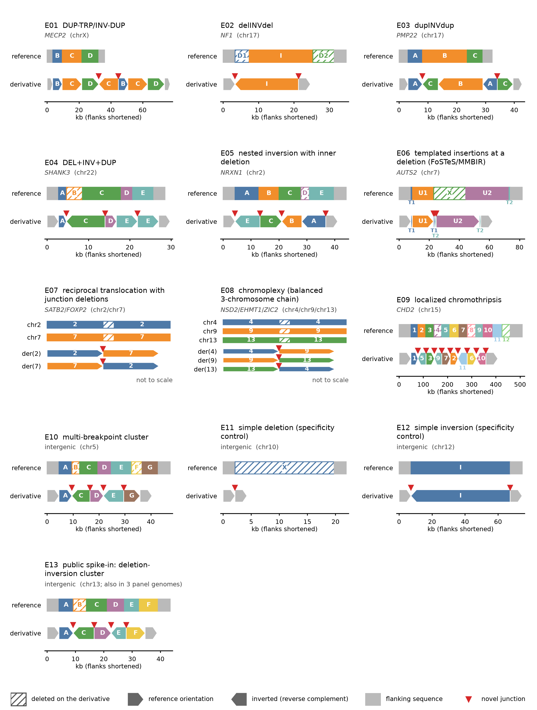

# CxSV — Long-Read Complex Structural Variant Detection

Detects complex structural variants (CxSVs) in long-read genomes (Oxford
Nanopore, PacBio HiFi) with a three-caller ensemble (**Sniffles2**, **cuteSV**,
**SVIM**). It then separates **public** CxSVs, seen in a background panel of
presumed-healthy genomes, from **private** ones in a patient: the candidates
for pathogenic events.

The repository holds two Snakemake workflows that share one calling module:

| Workflow | Runs where | Input | Product |
|---|---|---|---|
| **Panel builder** `workflow/panel/Snakefile` | lab fleet | background cohorts (hundreds–thousands of genomes) | a **panel release**: CxSV loci with carrier counts, denominators, and the calling fingerprint |
| **Patient scorer** `workflow/patient/Snakefile` | anywhere, incl. a restricted environment | one patient run (or a family) + a panel release | every patient CxSV labelled public/private with its panel carrier count |

The patient scorer never needs the background reads, only the panel release,
so it can run where patient data must stay.

Planned work is in [`docs/ROADMAP.md`](docs/ROADMAP.md). The code that acquired
and aligned the lab's background panel is in [`acquisition/`](acquisition/README.md);
external SV catalogues (CoLoRSdb, HGSVC3, HPRC, gnomAD-SV) are described in
[`docs/EXTERNAL_CATALOGUES.md`](docs/EXTERNAL_CATALOGUES.md).

---

## Why the two sides must be called identically

A patient CxSV is private only relative to a panel built the same way.
Different caller versions, parameters, reference sequence or discovery code
would make some patient calls look private purely because of that difference.
Two mechanisms prevent this:

1. **One parameter file.** Everything that decides which SVs and CxSV loci a
   genome has lives in `config/calling.yaml` (sections marked
   `[FINGERPRINTED]`), read by both workflows.
2. **A calling fingerprint.** Each workflow writes `calling_fingerprint.json`:
   - the fingerprinted parameters;
   - every reference contig's name, length and MD5;
   - the tool versions;
   - a hash of the code that defines CxSV loci (comment and blank lines
     ignored).

   The panel release carries the panel's fingerprint, and the patient workflow
   stops at `check_panel_compatibility` if its own differs, listing every
   difference. (`allow_fingerprint_mismatch: true` overrides this for
   exploratory work only.)

CxSVs are **discovered per sample**: only one genome's own SVs are clustered
and classified, in both workflows. The panel then counts carriers per locus.
(Pooling SVs across many genomes before clustering, as the first version of
this pipeline did, chains SVs from different people into artificial loci; at
about 90 samples the pooled list already covered ~12% of the genome.)

---

## Layout

```
config/
  calling.yaml            shared + [FINGERPRINTED] calling/discovery parameters, reference, annotation
  panel.yaml              panel builder: cohorts, output root, panel_individuals, panel_sites,
                          release (name/date/test flag), panel_callability
  patient.yaml            patient scorer: runs, panel_release, panel_match (junction matching)
  scoring.yaml            patient scorer: external catalogues, scoring resources, weights, tiers,
                          patient info (sex, HPO terms, parents) — docs/SCORING.md
  sites/                  site overlays (paths, cohort sheets), e.g. faulk_lab_panel.yaml
envs/
  cxsv-pipeline.yaml      the one pinned environment for both workflows
  cxsv-pipeline.lock.yaml exact solved versions (conda env export)
  cxsv-pipeline.explicit.txt  package URLs + MD5s: what the container image installs
container/
  Dockerfile              the one pinned image (Docker / Singularity / Apptainer)
  run_cxsv.sh             offline-bundle entry point (copied to the bundle root)
  BUNDLE_README.md        template of the bundle's README
workflow/
  panel/Snakefile         panel builder entry point
  patient/Snakefile       patient scorer entry point
  lib/                    plain-Python modules (unit-tested): sample discovery, fingerprint,
                          junction model (cxsv_junctions), site clustering + matching (cxsv_matching),
                          release identity + manifest verification (cxsv_release), callability
                          (cxsv_callability), locus structure + classes (cxsv_classes),
                          scoring features (cxsv_scoring)
  rules/
    common.smk            shared: inputs, wildcards, CRAM reference cache env
    indexing.smk          shared: reference cache, CRAM M5 check, BAM/CRAM indexes
    calling.smk           shared, fingerprinted: Sniffles2 / cuteSV / SVIM
    per_sample.smk        shared, fingerprinted: filter, merge, CxSV discovery, annotation
    junctions.smk         shared, fingerprinted: per-sample junction table (docs/JUNCTIONS.md)
    sample_report.smk     shared: per-sample text report
    fingerprint.smk       shared: tool versions + calling fingerprint
    panel_cohort.smk      panel: per-cohort population call sets and QC plots
    panel_callability.smk panel: mosdepth CALLABLE masks per sample, callability per junction site
    panel_aggregate.smk   panel: carrier table, junction sites, Sniffles2 population mode,
                          versioned release (release.json + release_manifest.tsv)
    patient_private.smk   patient: release verification, compatibility check, breakpoint-level
                          panel status with callability, plots
    patient_scoring.smk   patient: external catalogue hits, locus read depth, scoring + report
  scripts/                scripts invoked by the rules (Python, R)
scripts/
  run_pipeline.sh         `run_pipeline.sh panel|patient [--extra-config FILE] [--resume] [--dry-run]`
  make_bundle.sh          `make_bundle.sh image|bundle --commit REV [--release DIR]`: offline bundle
acquisition/              background-panel acquisition and alignment (lab fleet)
  catalogues/             external SV catalogues: verified download, liftover, junction-site tables
  resources/              annotation + scoring resources (RepeatMasker, ClinGen, gnomAD constraint,
                          HPO, PARs): download, build, resources_manifest.tsv
tests/
  unit/                   pytest: sample discovery, fingerprint, panel/patient scripts, config guard,
                          classifier (test_classes), scoring features and scorer (test_scoring)
  synthetic/              seeded artificial genome, panel + patient end to end (runs in CI)
  positive_control/       generator for the lab positive control: design, haplotypes,
                          read simulation and splicing, scoring, structure figure
  lab/                    regression on the real positive control (lab fleet; too large for CI),
                          offline-bundle validation (validate_bundle.sh, compare_patient_runs.py)
docs/
  ROADMAP.md
  JUNCTIONS.md            junction model, shared junction-site schema, panel sites, patient matching
  RELEASE_AND_BUNDLE.md   panel release format, callability, container image, offline bundle, validation
  PANEL_BUILD.md          full panel build on the lab fleet: measured cost, shards, runner, ledger, estimate
  POSITIVE_CONTROL.md     the planted-CxSV catalogue, how it is built, latest regression result
  EXTERNAL_CATALOGUES.md  CoLoRSdb, HGSVC3, HPRC r2, gnomAD-SV: licences, builds, fields, conversion counts,
                          catalogue hits per patient call
  SCORING.md              points system, features, resources, PI criteria 1-8, tiers, validation
```

---

## Quick start

Run everything **from the project root**; relative paths in the configs are
relative to it.

### 1. Environment

```bash
mamba env create -f envs/cxsv-pipeline.yaml
conda activate cxsv-pipeline
```

Caller versions are part of the panel's identity: use the same environment
(or the same container) for the panel and every patient. The container image
(`container/Dockerfile`) installs exactly the packages of
`envs/cxsv-pipeline.explicit.txt`; in a restricted environment, use the
**offline bundle** (image, reference, resources, panel release, code) and its
`run_cxsv.sh`, with no network: [docs/RELEASE_AND_BUNDLE.md](docs/RELEASE_AND_BUNDLE.md).

### 2. Reference and annotation

- `reference`: T2T-CHM13v2 with UCSC `hs1` contig names (`chr1`..`chrM`); index
  it with `samtools faidx`. The RefSeq copy (`NC_*` names) is **not** compatible.
- Annotation BEDs: see [Annotation Resources](#annotation-resources).

Point `reference`, `ref_cache` and `annotation` at them in a site overlay, e.g.
`config/sites/<site>_panel.yaml`.

### 3. Build the panel

Declare background cohorts under `panel_cohorts:` in the site overlay. Each
cohort is either a directory (`bamfiles/<name>/*.bam|*.cram`) or a sample sheet:

```yaml
panel_cohorts:
  my_ont_cohort:               # directory mode: bamfiles/my_ont_cohort/
    platform: ONT
  my_sheet_cohort:
    samples: /data/registry/my_sheet_cohort.tsv
    min_coverage: 17           # keep rows with coverage_x >= 17
    platform: PACBIO           # default when the sheet has no platform column
```

A sample sheet is tab-separated with a header. Required columns are
`sample_id` and `alignment`; optional ones are `index`, `individual_id`,
`platform` and `coverage_x`. `individual_id` is what carriers are counted by,
so one person sequenced in two cohorts counts once. A sheet's indexes must
already exist, because the pipeline never writes into its directories.

```bash
bash scripts/run_pipeline.sh panel --extra-config config/sites/<site>_panel.yaml --dry-run
bash scripts/run_pipeline.sh panel --extra-config config/sites/<site>_panel.yaml
```

### 4. Score a patient

```yaml
# config/sites/<site>_patient.yaml
reference: /restricted/refs/hs1.fa
ref_cache: /restricted/refs/ref_cache
panel_release: /restricted/cxsv_panel/release
patient_runs:
  family_042:
    samples: /restricted/family_042/sheet.tsv
```

```bash
bash scripts/run_pipeline.sh patient --extra-config config/sites/<site>_patient.yaml
```

Do not override any `[FINGERPRINTED]` section in a patient overlay; the run
would stop at the compatibility check.

**CRAM inputs** must have been encoded against `reference`. The pipeline builds
an MD5-keyed htslib cache of it once (`ref_cache`, ~3.1 GB for hs1), points
every tool at it through `REF_PATH` (so no network access is needed), and
checks each CRAM's `@SQ` M5 tags against it before calling. Sniffles2 2.8.1,
cuteSV 2.1.4 and SVIM 2.0.0 give identical call sets from a matched BAM/CRAM
pair.

---

## Outputs

### Per sample — both workflows

`results/<panel|patient>/samples/<cohort>/<sample>/`

| File | Description |
|---|---|
| `callers/{sniffles,cutesv,svim/variants}.vcf` | raw calls; `callers/sniffles.snf` for joint genotyping |
| `merged_sv.vcf` | SURVIVOR merge of the three callers (SUPP_VEC bit order CuteSV, SVIM, Sniffles2) |
| `cxsv/cxsv_summary.tsv` | every SV cluster, `IsCxSV` and the criteria (C1–C5) that fired |
| `cxsv/cxsv_only.vcf` | merged calls inside this sample's CxSV loci |
| `cxsv/cxsv_master_table.tsv` | annotated CxSV loci (genes, exons, repeats, segdups, complexity class) |
| `cxsv/cxsv_loci.bed` | Chr, Start, End, Exon_Disrupt |
| `junctions/junctions.tsv` | every merged SV call as a breakpoint junction (duplicate / reciprocal breakends collapsed), with its CxSV locus (docs/JUNCTIONS.md) |
| `sv_summary.txt` | per-sample text report |

### Panel — `results/panel/`

| File | Description |
|---|---|
| `release/panel_junction_sites.tsv` | junction sites clustered across individuals, in the shared junction-site schema (`chrom1 pos1 chrom2 pos2 svtype svlen ac an af source version` + `af_<platform>`, `af_<superpopulation>`) |
| `release/panel_junction_carriers.tsv` | the same sites with their coordinate envelope and carrier individuals: what patient loci are matched against |
| `release/panel_individuals.tsv` | sex, superpopulation, platforms, cohorts and samples per panel individual |
| `release/sniffles_population_sites.tsv` | Sniffles2 population-mode joint genotypes of the per-sample `.snf` files, same schema (`source=sniffles2_population`) |
| `release/panel_frequency_comparison.tsv`, `..._summary.tsv` | Sniffles2 vs clustered carriers per site, and summary statistics |
| `release/panel_cxsv_calls.tsv` | one row per (sample, CxSV locus): region-overlap (hotspot) information for patient loci |
| `release/panel_cxsv_loci.tsv` | overlapping calls merged across samples, with carrier counts by platform (summary only) |
| `release/panel_summary.tsv` | samples / individuals / calls per cohort, per platform, total |
| `release/calling_fingerprint.json` | what a patient run must reproduce |
| `release/release.json` | release id (`<name>-<YYYYMMDD>-<fingerprint12>`), source commit, fingerprint, samples/individuals by platform and superpopulation, callability definition and summary, tools, container image id / SIF sha256 |
| `release/panel_junction_callability.tsv` | per junction site: panel samples / individuals callable at both breakpoints (by platform), next to `ac` |
| `release/panel_callability_summary.tsv`, `release/callability/` | site-level callability totals; one CALLABLE mask per panel sample (mosdepth, depth >= `panel_callability.min_depth` at MAPQ >= `min_mapq`) |
| `release/release_manifest.tsv` | file, bytes, sha256 of every other release file; the patient workflow refuses a release that does not verify |
| `panel/plots/cxsv_population_sharing.pdf` | carriers per locus and their genomic distribution |
| `cohorts/<cohort>/` | population VCF, consensus VCF, SV counts, stacked CxSV table, QC plots (SV types, sizes, chromosome density, breakpoint resolution, caller Venn, genomic context, complexity classes) |

### Patient — `results/patient/`

| File | Description |
|---|---|
| `panel_release_check.txt` | the release verified against its manifest: release id, test flag, source commit, manifest sha256, runtime image / SIF / bundle |
| `panel_compatibility.txt` | fingerprint comparison with the panel release; written only when compatible (or overridden). The full report, including every difference on a mismatch, is `logs/panel_compatibility.log` |
| `samples/<run>/<sample>/private/cxsv_panel_status.tsv` | every CxSV locus + `Panel_Junctions`, `Panel_Junctions_Seen`, `Panel_Carriers`, `Panel_Callable` (panel individuals callable at all its junctions), `Panel_Individuals`, `Panel_Carrier_Freq`, `Panel_Carriers_By_Platform`, `Panel_Carriers_By_Superpopulation`, `Panel_Best_Junction_Fraction`, `Panel_Region_Carriers`, `Panel_Hotspot`, `Panel_Status` |
| `samples/<run>/<sample>/private/private_cxsv_master_table.tsv` | loci that are not public (`private` and `shared_junctions`) |
| `samples/<run>/<sample>/private/private_cxsv.vcf` | the patient's SV records inside those loci |
| `samples/<run>/<sample>/private/junction_panel_status.tsv` | every patient junction (also simple SVs) with its panel sites, carriers, `panel_callable`, carrier frequency and site allele frequency |
| `samples/<run>/<sample>/private/cxsv_catalogue_hits.tsv` | per CxSV locus and external catalogue (CoLoRSdb, HGSVC3, HPRC, gnomAD-SV): junctions matched / total, max AF, max group AF, contains yes/no; `Catalogues_Containing`, `Catalogue_Max_AF` (roadmap item 4) |
| `samples/<run>/<sample>/private/junction_catalogue_hits.tsv` | per locus junction: matched sites, max AF and best site per catalogue |
| `samples/<run>/<sample>/private/catalogue_check.tsv` | every catalogue table verified against its manifest (sha256) |
| `samples/<run>/<sample>/scoring/cxsv_scores.tsv` | every CxSV locus ranked: total points, tier, top-3 contributions, and each feature's value and points (roadmap item 5; [docs/SCORING.md](docs/SCORING.md)) |
| `samples/<run>/<sample>/scoring/cxsv_score_features.tsv` | the same, one row per (locus, feature) with the rule applied |
| `samples/<run>/<sample>/scoring/cxsv_score_report.md` | human-readable per-call report |
| `samples/<run>/<sample>/scoring/locus_depth.tsv`, `scoring_params.json` | read depth of locus segments (copy number); the weights, tiers, resources and patient information used |
| `samples/<run>/<sample>/plots/` | genomic context and complexity class plots |

Patient loci are matched against the panel **on breakpoints**, not on region
overlap (roadmap item 3; [docs/JUNCTIONS.md](docs/JUNCTIONS.md)).

- **Junction match:** a patient junction matches a panel site when svtype and
  both contigs agree and each end lies within `panel_match.tolerance` (500 bp).
- **Carrier:** a panel individual carries a locus when it carries at least
  `panel_match.min_junction_fraction` (0.75) of the locus's junctions. That is
  all junctions for loci of ≤ 3 junctions, and one may be missing from 4 on.
- **Status:**
  - `public`: at least `panel_match.min_carriers` (1) individuals carry the
    rearrangement;
  - `shared_junctions`: some junctions are in the panel but not the
    rearrangement, e.g. a different event at a hotspot. Not public;
  - `private`: no junction is in the panel.
- **Hotspot flag:** region-overlap carriers (the previous rule, padded by
  `panel_match.hotspot_window`) stay as information in
  `Panel_Region_Carriers` and `Panel_Hotspot`.

The `panel_match` settings are not fingerprinted. The junction tables
(`junction_params` in `config/calling.yaml`) are.

Panel settings (`config/panel.yaml`):

- `panel_individuals`: the registry `individuals.tsv`, which supplies sex
  (chrX/chrY allele numbers) and superpopulation (`af_<group>`);
- `panel_sites.tolerance`: 500 bp, keep it equal to `panel_match.tolerance`;
- `release`: `name`, `date`, `test_release`, `description` of the release; the
  id `<name>-<YYYYMMDD>-<fingerprint12>` is the `version` column;
- `panel_callability`: `min_depth` (10) and `flank` (100 bp) of the callability
  definition (docs/RELEASE_AND_BUNDLE.md);
- `sniffles_population.extra`: options for very large panels.

---

## Annotation Resources

`resources/` is gitignored — several of these files are hundreds of MB and
exceed GitHub's size limits, so they're fetched/regenerated locally instead
of committed. Paths are set in `config/calling.yaml → annotation:` (override per site).

The pre-generated `resources/` files (already in the naming/format the
pipeline expects) are available for direct download here:
[arcticsynology.synology.me](https://arcticsynology.synology.me:5001/d/s/192nJPzqq5CpT5HWgZE0M7G3v7RR9FyA/VtNjg_kikWCKrrMjMe8bgTxjbr77P_uH-j7XAlKzMWA0).
Download and extract into `resources/` before running the pipeline.

Alternatively, regenerate them yourself from the original sources:

| Resource | Source | Format |
|----------|--------|--------|
| `genes.final.bed`   | UCSC Table Browser → knownGene → BED         | chr start end gene_name |
| `exons.filtered.bed`| UCSC Table Browser → knownGene exons          | chr start end gene_name |
| `repeats.final.bed` | T2T consortium CHM13v2 RepeatMasker 4.1.2p1.2022Apr14, **per-element records** (`acquisition/resources/build_resources.py`; replaced the UCSC "joined" spans on 2026-10-29, kept as `repeats.final.bed.bak`) | chr start end rep_class |
| `segdup.final.bed`  | UCSC genomicSuperDups → BED                    | chr start end |

Scoring resources (roadmap item 5; free sources only, built by
`python acquisition/resources/build_resources.py --download`, versions and
checksums in `resources/resources_manifest.tsv`, details in
[docs/SCORING.md](docs/SCORING.md)): `scoring/clingen_region_dosage.tsv` (ClinGen curated regions lifted to hs1, item 9), `scoring/clingen_dosage.tsv` (ClinGen
dosage HI/TS), `scoring/gnomad_constraint.tsv` (gnomAD v4.1 LOEUF),
`scoring/hpo_genes_to_phenotype.txt` + `scoring/hp.obo` (HPO), `scoring/par.bed`
(CHM13v2 PARs). OMIM is optional and needs the lab's licence (off by default).

> **Note:** All resources must use the same chromosome naming convention as
> the reference (e.g. `chr1`, not `1`, for hs1/CHM13).

---

## CxSV Definition (Computational)

Each sample's SV calls are clustered within 50 kb (`cxsv_params.cluster_distance`).
Every cluster is then described by its **distinct junctions**, not by VCF
records (`workflow/lib/cxsv_classes.py`, roadmap item 5):

- duplicate and reciprocal records (same svtype and contigs, both ends within
  `junction_params.collapse_distance`, 300 bp) are one junction, e.g.
  Sniffles2's two records per inversion breakpoint or a BND and its mate. A
  simple balanced inversion is one junction with two breakends;
- a single-caller record at the midpoint of two other overlapping junctions of
  the same type (SVIM's composite inversion between two offset inversion
  junctions) is not counted;
- **breakends** are the distinct break positions (ends within 300 bp merged).

A cluster is a CxSV if any criterion holds (`workflow/scripts/classify_cxsv.py`):

- **C1**: ≥ 3 distinct junctions, or ≥ 2 junctions with ≥ 3 breakends of
  which at least one changes orientation (INV/BND): an inversion or
  translocation whose junctions do not share their breakpoints (sequence
  lost or gained at the breaks, e.g. delINVdel, an unbalanced reciprocal
  translocation). Two nearby deletions are not a CxSV by C1.
- **C2**: nested: one span junction wholly inside another.
- **C3**: overlapping span junctions of two different types.
- **C4**: copy-number junction (DEL/DUP) + orientation junction (INV/BND).
- **C5**: chromoanagenesis cluster: ≥ 3 junctions within a 10–50 kb window.

CxSVs are never filtered by genomic context: intergenic, repeat and segdup
loci are kept (most CxSVs are expected there). The structure is written to
`cxsv_summary.tsv` / `cxsv_master_table.tsv`: `N_Junctions`, `N_Breakpoints` /
`N_Breakends`, `Max_Interleaved` (largest group of interleaved junctions,
PI criterion 1), `N_Inter_Junctions`, `Complexity_Tier`, `N_Composite`.

**Since 2026-10-29 these rules are part of the calling fingerprint: panels built
before then must be rebuilt** (a patient run refuses an older panel release).

## Complexity Class Labels

First matching row wins (`cxsv_classes.complexity_class`). Types are the
*called* junction types: a deletion or duplication created by an inversion
junction (delINVdel, dupINVdup) has no DEL/DUP record and is not a type here;
copy number is assessed from read depth in scoring. Tiers follow the PI's
criterion 2: intermediate 3–5 breakends, extreme > 5. All cut-offs are
operational choices, not validated thresholds.

| Class label | Rule |
|---|---|
| `Chromothripsis_like` | extreme tier (≥ 6 breakends) **and** interleaving: a component of ≥ `min_interleaved` (3) interleaved junctions, or ≥ 3 interleaved + ≥ 4 interchromosomal junctions |
| `DEL+DUP+INV` | DEL, DUP and INV junctions |
| `DEL+INV` | DEL and INV junctions |
| `DUP+INV` | DUP and INV junctions |
| `INS+DEL` | INS and DEL junctions |
| `BND_cluster` | ≥ 2 distinct translocation (BND) junctions |
| `Multi_breakpoint_cluster` | extreme tier without interleaving |
| `Nested_SV` | C2 fired (nested junctions) |
| `Overlapping_types` | C3 fired |
| `CN_plus_orientation_change` | C4 fired (e.g. DEL + BND) |
| `Complex_inversion` | ≥ 2 distinct inversion junctions and nothing else (e.g. delINVdel, dupINVdup, DUP-TRP/INV-DUP fold-backs) |
| `Complex_other` | any other CxSV (e.g. three deletions within 50 kb) |
| `NA` | not a CxSV (in `cxsv_summary.tsv` only) |

Before 2026-10-29, C5 alone made a locus `Chromothripsis_like` (compact 2–4
junction events were labelled so), and duplicate reciprocal INV records made
C2 fire on simple inversions. Both are fixed; docs/POSITIVE_CONTROL.md has the
class concordance before and after.

---

## Tests

| Test | Data | Where it runs | Command |
|---|---|---|---|
| Unit | none | CI + anywhere | `pytest tests/unit` |
| Synthetic end to end | seeded artificial 1.2 Mb genome, 3 panel genomes + 1 patient | CI on every push | `bash tests/synthetic/run_synthetic.sh` |
| Offline bundle | the bundle + a public stand-in patient slice | lab fleet, network off | `bash tests/lab/validate_bundle.sh BUNDLE WORKDIR STANDIN_DIR [RELEASE]` |
| Positive control | sample 3559 with 12 planted heterozygous events + the E13 public spike-in (also in 3 background genomes) (~105 GB CRAM on the lab NAS) | lab fleet | `bash tests/lab/pos_control_regression.sh [WORKDIR] [N_BACKGROUND]` |

The positive control is described in [docs/POSITIVE_CONTROL.md](docs/POSITIVE_CONTROL.md):
ten complex rearrangements at clinically relevant genes, two simple-SV
specificity controls and a complex SV that is also planted in 3 background
genomes and must come out public (E13), each with a breakend-level truth set.
The synthetic test includes a HOTSPOT DECOY: a different CxSV, carried by two
panel genomes at the locus of the patient's PRIVATE event, which must stay
private. Its CRAM (~105 GB)
stays on the lab NAS; the repository holds the generator, the event catalogue
and the truth coordinates.



---

## Troubleshooting

### `[panel] no cohorts/runs configured` / `[patient] no cohorts/runs configured`
Nothing under `panel_cohorts:` / `patient_runs:`. Both are empty in the
committed configs on purpose; declare them in a site overlay passed with
`--extra-config`.

### `sample sheet ... has N problem(s)`
A row points at a missing alignment or index, repeats a `sample_id`, or names a
file that is not `.bam`/`.cram`. The error lists the lines. Fix or regenerate
the sheet; index sheet files yourself (`samtools index FILE`).

### `panel release ... does not verify against its release_manifest.tsv; refusing it`
A release file is missing, changed, or not listed in the manifest (each one is
named). Restore the release from its source (the bundle, or the panel
builder's `results/panel/release/`); never edit a release in place. A new panel
build writes a new release with a new manifest.

### `check_panel_compatibility`: `this run is not comparable with the panel`
The patient run's calling fingerprint differs from the panel release's.
`results/patient/logs/panel_compatibility.log` lists each difference (parameter,
contig, tool version or code file). Use the panel's environment and do not
override `[FINGERPRINTED]` parameters; if the change is intended, build a new
panel release with it.

### `check_cram_reference` fails: `M5 ... is not in the pipeline reference`
The CRAM was encoded against a different reference (e.g. GRCh38, or CHM13 with
RefSeq `NC_*` names). Point `reference` at the FASTA it was made with, or
re-encode: `samtools view -C -T hs1.fa -o out.cram in.cram`.

### A caller fails on a CRAM: `Failed to populate reference`
The MD5 cache is missing or incomplete. Delete `<ref_cache>/md5_manifest.tsv`
and re-run; `build_ref_cache` rebuilds it.

### cuteSV produces an empty VCF
A stale `callers/cutesv_work/` from a failed run, or coverage too low (cuteSV
needs roughly 5–10x). Remove the work directory and resume with `--resume`.

### SURVIVOR merge fails or exits silently
SURVIVOR needs at least one record per input VCF. Check
`bcftools view -H <sample>/callers/<caller>_filtered.vcf | wc -l` and the caller log.

### Pipeline reruns rules that already completed
Timestamps changed (e.g. after copying files). `snakemake -s workflow/<panel|patient>/Snakefile --touch ...`
marks outputs up to date.

---

## Citation

If you use this pipeline, please cite the underlying tools:

- **Sniffles2:** Smolka et al., *Nature Methods* 2024
- **CuteSV:** Jiang et al., *Genome Biology* 2020
- **SVIM:** Heller & Vingron, *Bioinformatics* 2019
- **SURVIVOR:** Jeffares et al., *Nature Communications* 2017
- **bedtools:** Quinlan & Hall, *Bioinformatics* 2010
