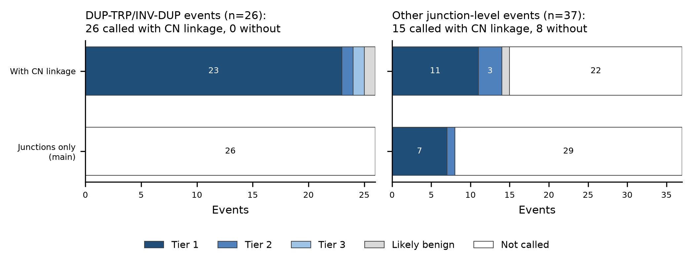
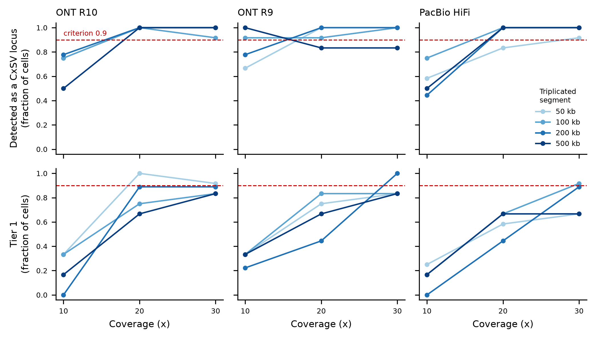
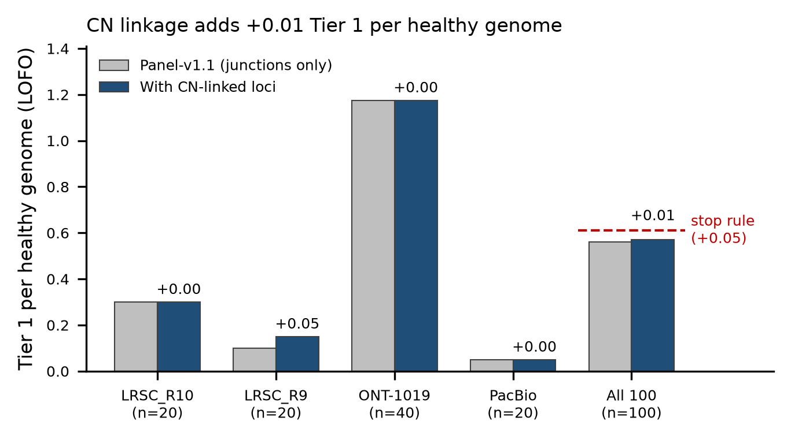

# Copy-number-anchored linkage — Phase 1 report (roadmap item 15)

Plan: [DUP_TRP_PLAN.md](DUP_TRP_PLAN.md). The PI's decisions on that plan were:
- **Scope:** all copy-number-linked complex events, with DUP-TRP/INV-DUP as the primary target.
- **Stop rule:** healthy Tier 1 may rise by at most +0.05 per genome.
- **Tooling:** in-house depth bins, panel-of-normals (PoN) and HMM, plus one external long-read CNV caller as a comparator.

Phase 1 runs **outside the pipeline** (`calibration/cn_linkage/`):
- no `workflow/` change;
- no calling-fingerprint change;
- no panel or bundle change.

New loci are added beside the existing junction loci, and the deployed scorer scores them with no weight changes.

Code base: main `b60559f`, run from `/mnt/sargasso1/CxSV/calibration/cn_linkage/code_tree`. Scoring inputs:
- panel release `cxsv-panel-20261105-c31ecc9f8fa2` (panel-v1.1-r2);
- pipeline image of bundle `cxsv-bundle-20261105-8fc5bef725bd`.

Bundle `8fc5bef725bd` has since been deleted, superseded by `cxsv-bundle-20261105-95126e14f036` (same SIF, sha256 9f4e049f…, same panel-v1.1 release). The script defaults now point to the new bundle.

This branch is based on main `95126e1`, which turned library-QC conservative mode on by default (PR #29). Every Phase 1 number below was computed before that change, and Phase 2 re-measures under it.

## Verdict: GO for Phase 2

| Test | Criterion (plan §4) | Result | Pass |
|---|---|---|---|
| A. Literature, synthetic CN | ≥ 80% of the 26 DUP-TRP called; report the other 37 | **26 / 26 called** (junctions only: 0). 23 Tier 1; 17 classified DUP-TRP/INV-DUP, 9 CN_linked_gain. Other 37: 15 called (junctions only: 8), 11 Tier 1 | ✓ |
| B. Read-level grid | ≥ 90% at ≥ 20x for triplicated segment ≥ 100 kb | **158 / 162 = 97.5% detected** (junction track alone: 5% of the same runs). Tier 1 77%; DUP-TRP class 80% | ✓ |
| C. Full-genome PC | L01 at Tier 1; every other event unchanged | **L01 FAIL → PASS** (Tier 1, 1.53, DUP-TRP_INV-DUP). The other 16 events keep their verdict, score and tier. L03 gains one Tier 2 CN locus | ✓ |
| D. Healthy LOFO (subset) | Tier 1 rise ≤ +0.05 per genome | **+0.01** (0.56 → 0.57 on the 100-genome subset). 1 new Tier 1 in 100 genomes; 0 existing loci changed | ✓ |
| E. Stand-in and host | 0 Tier 1 | HG01868: 0 (3 new loci, all public / likely benign). Host 3559: no new off-event Tier 1 | ✓ |
| External comparator | run on a few genomes | Spectre 0.2.1 ran on PC and HG01868; the comparison is unfinished (see §6) | partial |

Phase 2 cost estimate for the full panel: §7.

## 1. Depth pass

Per genome:
- `depth_pass.sh` runs mosdepth 0.3.10 from the image: `-n -x --mapq 20 --by 1000`.
- CRAM 3.1 is first transcoded to 3.0, with a record-count check.
- Every output has 3,117,304 bins of 1 kb, matching the fai.
- The 10 kb bins used for segmentation are aggregated from the 1 kb track, so one pass gives both resolutions.

Workers on freya, shadowfax, keurig and athena take tasks through atomic `mkdir` claims on the share (`depth_worker.sh`). From 21:30 the run was throttled to 4 NAS readers fleet-wide while the library-QC bundle was validated.

| Stratum | Genomes | TB | Mean GB | Mean wall (min) | Median MB/s per stream |
|---|---|---|---|---|---|
| LRSC R10 | 20 | 2.08 | 104 | 13.6 | 142 |
| LRSC R9 | 20 | 2.40 | 120 | 12.9 | 155 |
| ONT-1019 (CRAM; 8 × 3.1) | 40 | 0.19 | 4.7 | 1.6 | 64 |
| PacBio | 20 | 3.39 | 169 | 31.1 | 140 |
| **Subset** | **100** | **8.06** | | **12.0** | |

- **Subset total:** 20.3 stream-hours, a mean of 110 MB/s per stream from the NAS.
- **From local disk** (freya; HG01868 BAM 90.9 GB, PC CRAM 105 GB): 409–421 MB/s per stream. The NAS is therefore the bottleneck, not mosdepth.
- **Per-genome table:** [cn_linkage/depth_timing.tsv](cn_linkage/depth_timing.tsv).

## 2. Panel-of-normals and segmentation (`cnlib.py`, `segment_all.py`)

- **PoN:** one per platform stratum, built from the unflagged subset genomes. The 24 libraries in `calibration/library_qc/flagged_v1.1.tsv` are excluded; 4 of them are in the subset.
- **Normalisation:** depth ÷ genome median ÷ (expected copies / 2).
- **Masked bins:** PoN median < 0.25, relative MAD > 0.30, or fewer than 4 genomes. Between 7.5% (R9) and 13.1% (ONT-1019) of autosomal 10 kb bins are masked.
- **HMM:**
  - ploidy-aware Viterbi over copy-number states 0–6, run on the 10 kb bins;
  - each segment needs at least 3 bins and |CN − ploidy| ≥ 0.6;
  - PAR-aware on chrX.
- **Boundaries:** refined to 1 kb on the fine track, using the observed level on each side.
- **LOFO:** every subset genome is segmented with its own family left out of the PoN.
- **Noise:** σ per 10 kb bin is 0.16–0.17 for LRSC/PacBio and 0.23 for ONT-1019.
- **Segments per genome (median):** R10 32, R9 50, PacBio 16, ONT-1019 7.
- **Sex check:** the subset sheet's sex matches the chrX ratio for all 100 genomes. PC and HG01868 are both inferred female.
- **Per-genome table:** [cn_linkage/genome_stats.tsv](cn_linkage/genome_stats.tsv).

Two additions came out of the positive control (they are deviations from the plan):

1. **Nested-level scan.** The PC L01 triplication reads 1.75× instead of 2.0× over a 125 kb interval. The genome-wide HMM change penalty therefore merged it into the duplication.
   - Each gain segment ≥ 60 kb is scanned on its 1 kb bins for a higher interval (circular binary segmentation statistic).
   - The interval is kept when it is ≥ 30 kb long, rises by ≥ 0.4 copy, and has z ≥ 6. The standard error comes from the segment's 10 kb blocks, because long reads correlate neighbouring 1 kb bins.
   - On simulated plain gains with correlated noise, about 1 in 300 segments produced a false nested level at these thresholds.
2. **chrX PoN pools both sexes.** Values are already normalised per expected copy, and chrY uses males only. The plan called for a per-sex chrX reference, but with only 7 R10 females that reference was too noisy to resolve L01: the nested level was lost.

Result for L01 on the real PC depth (truth in brackets):
- 101,753,000–102,300,000 at 3 copies [101,752,400–102,285,212];
- 102,300,000–102,411,000 at 4 copies [–102,410,548];
- 102,411,000–102,494,000 at 3 copies [–102,492,226].

## 3. Candidates, junction association and structure model (`cnlink.py`, `augment.py`, `link_all.py`)

- **Candidates:** abnormal segments closer than 500 kb on a contig are grouped into one candidate.
- **Records** from `merged_sv.vcf` attach to a candidate as follows, with no distance limit (this is the distance-free association):
  - **DEL/DUP ≥ 10 kb:** reciprocal overlap ≥ 0.5 with a loss or gain segment of the same direction.
  - **INV:**
    - one end within 10 kb of a segment boundary; the tolerance widens over masked bins next to the boundary;
    - the other end inside the candidate ± 100 kb; this slack covers outer duplications too short to segment.
  - **BND:** any breakend at a boundary.
  - **Readmitted records:** the records in `long_span_records.tsv` and `single_caller_filtered.tsv` (svim_lowq) are included, so they come back only when copy number supports them.
- **Classes:**
  - DUP-TRP/INV-DUP: a ≥ +2 segment adjacent to a +1 segment, plus an inverted junction (INV, or BND ++ / --);
  - otherwise CN_nested_gain, CN_linked_gain_loss, CN_linked_gain or CN_linked_loss.
- **Complex:** at least one junction, and either ≥ 2 segments, an orientation junction, or ≥ 2 junctions. A single DUP or DEL that explains one segment becomes `simple_cnv`.
- **Panel CN frequency:** a candidate whose every segment is seen in the same direction (reciprocal overlap ≥ 0.5) in at least one genome of another family is dropped as `public_cn`.
- **Locus:** each surviving candidate becomes one locus per contig.
  - It is added through the existing `vcf_to_bed` → `classify_cxsv` → `extract_junctions` → `annotate_cxsv` chain, with `CxSV_Criteria` = `CN_linked;…` and `Cmplx_Class` set to the CN class.
  - A candidate whose locus id already exists is not added again (37 cases).
  - The new classes get the default complexity points (0.05); no weight changes.
- **Rescoring:** `patient_rescore.py` re-runs privacy, catalogue matching and depth for the new loci only, then runs the deployed `score_cxsv.py`.

Subset (100 genomes), per genome: 22 candidates on average, almost all `cn_only` (copy-number change, no junction). Totals:

| Decision | n |
|---|---|
| cn_only (no junction; no locus, the scorer needs junctions) | 1,958 |
| public_cn | 100 |
| simple_cnv | 40 |
| **locus** | **112** candidates → 144 per-contig loci: 107 written (49 genomes), 37 not written because the locus id already exists |

How the 107 written loci scored in LOFO:

| Class | Benign | Tier 3 | Tier 2 | Tier 1 |
|---|---|---|---|---|
| CN_linked_gain | 32 | 2 | 5 | 0 |
| CN_linked_loss | 25 | 2 | 2 | 0 |
| DUP-TRP/INV-DUP | 15 | 3 | 1 | 1 |
| CN_nested_gain | 10 | 1 | 0 | 0 |
| CN_linked_gain_loss | 7 | 1 | 0 | 0 |

Panel status of the 107: 54 public, 39 private, 14 shared_junctions.

**Readmitted long records** (span > `span_link_max`):
- 21 loci carry 52 such records.
- None reaches Tier 1: 15 likely benign, 2 Tier 3, 4 Tier 2.
- Their panel status: 10 private, 8 public, 3 shared_junctions.

**Readmitted svim_lowq records:** 25 loci carry 66 such records, and all 25 score likely benign.

So CN-confirmed readmission does not bring back the healthy-genome noise that item 13 removed. Tables: [cn_linkage/candidates_all.tsv](cn_linkage/candidates_all.tsv) and [cn_linkage/loci_all.tsv](cn_linkage/loci_all.tsv).

## 4. Tests

### A. Literature events with modelled copy number (`literature_cn.py`)

Each of the 63 lit-v1.0 junction-level events is a synthetic patient:
- its calls are exactly the published junctions, as in item 11;
- its depth is a real healthy LRSC R10 genome of the carrier's sex: HG02026 for males (31x), HG02181 for females (29x);
- inside the event, that depth is multiplied by (ploidy + Δ) / ploidy from `literature_cn_segments.tsv`;
- the track is segmented against the R10 PoN with the donor's family left out.



- **DUP-TRP:** 26 / 26 are called, against 0 with junctions only. 23 reach Tier 1.
- **DUP-TRP below Tier 1:**
  - BAH19_BAB8938 is likely benign: its PLP1 boundaries fall in donor depth dips;
  - GRO24_BAB15418 is Tier 3;
  - GRO24_BAB15428 is Tier 2.
- **Class:** 9 of the 26 come out as CN_linked_gain rather than DUP-TRP. The donor's own depth dips at Xq28 hide the nested TRP level, but they still score.
- **Other 37:** 15 called against 8. The seven gains are BAH19_BAB8928 (DUP-NML-DUP), EIS24_P4a, NP18_P00, NP18_P2046_133, NP18_P2109_176, NP18_P2109_185 and NP18_P4855_512.

Tables: [testA_literature_cn_summary.tsv](cn_linkage/testA_literature_cn_summary.tsv), [testA_literature_cn_scores.tsv](cn_linkage/testA_literature_cn_scores.tsv).

### B. Read-level simulation grid (`grid.py`, `grid_worker.sh`)

**Design:** 117 cells × 3 coverages (10, 20, 30x) = 351 runs.
- **Cells:** 3 loci × 3 platforms × 13 (total span, triplicated segment) pairs. Spans are 0.2–2 Mb; triplicated segments are 50–500 kb and shorter than the span.
- **Loci and hosts:**
  - MECP2 (Xq28) and PLP1: male hosts;
  - LMNB1 (chr5): female hosts.
- **Hosts by platform:**
  - R10: HG03745 (m), HG02772 (f);
  - R9: NA18865 (m), HG03861 (f);
  - PacBio: HG00477 (m), HG00555 (f).

**Simulation:**
- The positive-control haplotype builder and badread model the derivative chromosome inside a 1.5 Mb window around the event. The R9 and PacBio read models were trained on those hosts.
- Reads are mapped with minimap2 (map-ont or map-hifi).
- Host reads in the replaced interval are dropped, and simulated plus host reads are downsampled to the target coverage.

**Pipeline per run:**
- the patient workflow from the bundle image, up to junctions and the master table;
- mosdepth on the window, then segmentation against the stratum PoN (host family left out);
- linkage, augmentation and scoring.

Runs used local disk on each node; on the CIFS share, timestamp skew breaks snakemake's mtime checks. Each run took 12 min (median, 4 threads), 69 run-hours in total (4 threads each) across freya, shadowfax, keurig, athena and betsy. Two betsy runs repeated on freya gave the same `result.json`, a byte-identical `cxsv_scores.tsv` and the same merged records ([verification](cn_linkage/testB_betsy_verification.txt)).



*n per point = 12 (50 and 100 kb), 9 (200 kb), 6 (500 kb) cells; detection means a CxSV locus overlapping the event.*

| Coverage | Detected (any locus) | Junction track only | CN locus | DUP-TRP class | Tier 1 |
|---|---|---|---|---|---|
| 10x | 71% | 11% | 62% | 29% | 23% |
| 20x | 97% | 12% | 90% | 62% | 71% |
| 30x | 97% | 15% | 88% | 70% | 85% |

**Criterion set** (≥ 20x, triplicated segment ≥ 100 kb; 162 runs):
- detection 97.5%;
- per platform: R10 98%, R9 94%, PacBio 100%.

**Misses** (4): copy number was seen, but no junction record fell at the boundaries, so they are `cn_only`:
- MECP2_R10_S500_T100 at 30x;
- PLP1_R9_S200_T100 at 20x;
- LMNB1_R9_S1000_T500 at 20x and 30x.

**Off-event Tier 1:** none in any of the 351 runs.

**Below Tier 1:** 33 of the 158 detected runs in the criterion set (21%): 23 Tier 2, 7 Tier 3, 3 likely benign. 22 of the 33 are 1–2 Mb spans. One likely contributor is that the locus is scored on the segments the junctions define, not on the CN segments (§7, open item 2). Table: [testB_grid_results.tsv](cn_linkage/testB_grid_results.tsv).

### C. Full-genome positive control

The PC run of item 11 r2 (E01–E13 + L01–L04) was augmented and rescored with the real PC depth segments.
- **L01** (PLP1 DUP-TRP/INV-DUP) goes from **FAIL to PASS**: one locus chrX:101,752,400–102,492,226, class DUP-TRP_INV-DUP, private, score 1.53, Tier 1. Top features: gene_dosage +1.00 (PLP1 triplosensitive), panel_privacy +0.18, exons +0.15.
- **The other 16 events** have unchanged verdicts, scores and tiers. Ranks shift by one or two because loci were inserted.
- **L03** gains one CN_linked_loss locus (chr9:30,092,263–32,825,947, Tier 2) next to its 19 existing loci.
- **Unchanged items:** no existing locus changed score or tier; the PC Tier 1 count goes 15 → 16, the +1 being L01. E13 and L03 still fail as before (known failures).

Tables: [before](cn_linkage/testC_pc_events_panel_v1.1.tsv), [after](cn_linkage/testC_pc_events_cn.tsv), [score_pos_control output](cn_linkage/testC_pc_score.txt).

### D. Healthy specificity, LOFO on the 100-genome subset (`cn_lofo.sh`)

Method: the item-10 / item-13 LOFO chain (locus callability, leave-out status, depth, deployed scorer), unchanged, on the augmented subset tree. Depth rows of unchanged loci are reused from the panel-v1.1-r2 LOFO run. The chain took 441 s on athena.



- **Tier 1 per healthy genome:** 0.56 → 0.57 (+0.01), against a stop rule of +0.05.
- **Per stratum:** LRSC R9 +0.05 (0.10 → 0.15). That is the single new Tier 1 below (HG00136): one locus in 20 genomes moves a stratum by 0.05. LRSC R10, ONT-1019 and PacBio are +0.00. The stop rule is a panel-wide per-genome rate, so R9 sits at the threshold only because n = 20. Phase 2 should report per-stratum rates on the full panel.
- **Score stability:** 0 existing loci changed score or tier across 112,224 loci.
- **New loci:** 107 added: 89 benign, 9 Tier 3, 8 Tier 2, 1 Tier 1.
- **The one new Tier 1:** HG00136 (R9), chr2:230,331,120–230,521,261, DUP-TRP_INV-DUP, private, 1.41, driven by gene dosage.
- **Why the baseline is 0.56, not 0.251:** the subset is stratified and over-represents ONT-1019 (40 of 100, at 1.18 Tier 1 per genome). The panel-wide 0.251 is the full 1,619-genome rate, and Phase 2 must check the stop rule on the full-panel LOFO.

Tables: [testD_per_genome.tsv](cn_linkage/testD_per_genome.tsv), [testD_new_loci.tsv](cn_linkage/testD_new_loci.tsv).

### E. Stand-in and host

- **HG01868** (LRSC R9 stand-in): Tier 1 stays 0. Its 3 new loci are all public and likely benign:
  - chr1:156,217–344,470 DUP-TRP, subtelomeric;
  - chr9:33,220–142,303 loss;
  - chr3:134,712,784–134,722,137 gain.
- **Host 3559:** apart from L01, the PC gains no Tier 1.

Table: [testCE_new_loci.tsv](cn_linkage/testCE_new_loci.tsv).

## 5. Unit tests

`tests/unit/test_cn_linkage.py` has 10 tests and uses numpy only, as CI installs no pandas. It covers:
- the pandas-free bin reader;
- the null genome;
- male and female DUP-TRP segmentation and class;
- the nested scan, including a compressed triplication and its quiet case on a plain gain;
- the simple_cnv, cn_only and public_cn decisions;
- masked-bin boundary widening and the INV other-end slack;
- inverted BND ALT parsing.

## 6. External comparator (Spectre)

What was done:
- Spectre 0.2.1 was installed in a separate conda env on freya (`cnvspectre`). It crashes with numpy 2 (`np.NaN`), so numpy < 2 is pinned in that env only; the image is untouched.
- It ran on the same 1 kb mosdepth tracks for the PC (64 s, 46 calls) and HG01868 (41 calls) via `spectre_compare.sh`. Males get `--ploidy-chr chrX:1,chrY:1`; females run on chr1–22,X.

What is not done:
- The site-by-site comparison against our segments is unfinished. My first conversion of Spectre's VCF reported every call as DEL with no CN and no L01 gain, which points to a parsing problem on my side.
- Inspecting Spectre's VCF needs the user's approval, which this session did not have.
- Treat Spectre as not yet compared. The files are in `/home/minknow/scratch/item15/spectre/` on freya.

## 7. Phase 2: plan and cost

**Integrate:**
- `cn_depth` per-sample rule (the mosdepth pass above);
- `cn_linkage` discovery rule (`cnlib` / `cnlink` / `augment` logic as workflow scripts);
- the PoN as a release component (`pon/<stratum>.npz`);
- calling-fingerprint change, then a downstream rebuild as panel-v1.2, full LOFO, bundle, validation, PC and tag.

**Full-panel depth pass** (1,619 alignments, 80.8 TB):
- the subset needed 20.3 stream-hours for 8.06 TB, so the panel needs about 200 stream-hours;
- the NAS delivers about 110–160 MB/s per stream and about 560–630 MB/s in aggregate, so this is **36–40 h of wall time** on 4–5 streams;
- mosdepth CPU is minor (4 threads per stream).

**After the depth pass:**
- PoN and segmentation of 1,619 genomes: about 20 min on one node (73 s for 102 genomes);
- linkage and augmentation: about 30 min;
- full-panel LOFO: about 2 h.

**Phase 2 must re-measure:**
- the stop rule on the full panel (baseline 0.251);
- under library-QC conservative mode, now the default on main;
- with the PoN built from all unflagged genomes, about 16× this subset's PoN, which should lower the masked fraction and σ.

**Open items for Phase 2:**
1. CN-only candidates (no junction at the boundaries) get no locus because the scorer needs junctions. All 4 grid misses are of this kind. A CN-only locus type needs a scorer decision.
2. Locus depth comes from the junction-defined segments, not the CN segments, so the dosage of loci with CN-only boundaries is under-represented.
3. The nested-scan thresholds (z ≥ 6, ≥ 0.4 copy) were set on the PC and on null simulations. They should be checked against the full-panel nested-gain rate.
4. Finish the Spectre comparison (§6).

## 8. Reproduce

All commands run in the bundle image (`singularity exec -B /mnt/sargasso1 … cxsv-pipeline.sif`), with `CODE` = repo checkout.

```
# depth pass (fleet; claims on the share)
bash calibration/cn_linkage/depth_worker.sh TASKS /mnt/sargasso1/CxSV/calibration/cn_linkage/depth 2
# PoN, segmentation, linkage, subset manifest, test D
bash calibration/cn_linkage/run_phase1.sh /mnt/sargasso1/CxSV/calibration/cn_linkage/phase1 12345
python3 calibration/cn_linkage/testD_compare.py phase1/lofo /mnt/sargasso1/CxSV/calibration/panel_v11_r2/lofo \
    phase1/aug/subset_manifest.tsv testD_per_genome.tsv
# test A
python3 calibration/cn_linkage/literature_cn.py --literature …/lit-v1.0 --repo $CODE --release RELEASE \
    --seg phase1/seg --depth-root …/depth --donor-male 1kGP_LRSC_ONT_CHM13/HG02026 \
    --donor-female 1kGP_LRSC_ONT_CHM13/HG02181 --genomes phase1/genomes.tsv --families … --par … --work phase1/testA
# test C / E
python3 calibration/cn_linkage/patient_rescore.py --run RUN --aug phase1/aug/samples/extra/<name> --aln ALN \
    --release RELEASE --code $CODE --ref hs1.fa --sample <id>
# test B (simulation in env cxsv-posctrl, runs in the image on every node)
python3 calibration/cn_linkage/grid.py design|simulate --out GRID …
bash calibration/cn_linkage/grid_worker.sh GRID/tasks.txt GRID phase1/seg $HOME/item15_grid 4 4
python3 calibration/cn_linkage/grid.py collect --out GRID
# figures
python3 calibration/cn_linkage/make_figures.py --test-a … --test-d … --genomes … --grid … --out docs/cn_linkage
```

Data on the share:
- `/mnt/sargasso1/CxSV/calibration/cn_linkage/`: `depth/`, `phase1/{genomes.tsv,seg,aug,lofo,testA,testC}`, `grid/`, `models/`, `refs/`.
- Simulation models: R9 (NA18865) and PacBio (HG00477), trained with `train_model.sh`. The PacBio identity cap is 99.99, not 99.5: badread rejects a cap below the mean identity of 99.605. R10 uses the positive-control model.
