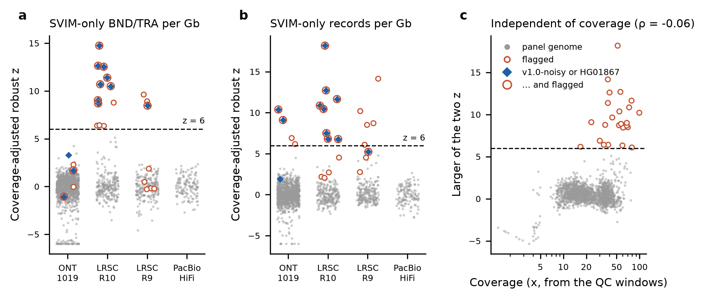

# Library QC: chimeric-library flag and conservative mode (roadmap item 14)

Status 2026-11-06: deployed in bundle `cxsv-bundle-20261106-169503679a60` (commit 1695036 =
PR #28, #29 and the follow-ups PR #32: auto-detected group, wording, test-release ids; earlier
bundle `cxsv-bundle-20261105-95126e14f036`). Validation and end-to-end records:
[library_qc/DEPLOYMENT.md](library_qc/DEPLOYMENT.md). Since 2026-11-09 the
patient bundle is `cxsv-bundle-20261109-84d380e08cc4` (panel-v1.2), with the same library QC
(record: [panel_v1.2/README.md](panel_v1.2/README.md) section 10).
PI decision 2026-11-05:
the flag in every patient report, **conservative mode ON by default** for flagged
libraries, **no panel exclusion** (panel-v1.1 stays as is).
- The QC flag is computed and reported for every patient.
- Conservative mode (`library_qc.conservative_mode`, default **true**) acts only on a
  FLAGged library. The report states whether it demoted calls and lists every
  demoted locus (section 4).
- **Calling fingerprint unchanged** (c31ecc9f8fa2): no fingerprinted file or
  parameter section changes, so panel-v1.1 stays compatible.
- Healthy-genome rates: panel-v1.1 (`cxsv-panel-20261105-c31ecc9f8fa2`),
  leave-one-family-out (LOFO), deployed scorer, no re-tuning.

## 1. Why

- Healthy Tier 1 on panel-v1.1 is 0.251 per genome, but 147 of the 407 healthy
  Tier-1 calls come from 3 genomes (docs/panel_v1.1/README.md).
- Before `svim_lowq`, 11 further genomes were noisy (docs/R10_EXCESS.md). Their
  libraries carry thousands of single-caller breakend calls (chimeric reads, short
  inserts).
- The risk that matters is a **chimeric patient library**: its private
  single-caller junctions score like real rearrangements. Dropping noisy genomes
  from the catalog does not address that. So the QC must run on the patient side,
  and on the panel side if the catalog is to be cleaned.
- The QC must not depend on Tier-1 counts: excluding genomes for having many Tier-1
  calls would be circular. Every metric here is computed upstream of CxSV
  discovery and scoring.

## 2. Metrics (`workflow/scripts/library_qc.py`)

**Read level.** Over 20 fixed 1-Mb windows of unique autosomal sequence
(`config/library_qc_windows.hs1.bed`), primary mapped reads with MAPQ ≥ 20 that
start in a window:
- the windows come from `calibration/library_qc/make_windows.py`: one per chr1-20,
  < 0.5% segdup, < 3% satellite/simple/low-complexity, ≥ 10 Mb from chromosome ends;
- `frac_sa`: fraction with a supplementary alignment;
- `frac_sa_interchrom`: fraction with a supplementary alignment to another chromosome;
- `coverage_est`: coverage estimated from the windows (Spearman 0.96-0.997 with the
  registry coverage per platform).

About 4-11 s per genome; CRAM 3.0 and 3.1 decode through pysam/htslib in the image.

**Call level**, from `merged_sv.vcf`:
- `svim_only_bnd`: SVIM-only (`SUPP_VEC` 010) BND/TRA records;
- `svim_only_any`: SVIM-only records of any type;
- the same per Gb of sequence (`coverage_est` × length of chr1-22 + chrX).

**Flag.** Per calibration group (platform stratum) and per call-level metric, a
coverage-adjusted robust z:

    z = (log10(m + 0.001) − (a + b·log10(coverage_est)) − r0) / mad

- a and b are a Theil-Sen fit over the group's healthy panel genomes; r0 and mad
  are the median and 1.4826 × MAD of the residuals
  (`calibration/library_qc/calibrate.py`, values in `config/library_qc.yaml`).
- **FLAG when either z > 6.**
- The read-level fractions are reported but are not part of the flag (section 3).

Why coverage-adjusted: the raw SVIM-only BND/TRA rate per Gb still rises with
coverage (Spearman 0.45-0.62 within each platform, because calls need a minimum
read support). The
adjusted z does not (|ρ| ≤ 0.02;
[library_qc_coverage_independence.tsv](library_qc/library_qc_coverage_independence.tsv)).

## 3. Calibration on the 1,619 panel genomes



**Figure.**
- (a), (b): coverage-adjusted robust z of the two call-level metrics, by
  platform. Grey: panel genomes. Open red: flagged (z > 6 in either). Blue
  diamonds: the 11 genomes with ≥ 10 Tier 1 in panel-v1.0, plus HG01867.
- (c): the larger z against coverage.

**Flagged: 24 of 1,619 libraries (1.5%).**
- 11 of the 12 genomes of interest are flagged: the 11 v1.0-noisy genomes
  (including HG01879 and HG00268) and HG01867.
- The one missed, HG03009 (ONT-1019, z 3.3 / 1.9), now has 0 Tier 1.
- 13 other libraries are flagged ([library_qc_flagged.tsv](library_qc/library_qc_flagged.tsv)):
  - 6 LRSC R9/R10 libraries with short reads (median 1.3-2.3 kb) and elevated
    SVIM-only BND rates; panel-v1.0 Tier 1 of 1-9, panel-v1.1 0-2;
  - 5 LRSC R9 and 2 ONT-1019 libraries flagged by the SVIM-only any-type rate only;
    Tier 1 of 0-7.

Which metric finds which genome:

| genome | platform | frac_sa (median of platform) | z SVIM-only BND/TRA | z SVIM-only any | Tier 1 v1.0 → v1.1 |
|---|---|---|---|---|---|
| HG04176 | LRSC R10 | 0.16 (0.07) | 14.7 | 18.2 | 82 → 0 |
| HG01867 | LRSC R10 | 0.05 (0.07) | 11.4 | 7.5 | 5 → 32 |
| HG01879 | ONT-1019 | 0.43 (0.14) | 1.7 | 9.1 | 52 → 73 |
| HG00268 | ONT-1019 | 0.27 (0.14) | −1.1 | 10.4 | 37 → 42 |
| HG03009 | ONT-1019 | 0.29 (0.14) | 3.3 | 1.9 | 13 → 0 |

- The two call-level metrics catch different noise:
  - BND/TRA catches the R10/R9 chimeric libraries;
  - any-type catches HG01879 and HG00268, whose noise is SVIM-only DEL/INV.
- **The read-level supplementary fraction is not a usable flag.**
  - HG01867 has a normal read-level chimera rate (0.05).
  - The highest ONT-1019 values (HG01791 0.49, HG01915 0.45) have 0-1 Tier 1.
  - Within platforms it is weakly tied to coverage (|ρ| ≤ 0.3), so it is not
    confounded; it just does not separate the noisy libraries.
  - It is reported for review.
- Patients pass under every calibration group (largest z 4.6, under the PacBio
  group): positive control 3559, host 3559 and stand-in HG01868 (ONT-1019 group: z
  0.4 / −1.5, 0.4 / −1.5 and −0.6 / −1.3).

## 4. Patient side: conservative mode

### 4a. Which calibration group a patient is compared with

`workflow/lib/cxsv_libgroup.py`, called by `library_qc.py`. The group is chosen in
this order, and the report states the group, where it came from and the evidence:

1. **Sample sheet.** The column `qc_group` (or `patients.<sample>.qc_group`) always
   wins. The report adds what auto-detection would have given when it differs.
2. **Alignment header.**
   - PacBio: `@RG PL:PACBIO`, `DS` with `READTYPE=CCS`, or an `@PG` ccs / jasmine /
     pbmm2 / lima entry → PacBio_HiFi.
   - ONT chemistry named in `@RG DS/ID/PU`, `@PG CL/DS` or `@CO`: r10.4 / R10 / e8.2 /
     LSK114 / NBD114 / RBK114 → ONT_LRSC_R10; r9.4 / R9 / LSK109 / LSK110 / NBD104 /
     RBK004 → ONT_LRSC_R9.
   - Both chemistries named → ambiguous, the header is not used. Tokens are matched
     whole, so `chr9`, `chr10` or `-K 10g` do not count.
3. **Reads.** The read-group tags and base qualities of the reads the QC samples
   anyway (primary, MAPQ ≥ 20, in the QC windows, first 20,000):
   - a read-group tag naming the basecall model (dorado writes it) → as in 2;
   - PacBio CCS read names or `rq` tags on ≥ half of the reads → PacBio_HiFi;
   - base qualities uniform within ≥ 90% of reads (SRA-lite style) → ONT_1kGP_1019;
   - median per-read mean base quality ≥ 30 → ONT_LRSC_R10; ≤ 28 → ONT_LRSC_R9;
     between → undecided.
4. **Platform default.** `default_group[platform]` (ONT → ONT_1kGP_1019, PACBIO →
   PacBio_HiFi).

When header and reads both decide and disagree, the header is used and the report
says so. Thresholds: `library_qc.group_detection` (not fingerprinted).

**Validation on the 1,619 panel alignments** (3,000 reads each;
[library_qc/group_detection_panel.tsv](library_qc/group_detection_panel.tsv)):

@VAL@

### 4b. The conservative gate

With `library_qc.conservative_mode: true` and a **FLAG**ged library, a Tier-1 locus
stays Tier 1 only if:
- more than half of its junctions are called by ≥ 2 callers, or
- ≥ 1 copy-number segment changed (`locus_depth`).

Otherwise it is reported as Tier 2 with its points unchanged
(`cxsv_scoring.library_qc_gate`, column `Library_QC_Gate`).

**What the score report says** (`score_cxsv.library_qc_report`):
- always: the flag (PASS / FLAG / NA), the group and where it came from (section 4a),
  the reason, the four metrics and their z, and a "QC group evidence" line;
- FLAG, mode on, loci demoted: a bold line "Conservative mode DEMOTED n Tier-1
  locus/loci" with the rule and the number kept, and a section "Library QC: loci
  demoted by conservative mode" listing each demoted locus: rank, locus, class,
  total, tier before, tier reported, reason;
- FLAG, mode on, nothing demoted: that every Tier-1 locus has multi-caller or
  copy-number support, or "no Tier-1 locus to gate" when there is none;
- FLAG, mode off: that Tier-1 loci are not gated, plus the caution line (always
  shown for FLAG);
- PASS: that the mode did not act; NA: that the library could not be assessed;
- per locus, the section of each gated Tier-1 locus has a "library QC gate" line.

Switch it off for a run with `library_qc: {conservative_mode: false}` in the site
config.

**Test patients: the 24 flagged panel genomes**, scored LOFO against panel-v1.1
([conservative_mode_flagged.tsv](library_qc/conservative_mode_flagged.tsv)):

| | Tier 1, normal | Tier 1, conservative mode |
|---|---|---|
| all 24 flagged | 168 (7.0 per genome) | 55 (2.3 per genome) |
| HG01879 | 73 | 27 |
| HG00268 | 42 | 12 |
| HG01867 | 32 | 8 |

Healthy Tier 1 over the whole panel would fall from 0.251 to 0.182 per genome if
the mode applied to flagged libraries. Per-locus evidence:
[tier1_locus_evidence.tsv](library_qc/tier1_locus_evidence.tsv).

**Positive control with the mode forced on** (library forced to FLAG; scorer of
this branch):
- all 10 Tier-1 event loci (E01-E09; E07 has two loci) stay Tier 1;
- each is kept by multi-caller support (E02, E04, E05, E08, E09) or by a
  copy-number change (E01, E03, E06, E07);
- all 1,220 loci have the same tier and score with the mode off, on with the
  library's real PASS, and on with the forced FLAG.

Alternatives that failed the positive control (10 event loci):
- "every breakend-type junction ≥ 2 callers": keeps 1 of the 10 loci; the
  simulated events are often called by one caller per junction;
- "> half multi-caller, or ≥ 2 copy-number changes": loses E06 and both E07 loci;
- "≥ half multi-caller and a copy-number change": loses E06, E08 and E01;
- "a copy-number change" alone: loses E08 (balanced).

## 5. Panel side: catalog without the 24 flagged libraries

Aggregate-only rerun in scratch (`calibration/library_qc/exclusion_rerun.sh`;
test release under `/mnt/sargasso1/CxSV/scratch/libqc_exclusion`, not for use):
- 1,595 libraries / 1,561 individuals; 21 individuals leave the panel entirely;
  NA19238, NA20847 and HG01879 stay through another library;
- per-sample outputs are hard links of panel-v1.1's (76,497 files, verified
  unchanged);
- 9 aggregate jobs, no per-sample, caller or mosdepth job;
- the Sniffles2 population sites are reused from panel-v1.1 and still include the
  flagged libraries.

| | panel-v1.1 | without flagged libraries |
|---|---|---|
| junction sites (release contents) | 1,304,862 | 1,115,129 |
| unique site keys | 1,290,034 | 1,100,554 |
| sites only in flagged libraries (removed) | – | 181,556 (179,248 with 1 carrier) |
| sites shifted by re-clustering / with fewer carriers | – | 85,230 / 129,080 |
| panel CxSV loci | 13,488 | 11,382 |
| CxSV calls of the flagged libraries | 37,485 of 1,733,409 | – |

The flagged libraries (1.5% of the panel) contribute 14% of the junction-site keys,
nearly all of them single-carrier.

**Truth and literature junctions** (E01-E13, L01-L04, lit-v1.0; 500 bp at both
ends; [impact_truth_hits.tsv](library_qc/impact_truth_hits.tsv)):
- one removed site matches: a single-carrier DEL chr6:127,049,983-127,054,889 at
  lit-v1.0 COL17_TL010;
- three common DELs near the same event (617-1,106 carriers) lose a few carriers;
- no E or L truth junction is affected.

**Graded privacy of patients** against the two panels (same branch code; the
panel-v1.1 arm reproduces the deployed runs exactly):

| | effect of exclusion |
|---|---|
| positive-control events E01-E10, E13 | status unchanged (all private), tiers unchanged; privacy points change by at most 0.01 (callable fraction) |
| host 3559 | 4 benign loci change public ↔ shared_junctions (privacy points unchanged at −1.00); one shared_junctions locus (chr13:2,872,188-2,922,438, Nested_SV) moves from −0.78 to 0.00 privacy points as its seen-junction fraction falls (total −1.43 → −0.65, still Benign_likely); 0 tier changes |
| HG01868 | 2 benign loci change status; 0 privacy or tier changes |

([pc_privacy_compare.tsv](library_qc/pc_privacy_compare.tsv),
[hg01868_privacy_compare.tsv](library_qc/hg01868_privacy_compare.tsv))

**Full-panel LOFO**, with the flagged libraries reported as a stratum and scored as
patients against the panel without them
([lofo_exclusion_strata.tsv](library_qc/lofo_exclusion_strata.tsv)):

| stratum | n | Tier 1/genome, panel-v1.1 | without flagged | conservative mode on flagged |
|---|---|---|---|---|
| all | 1,619 | 0.251 | 0.252 | 0.182 |
| 24 flagged | 24 | 7.00 | 7.04 | 2.29 |
| 1,595 not flagged | 1,595 | 0.150 | 0.150 | 0.150 |
| LRSC R10 | 247 | 0.320 | 0.320 | 0.215 |
| LRSC R9 | 220 | 0.141 | 0.141 | 0.132 |
| ONT-1019 | 1,017 | 0.275 | 0.276 | 0.192 |
| PacBio HiFi | 135 | 0.126 | 0.126 | 0.126 |

Only one genome's Tier 1 changes: HG00268, 42 → 43. Removing the noisy libraries
does not make other genomes' loci look more or less private, because their noise
is private to them.

## 6. Recommendation

- **Metric and threshold:** coverage-adjusted robust z of SVIM-only BND/TRA per Gb
  and of SVIM-only records per Gb, per platform group; FLAG when either z > 6. The
  read-level supplementary fractions are reported only.
- **Patient:** always report the QC row and flag in the score report. Switch
  conservative mode on for flagged libraries (*adopted 2026-11-05: default on*). It removes two thirds of the
  flagged genomes' Tier-1 calls and leaves every positive-control event in Tier 1.
- **Panel exclusion: no** (*decided 2026-11-05; panel-v1.1 stays as is*).
  - It does not change healthy Tier 1 (0.251 → 0.252) or any patient tier tested.
  - It removes 181,556 mostly single-carrier junction sites, which are noise but
    harmless to scoring.
  - It costs carrier evidence for 129,080 sites and needs a new release.
  - Record the flag per panel library (this survey) instead, and revisit if a later
    panel adds many flagged libraries.
- **Residual noise:** HG01879, HG00268 and HG01867 keep 27, 12 and 8 Tier-1 calls
  in conservative mode. All three are flagged, so a patient like them would carry
  the flag and the caution line in the report.

## 7. Configuration and code

| file | role |
|---|---|
| `config/library_qc.yaml` | windows, MAPQ, k, eps, `default_group` by platform, `group_detection` thresholds, calibration per group, `conservative_mode` (true), gate parameters |
| `workflow/lib/cxsv_libgroup.py` | calibration-group detection: header, reads, resolution order (section 4a) |
| `config/library_qc_windows.hs1.bed` | the 20 windows |
| `workflow/rules/library_qc.smk` | rules `library_qc_params`, `library_qc` → `{S}/qc/library_qc.tsv` (patient workflow) |
| `workflow/scripts/library_qc.py` | metrics, z, flag |
| `workflow/scripts/score_cxsv.py`, `workflow/lib/cxsv_scoring.py` | report line, `Library_QC_Gate` column, gate |
| `workflow/rules/patient_scoring.smk` | `score_cxsv` input `qc/library_qc.tsv`; `scoring_params.json` carries the switch |
| `calibration/library_qc/` | `make_windows.py`, `survey.sh` (panel survey), `calibrate.py`, `tier1_locus_evidence.py`, `catalog_impact.py`, `exclusion_rerun.sh`, `privacy_compare.py`, `flagged_v1.1.tsv` |
| `calibration/graded_privacy/locus_callability.py` | `--skip-individuals-without-mask` (LOFO against a panel that leaves scored genomes out; `panel_rates.sh` env `LOCUS_CALLABILITY_EXTRA`) |
| `tests/unit/test_library_qc.py` | counts, z and flag, gate, config, windows, fingerprint independence, read metrics (pysam), report wording, panel-release line |
| `tests/unit/test_libgroup.py` | group detection on abridged real headers of each panel platform and the patient stand-ins, read cues, resolution order, `library_qc.py` end to end on a small BAM |

**Calibration group of a patient:** section 4a. In short:
- the sample-sheet column `qc_group` (or `patients.<sample>.qc_group`) when set;
- else detected from the alignment header, else from the sampled reads, else
  `default_group[platform]` (ONT → ONT_1kGP_1019, PACBIO → PacBio_HiFi);
- groups: ONT_1kGP_1019, ONT_LRSC_R10, ONT_LRSC_R9, PacBio_HiFi;
- a library whose reference has none of the windows (test data) gets NA.

**Not fingerprinted:**
- `library_qc` is not in `CALLING_PARAM_KEYS`, and no file of `CALLING_CODE` changes;
- the patient-workflow, scoring and calibration files are outside the fingerprint
  (test `test_not_in_calling_fingerprint`; fingerprint computed on the branch:
  c31ecc9f8fa2).

**Reproduce:**

```bash
C=calibration/library_qc
bash $C/survey.sh CODE TASKS OUT SIF 12          # TASKS: label, alignment, merged_sv.vcf
python $C/calibrate.py --survey survey_all.tsv --groups docs/panel_v1.1/lofo_r2_per_genome.tsv \
  --noisy docs/r10_excess/noisy_genomes.tsv --k 6 --out-dir OUT --config-out config/library_qc.yaml
bash $C/exclusion_rerun.sh BUILD_v1.1-r2 EXC EXC/code $C/flagged_v1.1.tsv SIF 20
python $C/catalog_impact.py --old BUILD/results/panel/release --new EXC/results/panel/release \
  --flagged $C/flagged_v1.1.tsv --truth E01-E12=... --truth lit-v1.0=... --out-prefix OUT/impact
LOCUS_CALLABILITY_EXTRA=--skip-individuals-without-mask RELEASE=EXC/results/panel/release \
  SAMPLES_ROOT=BUILD/results/panel/samples SAMPLE_MANIFEST=BUILD/results/panel/panel/sample_manifest.tsv \
  SIF=SIF CODE=. bash calibration/oversized_clusters/panel_rates.sh BUILD CAL 14
```

Survey results: `/mnt/sargasso1/CxSV/calibration/library_qc/` (survey2/ per genome).
Exclusion rerun: `/mnt/sargasso1/CxSV/scratch/libqc_exclusion`.
