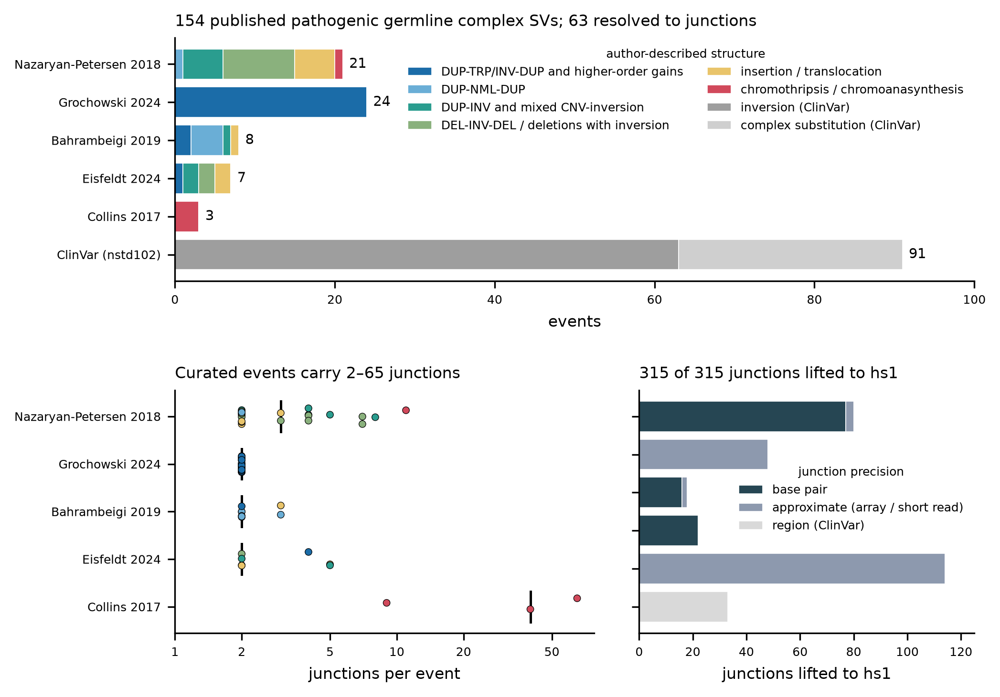
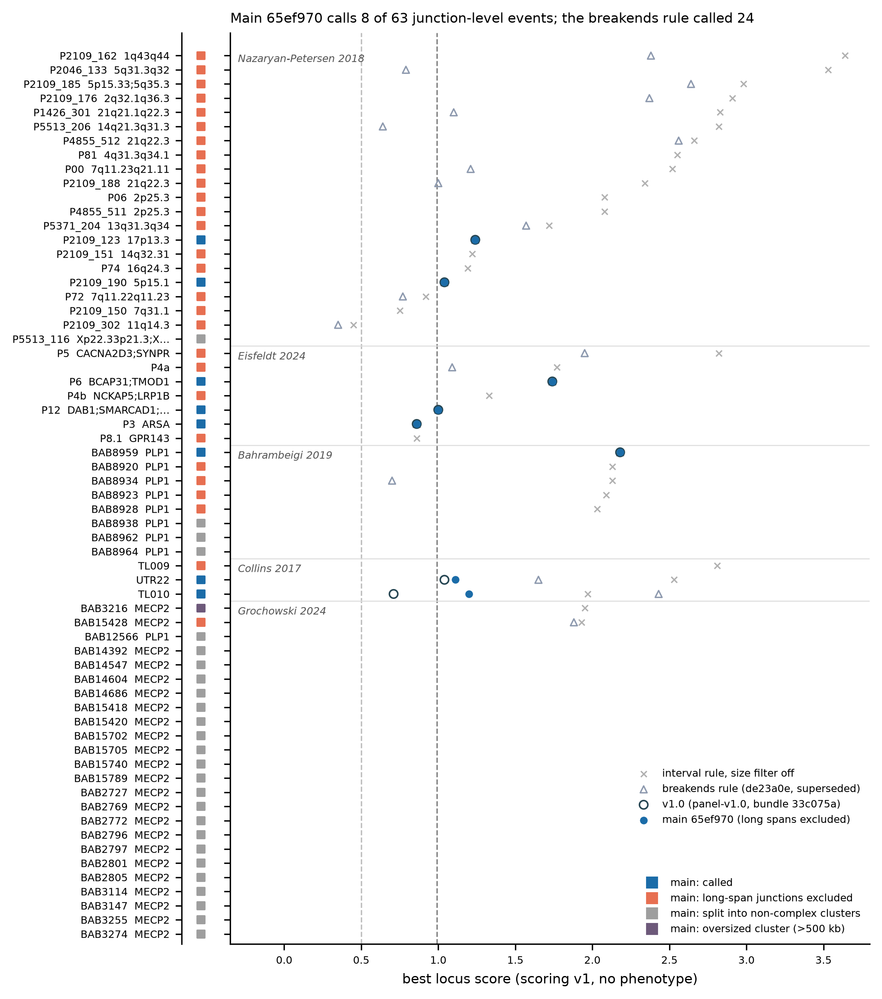
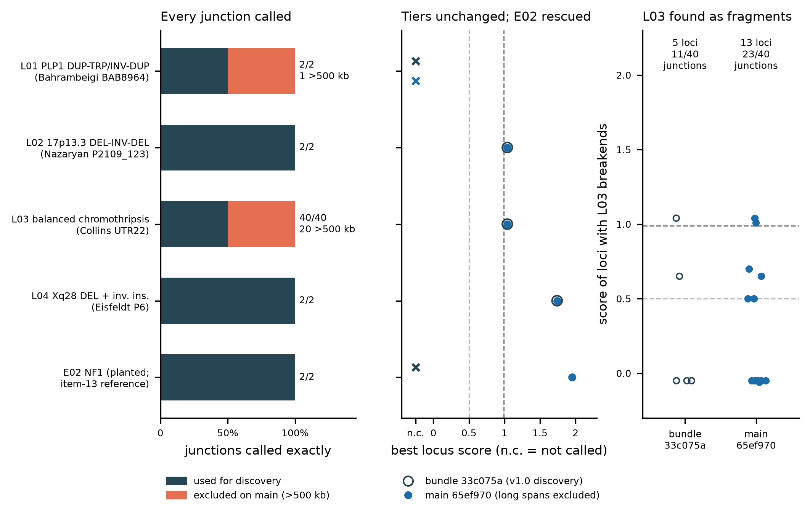

# Curated literature set of pathogenic germline complex SVs (roadmap item 11)

*Approved 2026-11-04 (decision 5). Resource `lit-v1.0`; code on branches
`item11-literature-set` (merged as PR #19) and `item11-literature-set-2`.*

This document covers the resource and the two tests run with it:

- **A** annotation, privacy and scoring of every junction-level literature
  event, against panel-v1.0 and the four catalogues, under the panel-v1.0
  discovery rule and under main's item-13 rules;
- **B** detection of four literature structures planted into the whole-genome
  positive control (add-ons L01–L04).

No scoring weight was changed. The change proposals are in section 7.

**In short.** The set has 154 published events. 63 are resolved to junctions
(282 junctions on hs1) and 91 are ClinVar region-level records. Every junction
lifted to hs1. 39 of the 63 junction-level events contain at least one junction
longer than 500 kb (151 of 282 junctions). On main 65ef970 these junctions are
excluded from discovery (`long_span_rule: exclude`). The rule rescues the
positive control's E02 in the whole genome. It does not, however, call any
literature event that the panel-v1.0 rule missed: 8 of 63 events are called,
the same 8 as in v1.0. The superseded breakends rule (de23a0e) called 24. In the
whole-genome detection test, all 46 L-series junctions are called exactly
under both codes. L02 and L04 are Tier 1 in both. L03 stays Tier 1 but is
reported as 13 fragments, because 20 of its 40 junctions are excluded. L01 is
called by neither code; its 533 kb junction is excluded on main.



## 1. The resource

| | |
|---|---|
| Version | `lit-v1.0` |
| Lab copy | `/mnt/sargasso1/CxSV/resources/literature/lit-v1.0` (checksums in `MANIFEST.tsv`) |
| Built by | `acquisition/literature/build_literature_set.py` (sources and curated tables in `acquisition/literature/`, see its README) |
| Source files | `/mnt/sargasso1/CxSV/resources/literature/_downloads/20261104/` (sha256 in `acquisition/literature/sources.tsv`, verified on every build) |
| Bundle | `scripts/make_bundle.sh bundle … [--literature DIR]` copies the newest verified `lit-v*` to `resources/literature/<version>` and sets `literature_set.root` in `bundle_site.yaml` |

Files:

| File | Content |
|---|---|
| `literature_events.tsv` | One row per event: source, citation, DOI, PMID, case, phenotype label, reported genes, inheritance, the authors' event type and classification, `known_pathogenic`, carrier sex and zygosity, junction counts, precision, lift status, hs1 region, span, genes at breakends, flags |
| `literature_junctions.tsv` | One row per junction: hs1 `chrom1 pos1 side1 chrom2 pos2 side2`, svtype (BND/DEL/DUP/INV from the sides, as the callers report it), precision, lift status, and the source-build coordinates (`src_*`, `hg38_*`) |
| `literature_set.lit-v1.0.junction_sites.tsv.gz` (+ `.tbi`) | The lifted junctions in the item-3 junction-site format (`source = cxsv_literature`), so the item-3 matcher can use them directly |
| `literature_derivatives.tsv` | Derivative-chromosome fragment chains (Collins et al. 2017) |
| `literature_cn_segments.tsv` | Curated copy-number changes; used only by test A to synthesise read depth |
| `liftover_report.tsv` | Per-source liftover outcome |
| `literature_set.json` | Version, code commit, input and chain sha256, counts |

**Junction model.** A junction is one novel adjacency with a side at each end:
`+` means the sequence ending at the position is kept, `-` the sequence
starting there. Different chromosomes give BND, (+,−) DEL, (−,+) DUP and
(+,+)/(−,−) INV. The curation rules (germline, published, at least two
junctions; precision classes; per-source conventions) are listed in
`acquisition/literature/README.md`.

### Sources

| source_id | Citation | Events | Junctions |
|---|---|---|---|
| nazaryan2018 | Nazaryan-Petersen et al. 2018, *PLoS Genet* 14:e1007780 (S2 Table, Table 1) | 21 | 80 |
| grochowski2024 | Grochowski et al. 2024, *Cell Genom* 4:100590 (Table S1; DUP-TRP/INV-DUP at *MECP2* and *PLP1*) | 24 | 48 |
| bahrambeigi2019 | Bahrambeigi et al. 2019, *Genome Med* 11:80 (Table S2; *PLP1* complex gains) | 8 | 18 |
| eisfeldt2024 | Eisfeldt et al. 2024, *Genome Res* 34:1774 (Tables 1–2; long-read pilot) | 7 | 22 |
| collins2017 | Collins et al. 2017, *Genome Biol* 18:36 (Additional file 3; TL010, UTR22, TL009) | 3 | 114 |
| clinvar_nstd102 | ClinVar via dbVar nstd102 (GRCh38), pathogenic / likely pathogenic complex substitutions and inversions | 91 | 33 (inversions; the rest region level) |

The open-access full texts and supplements came through Europe PMC and the
publishers' open supplement servers. **Not obtained:**

- Kloosterman et al. 2011 *Hum Mol Genet*: publisher returned HTTP 403; not in PMC.
- de Pagter et al. 2015 *Am J Hum Genet*: PMC copy has no supplements; publisher returned 403.
- Kloosterman et al. 2012 *Cell Rep* Table S3: 403.
- Gu et al. 2015 *Hum Mol Genet* (17p13.3): 403.
- Carvalho et al. 2011 *Nat Genet* supplementary tables: not available.
- Beck et al. 2015 *PLoS Genet*: its supplementary tables have no coordinates.

No access control was worked around. DECIPHER is not used, because it requires a data-access agreement.

ClinVar has 509 pathogenic or likely pathogenic translocations, but none
carries coordinates in nstd102, so they are not included. ClinVar records stay
at region level (match tolerance 50 kb). The 33 inversion records with interval
ends are also given as junctions.

### Liftover

The item-4 code (`catalogues/liftover.lift_points`) lifts each breakpoint:
GRCh37 hg19 → hg38 → hs1, and GRCh38 → hs1. All 315 junctions lifted. No
junction was lost to an unmapped end or a split across contigs, and no span
changed. One side was flipped by a reversed chain block (GRO24_BAB15428). Of
the 91 ClinVar events, 33 lifted as junctions, 56 at region level and 2 failed
at region level.

## 2. Test A: annotation, privacy and scoring of the literature events

`tests/literature/score_literature_set.py` turns every junction-level event
into a synthetic patient whose calls are exactly the published junctions. Each
junction becomes one merged record with SUPP_VEC 111 and the sides encoded in
breakend ALT notation. The patient workflow's own scripts are then run rule by
rule: vcf_to_bed → bedtools cluster → classify → extract → annotate →
junctions → panel privacy (panel-v1.0, with real callability) → catalogues →
copy-number segments from depth synthesised out of the curated CN changes →
`score_cxsv.py`. Weights and tiers come from `config/scoring.yaml`; there is no
phenotype and there are no parents. Four discovery rules are run:

| Mode | Rule for DEL/DUP/INV records longer than 500 kb | Size filter |
|---|---|---|
| `v1.0` | clustered as their interval (panel-v1.0, bundle 33c075a) | 500 kb |
| `breakends` | clustered at their two breakends (de23a0e, superseded) | 500 kb |
| `main` | **excluded** from discovery (a1515bd, main 65ef970) | 500 kb |
| `filter_off` | excluded | off |

The interval rule with the size filter off (column `interval_rule_filter_off`,
from the 8949cef run) is the upper bound of what clustering at 50 kb finds.



| | interval, no size filter | v1.0 | breakends | **main 65ef970** |
|---|---|---|---|---|
| Junction-level events called (of 63) | 37 | 8 | 24 | **8** |
| Tier 1 | 32 | 6 | 18 | **7** |
| Known-pathogenic events called (of 53) | 27 | 6 | 19 | **6** |
| Known-pathogenic at Tier 1 | 25 | 4 | 15 | **5** |

Table: `docs/item11/literature_event_scores_modes.tsv`, one row per event,
giving tier and score per rule and main's outcome.

**Long-span records.** 39 of 63 events have at least one junction longer than
500 kb (151 of 282 junctions). On main they are listed in
`cxsv/long_span_records.tsv` and left out of discovery. Outcome on main:

- **8 called**: P2109_123, P2109_190, EIS24_P3, P6, P12, BAB8959, UTR22, TL010.
  - In TL010, 33 of 65 junctions are excluded; the score falls from 2.43 (breakends) to 1.20.
  - In UTR22, 20 of 40 are excluded; 1.65 → 1.11.
  - Both stay Tier 1.
- **28 not called because their long junctions are excluded.** The breakends rule
  or the interval rule calls them. 18 are from Nazaryan-Petersen, for example
  the chromoanasynthesis-like 1q43q44 event P2109_162 (Tier 1 2.38 under
  breakends). 4 are *PLP1*
  DUP-NML-DUP and DUP-INV events. Also lost: Eisfeldt P4a, P4b, P5 and P8.1
  (a 143 Mb Xp22–Xq28 DUP-INV-DUP), Collins TL009 (all 9 junctions longer
  than 500 kb), and Grochowski BAB15428, one of only two DUP-TRP/INV-DUP the
  other rules call.
- **26 not called under any rule**: 22 Grochowski DUP-TRP/INV-DUP, Bahrambeigi
  BAB8938, BAB8962 and BAB8964, and Nazaryan P5513_116. Their two junctions lie
  more than `cluster_distance` (50 kb) apart and are not interleaved. Each
  cluster is then a single INV (or DUP) and is not complex. This affects every
  DUP-TRP/INV-DUP whose triplication is longer than 50 kb; E01 is planted with
  a shorter one.
- **1 oversized cluster** (GRO24_BAB3216).

Caveat: test A has no background SVs. In real genomes, v1.0 loses events to
giant artefact records that chain across them (E02). The exclude rule fixes
that, and test B shows it.

**Privacy.** Under main, every called locus is `private`. At junction level, 8
of 282 junctions match a panel or catalogue site
(`docs/item11/junction_privacy_hits.tsv`):

- TL010 J46, J47 and J51 (Collins, approximate) coincide with common deletions
  in the panel and all four catalogues (catalogue AF 0.21–0.66). Collins'
  derivative chains have small reference gaps at these fragment boundaries.
  These are most likely polymorphic deletions on the carrier haplotype, not
  rearrangement junctions.
- P2109_150 J2, a 21 kb deletion-like junction of an inserted duplication,
  matches a polymorphic deletion: 8 panel carriers, catalogue AF ≤ 0.0065.
- Four rare gnomAD-SV matches (AF ≤ 2×10⁻⁴): P81 J1, the identical J2 of P06
  and P4855_511, and BAB8959 J2. All are short-read DEL calls at the same
  positions.

**Known-pathogenic events below Tier 1** (main, called):

- **EIS24_P3** (*ARSA* DEL-INV-DEL, homozygous, metachromatic leukodystrophy):
  0.86, Tier 2. The genes axis gives only 0.15 (exon broken). *ARSA* is
  recessive, so there are no dosage points, and the scorer does not use
  biallelic (1/1) loss.
- Under breakends only: **BAH19_BAB8934** (0.70), **NP18_P5513_206** (0.64) and
  **NP18_P2046_133** (0.79). The called locus is a breakend fragment of a few kb.
  The gained or lost genes (*PLP1*, 14q21.3q31.3, 5q31.3q32) lie between linked
  breakends, outside the locus, so the genes axis cannot see them.

## 3. Test B: detection, L01–L04 planted into the whole-genome positive control

Four literature structures were re-planted as add-ons on host 3559, by the same
mechanism as E13 (`tests/positive_control/literature_addons.py`). The release
CRAM and the E01–E13 truth are unchanged. Simulated reads: badread 0.4.2,
heterozygous, local depth 31–38×.

| Add-on | Event | hs1 | Note |
|---|---|---|---|
| L01 | Bahrambeigi BAB8964, *PLP1* DUP-TRP/INV-DUP | chrX:101,752,401–102,492,226 | full haplotype |
| L02 | Nazaryan P2109_123, 17p13.3 DEL-INV-DEL (VUS) | chr17:2,154,467–2,685,421 | in place of the *ARSA* event, which overlaps E04's window |
| L03 | Collins UTR22, balanced germline chromothripsis, 40 junctions on chr2/7/8/9 | 28 reference windows, 7.0 Mb | windowed: 100 kb on each side of every junction |
| L04 | Eisfeldt P6, Xq28 deletion + inverted 9q22.33 insertion | chrX:151,998,369–152,053,304; chr9:109,768,705–109,770,177 | full |

Both runs use the same reads and the same caller outputs:

1. **Bundle `cxsv-bundle-20261103-33c075a22071`**, run with
   `tests/lab/pos_control_full_genome.sh` and
   `ADDONS="E13 L01 L02 L03 L04"`. This is the full patient run, offline.
2. **Main 65ef970**, run with `tests/lab/pos_control_rerun_downstream.sh` in
   the same SIF. The dry run planned only downstream rules (no caller), and the
   caller VCFs were checked unchanged. `allow_fingerprint_mismatch: true` is set
   because the fingerprint on main is 64e10c1b1363 and panel-v1.0's is
   cd7e1d194cd4. Privacy is therefore against panel-v1.0 junctions, and its
   loci were made with v1.0 code.



| Event | Junctions exact | >500 kb, excluded on main | Loci with event breakends (33c075a → main) | Best score / tier, 33c075a | Best score / tier, main 65ef970 |
|---|---|---|---|---|---|
| L01 | 2/2 | 1 (532.8 kb INV) | 0 → 0 | not called (inside a 20.2 Mb oversized chrX cluster) | not called (the 81.7 kb INV is left alone) |
| L02 | 2/2 | 0 | 1 → 1 | 1.04 Tier 1, Complex_inversion, private | 1.04 Tier 1, same |
| L03 | 40/40 | 20 | 5 → 13 (11 → 23 junctions in a locus) | 1.04 Tier 1; chr2 and chr9 parts lost in 14.4 and 24.9 Mb oversized clusters | 1.04 Tier 1; 13 fragments (12 private, 1 shared_junctions); BND_cluster, DEL+DUP+INV |
| L04 | 2/2 | 0 | 2 → 2 | 1.74 Tier 1, BND_cluster, private | 1.74 Tier 1, same |
| E02 (reference) | 2/2 | 0 | 0 → 1 | not called (oversized) | 1.95 Tier 1 |

Junctions over all events: 86 exact, 1 partial, 0 missed of 87, in both runs.
E01 and E03–E13 are unchanged. The scorer verdict for L03 is FAIL on main only
because it counts every locus overlapping the 7 Mb of L03 windows. That
includes host loci with no L03 breakend, which are now classified (`public`,
up to 1,016 carriers). Every locus that carries an L03 breakend is private or
shared_junctions. Tables: `docs/item11/detection_L01_L04.tsv`,
`detection_loci_with_L_breakends.tsv` and `detection_L_junctions.tsv`.

**Literature match (annotation).** In the main run, L02 and both L04 loci are
matched at event level: `NP18_P2109_123(2/2)` and `EIS24_P6(2/2)`. The 13 L03
loci are matched at junction level (`COL17_UTR22(k/40)`). One host locus,
chr6:104,464,782–104,490,439, matches COL17_TL010 J51, the common deletion
above; it is `public`. The first version of the region level matched 386 loci
genome-wide on bare overlap, because large published regions (for example the
143 Mb EIS24_P8.1) overlap many loci. The region level now requires reciprocal
overlap of at least `region_min_overlap` (0.5). Re-run on the same loci, the
annotation gives 3 event, 14 junction, 0 region and 1,241 none (1,258 loci).

## 4. Long-span exclusion: answer to the lead's question

- **Junctions excluded:**
  - L01: 1 of 2 junctions.
  - L03: 20 of 40 junctions.
  - L02, L04: none.
  - In test A: 151 junctions in 39 of 63 events. They are real disease
    junctions, all with SUPP_VEC 111 by construction. In the positive control
    the excluded L-series junctions were called by 1–2 callers (SUPP_VEC 001,
    010, 011).
- **Detection:** L01 is not called by either code. On main the cause is the
  exclusion; under v1.0 it was the oversized filter. Under any rule, the two
  junctions' nearest ends are 125 kb apart (the triplication), so clustering
  at 50 kb splits them. L03 goes from 5 to 13
  loci with breakends (11 → 23 of 40 junctions in a locus); the event is still
  found only as fragments.
- **Class:** L03's loci are fragments (BND_cluster, DEL+DUP+INV,
  Multi_breakpoint_cluster). The chromothripsis criteria are not met by any
  single locus, under either code.
- **Tier:** no L-event changes tier: L02 1.04, L03 1.04 and L04 1.74, all
  Tier 1. In test A, exclusion costs 16 events against the breakends rule, 13
  of them Tier 1 there. It costs no event against v1.0.

## 5. `literature_match` annotation (no points)

`workflow/scripts/match_literature.py`; `rule literature_hits` in
`workflow/rules/patient_scoring.smk`. It is active only when
`literature_set.root` is set in `config/scoring.yaml`; bundles built with
`--literature` set it.

- **Junction match:** svtype and both contigs agree, and each end is within the
  tolerance for the junction's precision: 500 bp (bp), 10 kb (approximate) or
  50 kb (region).
- **Locus level:**
  - `event`: at least 75% of one published event's junctions are matched.
  - `junction`: at least one junction is matched.
  - `region`: reciprocal overlap of at least 0.5 with a published hs1 region.
  - `none`.
- **Output:** `private/cxsv_literature_hits.tsv`, plus `Literature_Match` and
  `Literature_Events` in `cxsv_scores.tsv` and the report line. Score, tier and
  status are unchanged.

## 6. Reproduce

```bash
# build the set (freya, env cxsv-catalogues)
python acquisition/literature/build_literature_set.py --sources /mnt/sargasso1/CxSV/resources/literature/_downloads/20261104 \
  --chain-hg19 …/hg19ToHg38.over.chain.gz --chain-hg38 /mnt/sargasso1/CxSV/resources/_downloads/20261029/hg38ToHs1.over.chain.gz \
  --fai /mnt/sargasso1/CxSV/refs/hs1.fa.fai --genes /mnt/sargasso1/CxSV/resources/genes.final.bed \
  --version lit-v1.0 --out /mnt/sargasso1/CxSV/resources/literature/lit-v1.0 --code-commit $(git rev-parse HEAD)
# test A (env cxsv-pipeline; ~10 min with --jobs 5)
python tests/literature/score_literature_set.py --literature /mnt/sargasso1/CxSV/resources/literature/lit-v1.0 \
  --repo . --release /mnt/sargasso1/CxSV/build/panel-v1.0/results/panel/release --work WORK --jobs 5
# test B (bundle run, ~2 h; then main's downstream, ~25 min)
A=/mnt/sargasso1/CxSV/datasets/pos_control/addons
ADDONS="$A/E13 $A/L01 $A/L02 $A/L03 $A/L04" EVENTS=$A/events_E01-E13+L01-L04.yaml SKIP_MD5=1 \
  bash tests/lab/pos_control_full_genome.sh /mnt/sargasso1/CxSV/bundles/cxsv-bundle-20261103-33c075a22071 W 12
ADDONS=… EVENTS=… LITERATURE=/mnt/sargasso1/CxSV/resources/literature/lit-v1.0 \
  bash tests/lab/pos_control_rerun_downstream.sh /mnt/sargasso1/CxSV/bundles/cxsv-bundle-20261103-33c075a22071 W W_main . 12
# figures
python docs/item11/make_figures.py --literature /mnt/sargasso1/CxSV/resources/literature/lit-v1.0
```

## 7. Proposals (not applied)

1. **Item 13: link the two ends of a long record when both ends join other
   SVs.** Exclusion removes 151 real junctions here. A record longer than
   `span_link_max` could instead be kept as an edge between two breakend
   clusters: the clusters are merged when each also holds another SV
   (paired-breakend linkage, as in DUP-NML-DUP, inverted duplications and
   chromothripsis), and the record is dropped only otherwise. The size filter
   would then apply to the summed breakend windows, not the span. Of the 28
   events lost to exclusion, 16 were called even by the breakends rule (no
   linkage at all), and all 28 by the interval rule without the size filter.
   Check it against the panel, as for item 13:
   artefact giant records are mostly single-caller and rarely have an SV at
   both ends.
2. **Item 13: interleaved inversion pairs.** DUP-TRP/INV-DUP with a
   triplication longer than 50 kb (22 Grochowski events, L01) splits into two
   single-INV clusters. Two INV junctions with opposite orientation (++/−−)
   whose spans nest within, for example, 1 Mb could be linked.
3. **Scoring: locus footprint.** When a locus is linked through long records
   (proposal 1), the genes and region-dosage axes should see the segments
   between its breakends: *PLP1* gains, 14q and 5q losses. Count them only
   where read depth confirms a copy-number change. Item 13 found that
   counting the whole interval of an unconfirmed long record made 3 false
   Tier-1 host calls under the breakends rule.
4. **Scoring: biallelic loss.** Under the current axes, a homozygous (GT 1/1)
   or male-hemizygous loss or disruption of a gene with recessive disease
   gets no dosage points (EIS24_P3, *ARSA*). This needs a curated
   recessive-gene list (OMIM / GenCC AR), which is a new resource.
5. **Positive-control scorer:** for windowed add-ons (L03), count only loci
   carrying a truth breakend in the status check.

## 8. Limitations

- Test A idealises the caller-evidence axes (all callers, full support) and
  synthesises read depth from the published CN changes.
- Approximate and array-level breakpoints (Collins, Grochowski) are placed at
  the reported positions.
- The L-series is planted heterozygous in a female host. The carriers include
  homozygous (P3) and hemizygous male (*PLP1*, *MECP2*) cases.
- L03 is simulated in windows (100 kb around each junction), not as whole
  derivative chromosomes.
- Main's PC run is compared against panel-v1.0, which was built with v1.0
  discovery. It is exploratory until a panel is released with the item-13 code.
- Two Nazaryan-Petersen cases needed a choice between conflicting source
  fields. P2109_188 J2 has S2 Table signs that conflict with the HGVS; it is
  flagged `sign;hgvs_conflict` in `curated/nazaryan2018_junction_types.tsv`.
  For P2109_123, the Table 1 HGVS is used for copy number, because the CMA
  interval disagrees with the junctions (`curated/cn_segments.tsv`).
