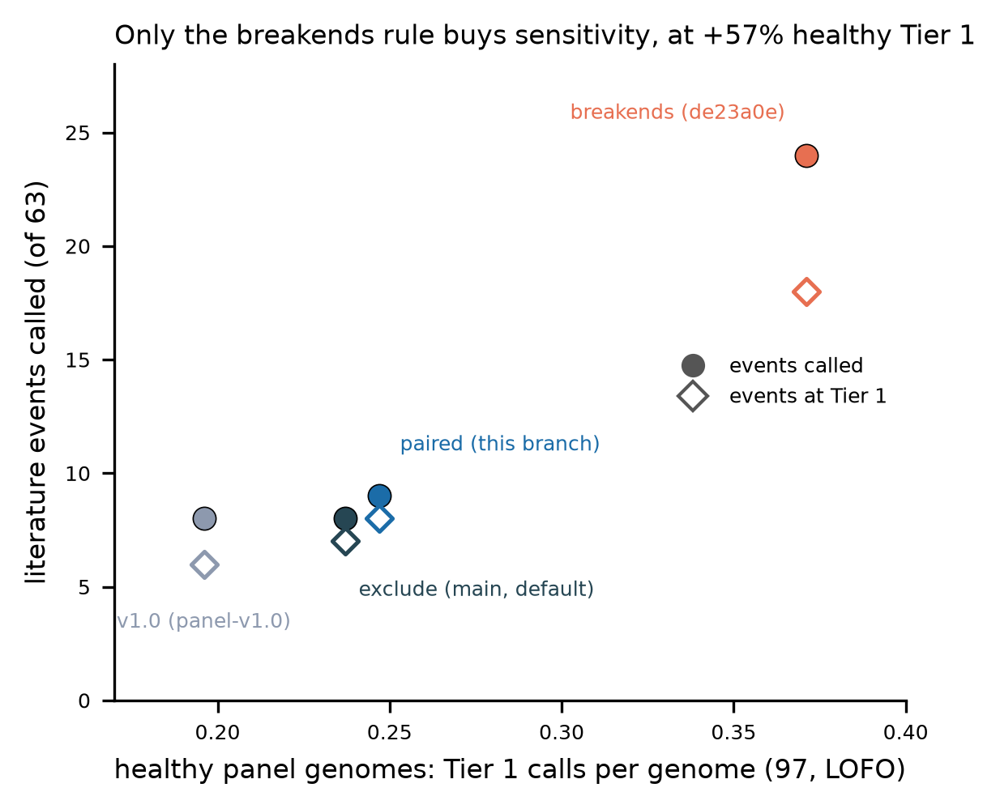

# Paired-breakend linkage of long records (roadmap item 13 follow-up, prototype)

Status 2026-11-04: prototype on branch `item13-paired-linkage` (on `main` 8aba785),
evaluated, **not adopted**. The default stays `long_span_rule: exclude`. The PI held
the panel-v1.1 tag for this check, which item 11's literature test asked for
(docs/LITERATURE_SET.md section 7, proposal 1).

## 1. Rule

`cxsv_params.long_span_rule` takes `exclude | breakends | paired`; the default is
unchanged (`exclude`). For a DEL/DUP/INV longer than `span_link_max` (500 kb),
`paired` does the following:

- **Partner test** (`vcf_to_bed.py paired_records`):
  - Each end must lie within `cluster_distance` (50 kb, the `bedtools cluster -d`
    rule) of another record's BED row.
  - A record whose rows lie within `collapse_distance` (300 bp) of both ends is
    the same junction called twice, so it is not a partner. Example: a Sniffles2
    breakend pair rewritten as an INV beside an SVIM INV.
  - A long partner counts only while it is itself paired. Long records are
    re-tested until none fails.
- **Edge:** a paired record is written as its two breakend rows (as under
  `breakends`). `link_paired_clusters.py` then merges the two `bedtools`
  clusters at its ends into one cluster (union-find over all paired records).
  Rows of merged clusters get an 8th column naming their original cluster.
- **Size:** `classify_cxsv.py` sizes a merged cluster, for `Size` and for the
  `max_cluster_size` filter, as the sum of its parts' spans. The long record's
  interval is never a clustering interval.
- **Records that fail** are left out of discovery, as under `exclude`.
  `long_span_records.tsv` lists every long record with `RULE` = `paired` or
  `exclude`. `extract_cxsv_vcf.py --long-records` takes only the paired ones
  into `cxsv_only.vcf`.

Under `exclude` and `breakends` the new link step passes `clusters.bed` through
byte for byte. On the 97 evaluation genomes, discovery under both rules is
identical to item 13's own runs (`cxsv_summary.tsv` and `clusters.bed`, 97/97).

**Not implemented: the optional interleaved-inversion-pair link** (for
DUP-TRP/INV-DUP with a triplication longer than 50 kb). It needs each INV's
orientation (`++` vs `--`). The pipeline's junction model (`cxsv_junctions.Junction`)
does not carry orientation, so the link would need `STRANDS` parsing from the
merged VCF and a check of each caller's orientation convention. That is not a
small, separable change.

Unit tests: `tests/unit/test_paired_linkage.py` (8 tests). They cover:

- a DUP-NML-DUP pair joined into one cluster sized by its parts;
- the 25.7 Mb artefact DEL without partners, handled as under `exclude` (E02
  recovered);
- a partner at one end only, which is not enough;
- duplicates of the same junction, which are not partners;
- a long partner that must itself be paired;
- the link step as a no-op for the other rules;
- `extract` taking only paired records;
- `paired` as a valid config value.

All 162 unit tests pass on freya.

## 2. Evaluation

No scoring weight was changed. Every arm uses this branch's code with only
`long_span_rule` switched. All arms use the same inputs: the panel-v1.0 caller
outputs, the 33c075a bundle SIF and the panel-v1.0 junction sites.

- **(a) Test A**, the 63 junction-level literature events
  (`tests/literature/score_literature_set.py`, docs/LITERATURE_SET.md):
  synthetic call sets, no background SVs.
- **(b) Whole-genome positive control** E01–E13 + L01–L04: downstream rules
  re-run on the 33c075a run's caller outputs
  (`tests/lab/pos_control_rerun_downstream.sh` with `LONG_SPAN_RULE`).
- **(c) 97 healthy panel genomes** (item 13's subset, 3 QC outliers removed):
  `calibration/oversized_clusters/downstream_rerun.sh` with `LONG_SPAN_RULE`,
  then `eval_scores.sh` (item-10 LOFO scoring) and `collect_tiers.py`.
  - Depth is re-used from item 13's arms for loci whose ids are unchanged.
  - Discovery per genome: `compare_rules.py`.
  - **Sanity check:** the code reproduces item 13 exactly. v1.0 gives 0.196,
    breakends 0.371 and exclude 0.237 Tier 1 per genome, with Tier 2 2.84 /
    3.52 / 3.14.
- **(d) Stand-in HG01868** (not in the panel): the bundle-validation run's
  downstream rules re-run as in (b).

| rule | literature called / Tier 1 (of 63) | healthy Tier 1 / genome | healthy Tier 2 / genome | genomes with any Tier 1 | blind span / genome, median (mean) | CxSV loci / genome, median | PC planted events at Tier 1 (of 17) | PC host Tier 1 | HG01868 Tier 1 / Tier 2 |
|---|---|---|---|---|---|---|---|---|---|
| v1.0 (panel-v1.0, reference) | 8 / 6 | 0.196 | 2.84 | 17.5% | 334 Mb panel-wide | 983 | 11 (E02 not called) | 0 | 0 / 5 |
| **exclude** (main) | 8 / 7 | **0.237** | 3.14 | 20.6% | 3.13 Mb (3.67) | 1,127 | 12 | **0** | **0** / 5 |
| breakends (de23a0e) | **24 / 18** | 0.371 | 3.52 | 30.9% | 3.32 Mb (3.79) | 1,138 | 12 | 3 | 4 / 6 |
| paired | 9 / 8 | 0.247 | 3.32 | 21.6% | 3.47 Mb (4.08) | 1,125 | 12 | 1 | 0 / 6 |

Tables are in `docs/item13b/`: `rule_comparison.tsv`, `literature_by_rule.tsv`,
`healthy_tiers_per_genome.tsv`, `healthy_tier12_loci.tsv`, `discovery_per_genome.tsv`,
`pos_control_by_rule.tsv` and `host_and_standin_tier1.tsv`. PC planted events at
Tier 1: E01–E09, L02, L03 and L04. L01, E10 and E13 are below Tier 1, and E11
and E12 are not CxSVs by design. E02 stays Tier 1 (1.95) under all three item-13
rules.



**What `paired` does in practice:**

- **Most long records pass the test.** Per genome, 18 of 33 (median) long
  records are paired; by cohort, 50% (ONT 1kGP) to 69% (PacBio). These are the
  recurrent artefact records, whose ends lie in dense SV regions (satellite and
  pericentromeric sequence). About 9 clusters per genome are joined, and some
  joined clusters become oversized by their parts. As a result, loci fall by
  2.7 per genome versus `exclude` and the blind span rises from 3.13 to 3.47 Mb.
- **Healthy Tier 1** (+0.010 per genome vs exclude):
  - +1: HG03352 `chr7:3,129-160,564,584`, a joined locus spanning chr7
    end to end (`region_dosage +1.00`, `gene_count +0.90` over the whole span,
    `shared_junctions`).
  - +1: HG02726 `chr15:25.9-26.5 Mb`.
  - −1: HG00589 `chr17:37.06-37.36 Mb`, a Tier-1 DUP+INV under exclude,
    is not among that genome's Tier-1/2 loci under paired. The genome has 4
    joined clusters and an unchanged blind span, so the locus was presumably
    joined into a larger one.
- **Positive control:**
  - The 25.7 Mb artefact DEL across the chr17 pericentromere (16.7–42.4 Mb) is
    paired. It joins its two end clusters into a public host locus,
    `chr17:16,672,217-42,437,362`: Tier 1 1.92, with gene points counted over
    25.8 Mb.
  - That locus spans E02, so the PC scorer marks E02 FAIL (2 loci). E02's own
    locus is still private Tier 1 1.95.
  - On the good side, L03 (Collins UTR22 balanced chromothripsis) becomes one
    joined `Chromothripsis_like` locus `chr2:166.6-181.0 Mb` (2.33; exclude
    1.04, breakends 1.64).
- **Literature (test A):** paired calls 9 events, one more than exclude
  (NP18_P2109_176). It raises the chromothripsis events to `Chromothripsis_like`:
  TL010 2.68 (exclude 1.20), UTR22 2.55 (1.11), P2109_176 2.82. The 15 events
  that only breakends calls are lost, because their long junctions have a
  partner at one end only.
  - Example: a DUP-NML-DUP's two junctions join breakpoints 0.6–0.8 Mb apart.
  - At such a one-sided end, breakends makes a CxSV locus from the long junction
    plus the local SVs. Paired, by definition, does not.

## 3. Recommendation

**Keep `exclude` for panel-v1.1.** `paired` buys one of 63 literature events
(9 vs 8) and better classes for three chromothripsis events. The price is
+0.010 healthy Tier 1 per genome, a whole-chromosome artefact locus, a public
Tier-1 host call in the positive control, and a failed E02 check.

The literature sensitivity that `breakends` has (24/63) comes from long
junctions with a partner at one end. Any discovery rule that recovers them also
puts an unconfirmed > 500 kb junction into a locus. The cost of `breakends`
(healthy Tier 1 0.237 → 0.371, host 0 → 3, HG01868 0 → 4) comes from the scorer
counting genes and region dosage over that long interval: every extra host or
stand-in Tier-1 call has `gene_dosage +1.00; gene_count +0.90`.

The next prototype should therefore change scoring, not discovery:

- under `breakends`, count genes and region dosage only over a long junction's
  breakend windows;
- count the interval only where read depth confirms a copy-number change.

Evaluate it on these same four tests.

**Caveat for merging.** This branch changes the calling fingerprint even with
`exclude`: the code digest changes, and `link_paired_clusters.py` joins the
fingerprinted code. A patient run on this branch would not be compatible with a
panel-v1.1 built from 65ef970. If `exclude` is kept, leave the branch unmerged
(or merge it only together with a later panel rebuild). The prototype,
evaluation scripts and tables can be cherry-picked without the workflow changes.

## 4. Reproduce

```bash
# (c) 97 genomes (shadowfax, ~2 min per arm for discovery; scoring ~5-30 min per arm)
for r in exclude breakends paired; do
  LONG_SPAN_RULE=$r bash calibration/oversized_clusters/downstream_rerun.sh SUB97.tsv W/eval_$r . SIF 10; done
AFTER_NAME=cal_paired REUSE_CAL=<item13 scores/cal_exclude> \
  bash calibration/oversized_clusters/eval_scores.sh SUB97.tsv W/scores W/eval_paired/results/panel/samples 10
python calibration/oversized_clusters/collect_tiers.py SUB97.tsv OUT before=... exclude=... breakends=... paired=...
python calibration/oversized_clusters/compare_rules.py SUB97.tsv OUT.tsv exclude=... breakends=... paired=...
# (b) positive control / (d) HG01868 (one arm at a time on a 61 GB node: classify_patient_cxsv
# loads the panel sites; six in parallel ran out of memory)
LONG_SPAN_RULE=paired ADDONS=... EVENTS=... bash tests/lab/pos_control_rerun_downstream.sh BUNDLE SRC W CODE 12
LONG_SPAN_RULE=paired SCORE=0 RUN_SUBDIR=offline_singularity RUN_CONFIG=standin_run.yaml INPUT_DIR=... \
  SAMPLE_REL=results/patient/samples/standin_HG01868/HG01868 bash tests/lab/pos_control_rerun_downstream.sh ...
# (a) literature (modes v1.0, breakends, exclude, paired)
python tests/literature/score_literature_set.py --literature lit-v1.0 --repo . --release RELEASE --work W --jobs 3
python calibration/oversized_clusters/fig_rule_tradeoff.py
```

Evaluation work directories:

- shadowfax: `/home/minknow/scratch/item13b/{eval_*,scores,reruns}`;
- keurig: `~/scratch_item13b/testA`;
- inputs staged on the NAS: `/mnt/sargasso1/CxSV/scratch/item13b`.
