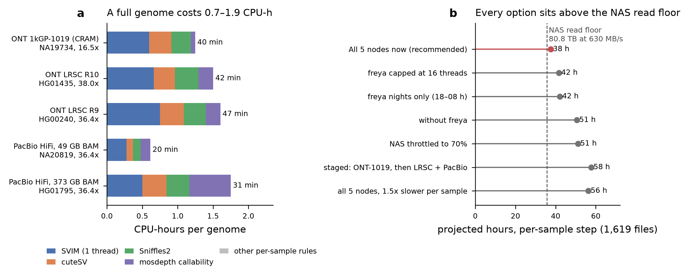

# Full panel build on the lab fleet

How the background panel is built from every verified registry file on the
Faulk lab nodes, without a cluster scheduler (SLURM is on hold, ROADMAP item 7).
This is roadmap item 12's build preparation. The build itself, the release, and
the `panel-v1.0` tag are separate steps.

**Scope (PI decisions, 2026-10-29):**
- all three cohorts: `1kGP_ONT_1019_CHM13`, `1kGP_LRSC_ONT_CHM13` and `1kGP_PacBio_CHM13`;
- **no coverage floor**: `min_coverage` is gone from `config/sites/faulk_lab_panel.yaml`.
  The mechanism stays in `workflow/lib/cxsv_inputs.py`; add `min_coverage: <x>`
  under a cohort to use it again.

That gives 1,619 files from 1,582 individuals. Each file gets one call set.

**Dispatch (PI decision, 2026-10-30):** all 5 usable nodes run at once. princess
is excluded (see [Nodes](#nodes)).

## Carrier counting across cohorts

Calls are made per file and carriers are counted per individual. These are the
rules the code implements, checked in `workflow/lib/cxsv_matching.py`
(`site_counts`, `groups_of`) and `workflow/scripts/build_panel_sites.py` /
`build_panel_loci.py`:

- **35 people are in more than one cohort**: 33 in two and 2 in all three, which
  is why there are 1,619 files for 1,582 individuals. Each of their files is
  called separately, under `samples/<cohort>/<sample>/`.
- A junction site's carriers, `ac` and `an` count each **individual once**. If a
  person is called in two files, the higher dosage is kept.
- `n_individuals` in the summaries and the denominators in
  `panel_individuals.tsv` also count each person once.
- **Platform groups** (`af_ONT`, `af_PACBIO`): a person counts once under every
  platform they were sequenced on, in both `ac` and `an`. Their carrier status
  comes from all of their files. So a person sequenced on ONT and PacBio whose
  junction was called only in the PacBio file still adds to `ac` in the ONT
  column.
- Both LRSC chemistries (R9 and R10) and the 1kGP-1019 cohort are platform `ONT`.
- **Callability** is counted the same way: an individual is callable at a site
  if any of their files is callable there (`lib/cxsv_callability.callable_counts`).
- `panel_individuals` now points at the registry `individuals.tsv`, so chrX/chrY
  allele numbers and superpopulation frequencies use the registry's sex and
  superpopulation.

## The build in one picture

```
freya: prepare_build.sh COMMIT cost_model.tsv
   freeze code (git archive) -> check fingerprint cd7e1d194cd4 -> make_shards.py
   (balanced plan) -> dry-run every shard and the full panel
freya: launch.sh BUILD all
   one run_node.py per node (setsid; over ssh)
     for each sample of the node's shard, longest first, up to `slots` at once:
       stage alignment + index NAS -> node-local disk   (one copy at a time per node)
       snakemake -s workflow/panel_build/Snakefile in the pinned SIF,
         own workdir BUILD/nodes/<node>/work, --cores 6, --nolock
         -> BUILD/results/panel/samples/<cohort>/<sample>/   (this node only)
       done = samples/<cohort>/<sample>/panel_build/cost.tsv; delete the local copy
     ledger: BUILD/nodes/<node>/ledger.tsv   (append-only, this runner only)
anyone: control.sh BUILD status | pause | resume | stop | slots | bwlimit | retry
freya: aggregate.sh BUILD   (after every sample is done)
   workflow/panel/Snakefile over all three full sheets, own workdir BUILD/aggregate
   -> cohort call sets + QC, panel loci, junction sites + carriers, callability,
      Sniffles2 population, release/ (manifest, release.json, callability masks)
```

## Layout on the NAS

`BUILD` is `/mnt/sargasso1/CxSV/build/panel-v1.0`, set by `build_root` in
`config/sites/faulk_lab_fleet.yaml`:

| path | written by | content |
|---|---|---|
| `code/` (+ `COMMIT`) | prepare_build.sh, once | `git archive` of the build commit; every node runs exactly this code |
| `cost_model.tsv` | prepare_build.sh | the measured cost model the plan used |
| `plan/shard_plan.tsv` | make_shards.py, once | one row per sample: node, order, estimates |
| `plan/node_summary.tsv`, `plan/estimate.json`, `plan/plan.json` | make_shards.py | per-node totals; inputs, fleet and model used |
| `plan/dryrun_<node>.txt`, `plan/dryrun_full_panel.txt` | prepare_build.sh | `snakemake -n` job lists |
| `nodes/<node>/sheets/<cohort>.tsv` | make_shards.py | the node's rows of each registry sheet (NAS paths) |
| `nodes/<node>/node.yaml` | make_shards.py | Snakemake overlay: the node's sheets, the shared results root, threads |
| `nodes/<node>/runner.json` | make_shards.py; `control.sh slots/bwlimit` | runner settings (re-read every 20 s) |
| `nodes/<node>/work/` | that node only | its Snakemake working directory (`.snakemake/`, incomplete markers) |
| `nodes/<node>/overlays/`, `logs/`, `run/` | that node only | per-sample overlay with local paths, logs, pid files |
| `nodes/<node>/ledger.tsv` | that node's runner only | append-only event log |
| `nodes/<node>/PAUSE`, `STOP`, `RETRY` | control.sh | control files |
| `results/panel/samples/<cohort>/<sample>/` | exactly one node (the plan is a partition) | per-sample outputs + `benchmarks/` + `panel_build/cost.tsv` |
| `results/panel/{cohorts,panel,release}/`, `calling_fingerprint.json` | freya (prepare + aggregate) | aggregate products |
| `aggregate/` | freya only | Snakemake workdir of the aggregate step |
| `status/` | `build_status.py --write`, run on freya | progress and cost summaries |

**Rules for writing to the NAS:**
- no file is written by two hosts, and no file is appended to by two hosts
  (O_APPEND is not atomic over SMB);
- every node has its own `.snakemake`;
- the shared per-sample tree is split by sample, and each sample directory is
  written by one node.

The per-sample tree is shared, rather than one results root per node, so the
aggregate step reads every sample in place. Copying or symlinking about 1 TB of
shard outputs over CIFS is never needed.

**Re-sharding a running build** (for example, if a node dies):
1. Stop the dead node's runner.
2. For each of its unfinished samples, move the sample directory to `#recycle`
   by deleting it, because its incomplete markers are in that node's
   `.snakemake`, which another node cannot see.
3. Write a new plan into a new `BUILD` (`--force` only with a new root). An
   existing plan is never rewritten in place.

## Per-sample cost (measured 2026-10-29)

How the measurements were made:
- Script: `scripts/panel_build/measure_cost.sh` on freya, in the pinned SIF
  (`cxsv-bundle-20261029-1dcabd9770f7`).
- One genome at the median coverage of each platform group. PacBio files come
  with and without kinetics tags (7.5x different size at the same depth), so
  there are two PacBio genomes.
- 5 genomes ran at once, each with `--cores 6`, Sniffles2/cuteSV at 4 threads,
  SVIM at 1 thread and mosdepth at 4 threads. freya's load average was about 11 of 32.
- Every alignment was first copied to freya's NVMe, which is what the build runner does.
- Run 1 and run 2 agree within 3% in wall time and CPU. The tables are from run 2.
- Per-rule wall time, CPU and peak RSS come from Snakemake `benchmark:` files.
  The panel_build Snakefile attaches them without touching any fingerprinted
  file. RSS is the sum over the job's process tree, sampled.
- Sample totals come from `/usr/bin/time -v` around each instance. Its "peak RSS"
  column is the estimate the planner uses: SVIM plus the largest of the other
  readers, plus 0.5 GB.

Data: [`docs/panel_build/measurements_20261029/`](panel_build/measurements_20261029/)
(`per_rule_cost.tsv`, `cost_model.tsv`, `nas_throughput.tsv`, `node_speed.tsv`).

| genome | group | sheet coverage | mosdepth depth (MAPQ≥20) | alignment | wall (min) | CPU (h) | busy threads | peak RSS (GB, est.) | kept on NAS |
|---|---|---:|---:|---:|---:|---:|---:|---:|---:|
| NA19734 | ONT_1019 | 16.54x | 14.85x | 4.6 GB | 39.5 | 1.38 | 2.10 | 7.1 | 0.55 GB |
| HG01435 | LRSC_R10 | 38.00x | 34.48x | 99.7 GB | 41.9 | 1.63 | 2.33 | 7.2 | 0.72 GB |
| HG00240 | LRSC_R9 | 36.43x | 34.51x | 107.7 GB | 47.2 | 1.78 | 2.27 | 8.1 | 1.02 GB |
| NA20819 | PacBio_HiFi | 36.39x | 31.83x | 48.7 GB | 19.7 | 0.69 | 2.12 | 4.4 | 0.34 GB |
| HG01795 | PacBio_HiFi | 36.39x | 32.80x | 372.8 GB | 31.5 | 1.91 | 3.65 | 4.0 | 0.32 GB |

Per rule (the remaining rules each take under 10 s and about 0 CPU):

| genome | rule | threads | wall (min) | CPU (h) | peak RSS (GB) |
|---|---|---:|---:|---:|---:|
| NA19734 ONT 1kGP-1019 CRAM | `run_sniffles` | 4 | 6.8 | 0.27 | 3.5 |
| NA19734 ONT 1kGP-1019 CRAM | `run_cutesv` | 4 | 10.0 | 0.31 | 1.2 |
| NA19734 ONT 1kGP-1019 CRAM | `run_svim` | 1 | 38.5 | 0.60 | 3.1 |
| NA19734 ONT 1kGP-1019 CRAM | `callable_mask` | 4 | 1.3 | 0.06 | 2.1 |
| NA19734 ONT 1kGP-1019 CRAM | `merge_sv_callers` | 1 | 0.0 | 0.00 | 0.1 |
| NA19734 ONT 1kGP-1019 CRAM | `sample_classify_cxsv` | 1 | 0.0 | 0.00 | 0.0 |
| NA19734 ONT 1kGP-1019 CRAM | `sample_annotate_cxsv` | 1 | 0.0 | 0.00 | 1.0 |
| NA19734 ONT 1kGP-1019 CRAM | `sample_junctions` | 1 | 0.0 | 0.00 | 0.0 |
| NA19734 ONT 1kGP-1019 CRAM | **sample total** (instance, `/usr/bin/time`) |  | 39.5 | 1.38 | 7.1 |
| HG01435 ONT LRSC R10 | `run_sniffles` | 4 | 6.7 | 0.33 | 3.7 |
| HG01435 ONT LRSC R10 | `run_cutesv` | 4 | 6.6 | 0.30 | 2.0 |
| HG01435 ONT LRSC R10 | `run_svim` | 1 | 41.1 | 0.66 | 3.0 |
| HG01435 ONT LRSC R10 | `callable_mask` | 4 | 3.3 | 0.21 | 1.9 |
| HG01435 ONT LRSC R10 | `merge_sv_callers` | 1 | 0.0 | 0.00 | 0.1 |
| HG01435 ONT LRSC R10 | `sample_classify_cxsv` | 1 | 0.0 | 0.00 | 0.1 |
| HG01435 ONT LRSC R10 | `sample_annotate_cxsv` | 1 | 0.0 | 0.00 | 1.7 |
| HG01435 ONT LRSC R10 | `sample_junctions` | 1 | 0.0 | 0.00 | 0.1 |
| HG01435 ONT LRSC R10 | **sample total** (instance, `/usr/bin/time`) |  | 41.9 | 1.63 | 7.2 |
| HG00240 ONT LRSC R9 | `run_sniffles` | 4 | 6.1 | 0.31 | 3.9 |
| HG00240 ONT LRSC R9 | `run_cutesv` | 4 | 8.2 | 0.33 | 3.8 |
| HG00240 ONT LRSC R9 | `run_svim` | 1 | 46.2 | 0.75 | 3.6 |
| HG00240 ONT LRSC R9 | `callable_mask` | 4 | 3.7 | 0.21 | 1.9 |
| HG00240 ONT LRSC R9 | `merge_sv_callers` | 1 | 0.0 | 0.00 | 0.1 |
| HG00240 ONT LRSC R9 | `sample_classify_cxsv` | 1 | 0.0 | 0.00 | 0.0 |
| HG00240 ONT LRSC R9 | `sample_annotate_cxsv` | 1 | 0.0 | 0.00 | 1.5 |
| HG00240 ONT LRSC R9 | `sample_junctions` | 1 | 0.0 | 0.00 | 0.0 |
| HG00240 ONT LRSC R9 | **sample total** (instance, `/usr/bin/time`) |  | 47.2 | 1.78 | 8.1 |
| NA20819 PacBio HiFi (49 GB BAM) | `run_sniffles` | 4 | 3.4 | 0.11 | 2.0 |
| NA20819 PacBio HiFi (49 GB BAM) | `run_cutesv` | 4 | 3.2 | 0.09 | 0.6 |
| NA20819 PacBio HiFi (49 GB BAM) | `run_svim` | 1 | 18.8 | 0.28 | 1.8 |
| NA20819 PacBio HiFi (49 GB BAM) | `callable_mask` | 4 | 2.3 | 0.14 | 1.9 |
| NA20819 PacBio HiFi (49 GB BAM) | `merge_sv_callers` | 1 | 0.0 | 0.00 | 0.1 |
| NA20819 PacBio HiFi (49 GB BAM) | `sample_classify_cxsv` | 1 | 0.1 | 0.00 | 0.1 |
| NA20819 PacBio HiFi (49 GB BAM) | `sample_annotate_cxsv` | 1 | 0.0 | 0.00 | 1.0 |
| NA20819 PacBio HiFi (49 GB BAM) | `sample_junctions` | 1 | 0.0 | 0.00 | 0.1 |
| NA20819 PacBio HiFi (49 GB BAM) | **sample total** (instance, `/usr/bin/time`) |  | 19.7 | 0.69 | 4.4 |
| HG01795 PacBio HiFi (373 GB BAM) | `run_sniffles` | 4 | 6.7 | 0.32 | 2.6 |
| HG01795 PacBio HiFi (373 GB BAM) | `run_cutesv` | 4 | 6.0 | 0.34 | 1.4 |
| HG01795 PacBio HiFi (373 GB BAM) | `run_svim` | 1 | 31.3 | 0.50 | 0.8 |
| HG01795 PacBio HiFi (373 GB BAM) | `callable_mask` | 4 | 8.5 | 0.59 | 1.9 |
| HG01795 PacBio HiFi (373 GB BAM) | `merge_sv_callers` | 1 | 0.0 | 0.00 | 0.1 |
| HG01795 PacBio HiFi (373 GB BAM) | `sample_classify_cxsv` | 1 | 0.0 | 0.00 | 0.0 |
| HG01795 PacBio HiFi (373 GB BAM) | `sample_annotate_cxsv` | 1 | 0.0 | 0.00 | 1.5 |
| HG01795 PacBio HiFi (373 GB BAM) | `sample_junctions` | 1 | 0.0 | 0.00 | 0.0 |
| HG01795 PacBio HiFi (373 GB BAM) | **sample total** (instance, `/usr/bin/time`) |  | 31.5 | 1.91 | 4.0 |

**What the numbers show:**
- SVIM (single-threaded) is the critical path of every sample.
- The callers decode the whole alignment, so cost has a coverage term and a
  file-size term. The file-size term is visible in the two PacBio genomes:
  mosdepth's CPU on the 373 GB BAM is 4x that on the 49 GB BAM, at the same depth.
- `cost_model.py` fits the file-size term on that PacBio pair (0.0038 CPU-h and
  0.0006 wall-h per GB) and applies it to every BAM group. The ONT-1019 CRAMs
  get a coverage term only.

**The NAS sets the build time:**
- `nas_throughput.sh` reads 8 GiB per stream.
- One node alone reads at 496–625 MB/s on 10 GbE, 367 MB/s on keurig, 229 MB/s
  on princess (2.5 GbE) and 117 MB/s on athena (1 GbE).
- Six nodes at once share **633 MB/s** in total. Five nodes with two streams each
  share **620 MB/s**. So the limit is the NAS, not the nodes or the number of streams.
- 80.8 TB at 630 MB/s is a **35.6 h floor** for reading every file once.
- With the four readers working from a local copy, the NAS is read about 1x per
  sample: freya's NIC received 1.16x the staged bytes during the measurement.
  Reading in place would mean about 4 passes, roughly 140 h.
- Each node therefore stages one file at a time (`max_concurrent_stage: 1`).

**Node speed** (`node_speed.py`, a pure-Python single-thread workload in the
image, idle node, seconds, lower is faster): freya 0.560, keurig 0.658,
shadowfax 0.690, athena 0.862, betsy 0.872. A node's per-sample time is freya's
measured time multiplied by `speed / 0.560`.

## Dry runs (2026-10-29, test build root, no jobs run)

`prepare_build.sh` was run against a scratch build root. It:
- froze the code;
- confirmed the calling fingerprint is `cd7e1d194cd4`;
- wrote the plan;
- dry-ran every node's shard and the full panel.

Every one of the 1,619 samples resolves. Full panel (`workflow/panel`, all three
sheets):

```
Job stats:
job                              count
-----------------------------  -------
callable_mask                     1619
check_cram_reference              1017
panel_release_id                     1
run_cutesv                        1619
run_sniffles                      1619
run_svim                          1619
filter_cutesv                     1619
filter_sniffles                   1619
filter_svim                       1619
merge_sv_callers                  1619
panel_callability_masks              1
panel_sniffles_population            1
plot_breakpoint_resolution           3
cohort_consensus_vcf                 3
cohort_population_vcf                3
sample_vcf_to_bed                 1619
cohort_sv_counts                     3
plot_chromosome_density              3
plot_size_distribution               3
sample_cluster_sv                 1619
plot_sv_count_by_type                3
sample_classify_cxsv              1619
sample_extract_cxsv_vcf           1619
sample_junctions                  1619
sample_annotate_cxsv              1619
sample_sv_summary                 1619
cohort_cxsv_tables                   3
panel_sample_manifest                1
plot_complexity_class_heatmap        3
plot_cxsv_venn                       3
plot_genomic_context                 3
build_panel                          1
build_panel_sites                    1
panel_site_callability               1
panel_sniffles_sites                 1
plot_panel_sharing                   1
panel_release_metadata               1
panel_release                        1
all                                  1
total                            25347
```

Per node (`workflow/panel_build`, the node's shard; 17 per-sample rules
including the cost record, plus `check_cram_reference` for CRAMs):

| node | samples | jobs in the dry run |
|---|---:|---:|
| freya | 440 | 7362 |
| shadowfax | 254 | 4206 |
| athena | 324 | 5385 |
| betsy | 342 | 5698 |
| keurig | 259 | 4275 |

## Plan and estimate (all 5 nodes, the confirmed option)

Commands: `make_shards.py` with `config/sites/faulk_lab_fleet.yaml` and the
measured cost model.

**How each node's finish time is computed.** It is the largest of three bounds:
- CPU-bound: CPU-h / usable threads;
- slot-bound: Σ sample wall-h / slots;
- I/O-bound: NAS bytes / min(the node's NIC rate, 630/5 MB/s).

Samples are placed longest first on the node whose finish time grows least
(LPT). **Slots** are set to min(⌊usable threads / 2.88 busy threads⌋,
⌊(RAM − reserve) / 8.07 GB⌋).

| node | samples | ONT-1019 | LRSC R10 | LRSC R9 | PacBio | slots | usable threads | speed factor | CPU-h (node) | NAS read (TB) | kept (GB) | CPU-bound h | slot-bound h | I/O-bound h | finish h |
|---|---:|---:|---:|---:|---:|---:|---:|---:|---:|---:|---:|---:|---:|---:|---:|
| freya | 440 | 321 | 42 | 46 | 31 | 8 | 24 | 1.00 | 654 | 16.6 | 275 | 27.2 | 37.5 | 36.6 | 37.5 |
| shadowfax | 254 | 141 | 48 | 36 | 29 | 6 | 30 | 1.23 | 504 | 16.2 | 173 | 16.8 | 37.5 | 35.7 | 37.5 |
| athena | 324 | 200 | 50 | 52 | 22 | 10 | 30 | 1.54 | 819 | 15.2 | 232 | 27.3 | 37.5 | 36.1 | 37.5 |
| betsy | 342 | 225 | 43 | 44 | 30 | 10 | 30 | 1.56 | 825 | 16.5 | 225 | 27.5 | 37.5 | 36.3 | 37.5 |
| keurig | 259 | 130 | 64 | 42 | 23 | 6 | 30 | 1.18 | 501 | 16.3 | 185 | 16.7 | 37.5 | 35.9 | 37.5 |
| **total** | 1619 | | | | | | | | 3303 | 80.8 | 1090 | | | | **37.5** |

**Options considered:**

| option | projected hours (per-sample step) |
|---|---:|
| All 5 nodes now (recommended) | 37.5 |
| freya capped at 16 threads | 41.6 |
| freya nights only (18–08 h) | 42.1 |
| without freya | 50.6 |
| NAS throttled to 70% | 51.1 |
| staged: ONT-1019, then LRSC + PacBio | 57.7 |
| all 5 nodes, 1.5x slower per sample | 56.3 |

How the options were modelled:
- *freya nights only*: freya at 14/24 of its capacity.
- *1.5x slower*: every node 1.5x slower per sample, for contention at more
  concurrent samples than measured.
- *Staged by cohort*: the two cohort subsets run one after the other.

All rows are projections of the per-sample step only.

**Assumptions and uncertainty.** Plausible range for the confirmed option: 36–56 h.
1. Cost is linear in coverage (plus the file-size term) with no intercept. It
   was measured at 16.5x (ONT-1019) and 36–38x (LRSC, PacBio). The deepest files
   are 61x (ONT-1019), 81x (R10) and 100x (R9). SVIM's clustering may grow faster
   than linearly in deep data, and these samples are long-tail risks; the
   longest-first order starts them early.
2. The measurement ran about 11 busy threads on freya's 32. The plan runs 6–10
   samples per node, about 17–29 busy threads, so SMT contention can slow each
   sample. Freya's single-thread speed fell from 0.560 s to 0.831 s under the
   measurement load. "1.5x slower" (56 h) is the pessimistic bound.
3. The NAS rate assumes no other heavy NAS traffic. Other users slow the build,
   and the build slows them (option *NAS throttled*).
4. Peak RSS is extrapolated linearly with coverage above the measured depth.
   For example, the 61x CRAM is estimated at 26 GB. This is probably
   conservative; the runner checks MemAvailable before each start.
5. **The aggregate step is not measured.** It is SURVIVOR merges of each
   cohort's 135–1,017 VCFs, Sniffles2 population mode over 1,619 `.snf` files,
   site clustering, callability over 1,619 masks, plots and the release, all on
   freya. Expect hours. Sniffles2 has `sniffles_population.extra` (e.g.
   `--combine-max-inmemory-results`) for large panels.

**Storage:**
- Per-sample outputs total about 1.1 TB (0.3–1.0 GB per sample). The largest
  item is SVIM's working directory: 0.1–0.7 GB.
- The aggregate products are small by comparison.
- sargasso1 had 21 TB free (81% used) on 2026-10-29.
- Node-local staging needs at most `slots + 1` alignments per node, capped by
  `stage_max_gb`. The largest file is 383 GB (PacBio with kinetics).

## Nodes

`config/sites/faulk_lab_fleet.yaml`, measured 2026-10-29:

| node | threads / RAM | reserve | NAS read alone | staging / tmp (node-local disk) | in the build |
|---|---|---|---:|---|---|
| freya | 32 / 123 GB | 8 threads, 32 GB (shared with other lab work) | 496 MB/s | `/home/minknow/scratch/cxsv_panel_build/` | yes; also prepare + aggregate |
| shadowfax | 32 / 61 GB | 2, 6 GB | 567 MB/s | `/home/minknow/cxsv_panel_build/` | yes |
| athena | 32 / 94 GB | 2, 8 GB | 117 MB/s (1 GbE) | `/home/tia/cxsv_panel_build/` (917 GB free; cap 500 GB) | yes |
| betsy | 32 / 121 GB | 2, 8 GB | 625 MB/s | `/home/minknow/cxsv_panel_build/` (`/tmp` is tmpfs) | yes |
| keurig | 32 / 60 GB | 2, 6 GB | 367 MB/s | `/home/minknow/cxsv_panel_build/` (`/tmp` is a 31 GB tmpfs) | yes |
| princess | 12 / 29 GB | — | 229 MB/s | — | **no** |

**keurig** is reached from freya over the LAN alias, like every other node
(`acquisition/README.md`). It no longer needs a dispatcher of its own.

**princess** is disabled for two reasons:
- it cannot run the pinned SIF: apptainer 1.4.5 without squashfuse falls back
  to extracting a sandbox, which fails with "Failed to create container
  process: Operation not permitted";
- it is the MinKNOW / dorado sequencing host.

Enabling it would need squashfuse or an apptainer upgrade (root), plus a
decision about sequencing runs.

**No node uses `/tmp`.** The container's `/tmp` is bound to `tmp_dir` on local
disk, and alignments are staged to `stage_dir`.

## Running it (next phase)

```bash
# on freya, from a checkout of the commit to build (after the PI merges this branch)
bash scripts/panel_build/prepare_build.sh <commit> docs/panel_build/measurements_20261029/cost_model.tsv
bash scripts/panel_build/launch.sh /mnt/sargasso1/CxSV/build/panel-v1.0 all
python3 /mnt/sargasso1/CxSV/build/panel-v1.0/code/scripts/panel_build/build_status.py \
    /mnt/sargasso1/CxSV/build/panel-v1.0 --write --costs        # progress + per-node cost
bash scripts/panel_build/aggregate.sh /mnt/sargasso1/CxSV/build/panel-v1.0 24
```

**What `prepare_build.sh` checks.** It stops if `code/` already exists from a
different commit, or if the fingerprint is not `expected_fingerprint`
(`cd7e1d194cd4`). It never overwrites a plan.

**What `aggregate.sh` checks.** It stops unless every planned sample is done,
and unless its dry run schedules no per-sample job. That second check catches a
stale or incomplete shard.

### Pause, resume, stop

The runners poll their control files every 20 s.

| command | effect |
|---|---|
| `control.sh BUILD pause NODE\|all` | drain: start no new sample; running samples finish |
| `control.sh BUILD resume NODE\|all` | continue |
| `control.sh BUILD stop NODE\|all` | terminate running samples now (Snakemake marks their outputs incomplete) and exit |
| `launch.sh BUILD NODE` | start or continue a node; done samples are skipped, live instances are re-adopted, interrupted ones are redone (`--rerun-incomplete` in the node's own workdir) |
| `control.sh BUILD slots NODE N` | change concurrency live |
| `control.sh BUILD bwlimit NODE MB` | throttle the node's NAS copies, e.g. 88 on 5 nodes is about 70% of the NAS |
| `control.sh BUILD retry NODE COHORT/SAMPLE` | give a sample that exhausted `max_attempts` another round |
| `active_hours: "18-08"` in the fleet config | a node starts samples only at night |

**What the runner protects.** Before starting a sample it requires:
- MemAvailable ≥ `reserve_ram_gb` + the sample's peak RSS estimate;
- the 1-min load average ≤ threads − `reserve_threads`;
- enough free space on its stage disk.

This is how other lab work on a shared node, freya in particular, keeps its share.

### Ledger and status

**`nodes/<node>/ledger.tsv`** has these columns: time, epoch, node, cohort,
sample_id, event, attempt, seconds, detail.

The events are:
- `start_runner`, `exit_runner`
- `staging`, `staged`
- `started`, `adopted`
- `done`, `failed`, `retry`, `gave_up`
- `paused`, `resumed`
- `stopped`

**`build_status.py BUILD`** prints, per node:
- planned / done / running / staging / failed / pending samples;
- CPU-h spent (from the cost records);
- estimated CPU-h left;
- hours since the last event (it warns after 24 h);
- runner up or down;
- ETA.

`--write` adds `status/status.tsv`, `status/samples.tsv` and
`status/node_costs.tsv` (per node and rule: CPU-h, job wall-h, max RSS). These
are the build ledger and per-node cost summary for the release.

## Tests

- `tests/unit/test_panel_build.py`:
  - the plan is a partition and balanced by cost, not count;
  - I/O-bound nodes get fewer bytes;
  - nodes too small for a sample are skipped;
  - there is no coverage floor in the site config;
  - the YAML reader matches PyYAML;
  - overlays never carry fingerprinted sections;
  - no staging or temp directory is under `/tmp`.
- `tests/synthetic/run_panel_build_synthetic.sh` (CI, after the synthetic e2e)
  plans the synthetic panel over two local "nodes" and runs both runners at once
  without a container (`CXSV_SIF=none`). It then:
  - checks that a second runner does nothing (resume);
  - runs status `--require-complete` and the aggregate;
  - requires the sharded release's junction sites, carriers, callability and
    individuals, and every sample's `junctions.tsv`, to be **byte-identical** to
    the unsharded panel's.

## Generating code

| file | role |
|---|---|
| `workflow/panel_build/Snakefile` | shard runner = panel Snakefile + benchmarks + cost record |
| `scripts/panel_build/lib.sh` | container, staging and snakemake helpers |
| `scripts/panel_build/shardlib.py` | sheets, overlays, YAML |
| `scripts/panel_build/measure_cost.sh` | cost measurement |
| `scripts/panel_build/cost_overlay.py` | test-sample overlays |
| `scripts/panel_build/cost_model.py` | per-rule table → model |
| `scripts/panel_build/nas_throughput.sh` | NAS probe |
| `scripts/panel_build/node_speed.py` | node speed |
| `scripts/panel_build/make_shards.py` | plan and estimates |
| `scripts/panel_build/prepare_build.sh` | freeze, fingerprint, plan, dry runs |
| `scripts/panel_build/launch.sh` | start nodes |
| `scripts/panel_build/run_node.py` | per-node runner |
| `scripts/panel_build/control.sh` | pause / resume / stop / slots / bwlimit / retry / status |
| `scripts/panel_build/build_status.py` | monitor + cost summary |
| `scripts/panel_build/aggregate.sh` | aggregate step |
| `docs/panel_build/make_estimate_figure.py` | the figure below |



**Figure: per-genome cost and build options.**
- **(a)** CPU-hours per test genome by rule, from Snakemake benchmarks. The
  label is the sample's wall time at 6 cores (5 genomes at once on freya, local
  NVMe copies).
- **(b)** Projected hours of the per-sample step for each dispatch option
  (make_shards.py, measured cost model). The dashed line is the NAS read floor:
  80.8 TB at 630 MB/s.
