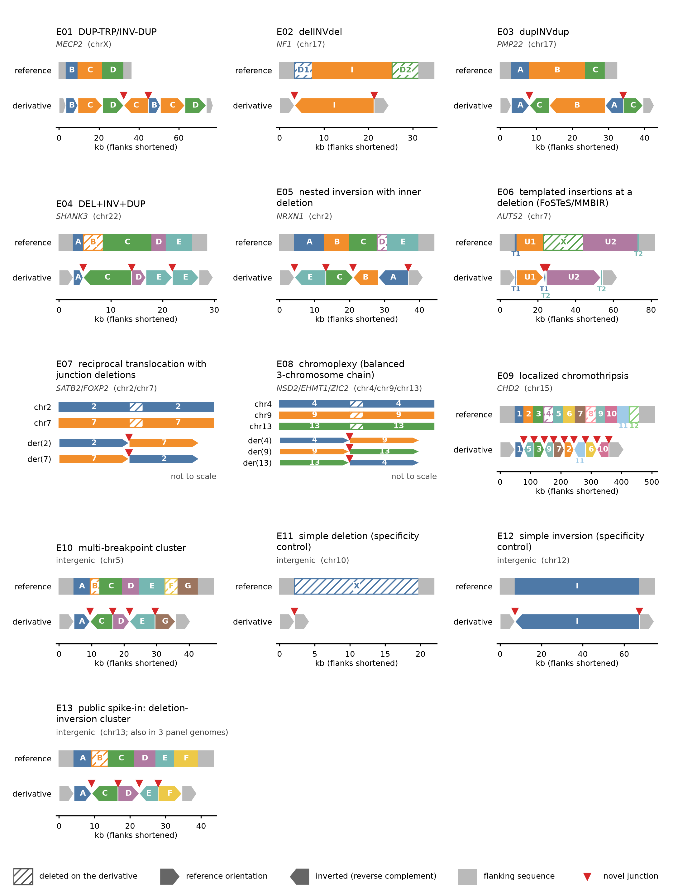
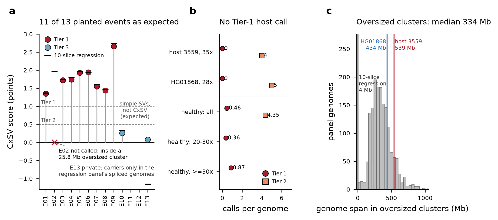
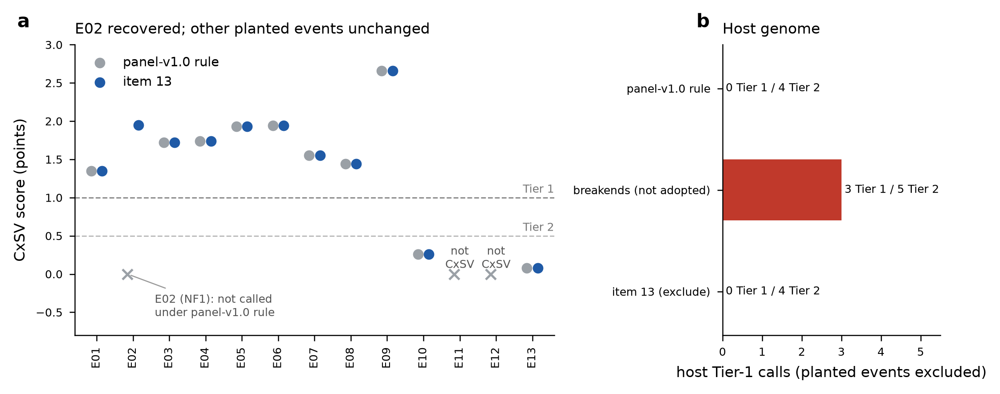
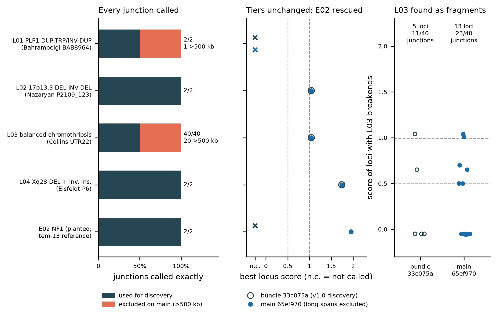
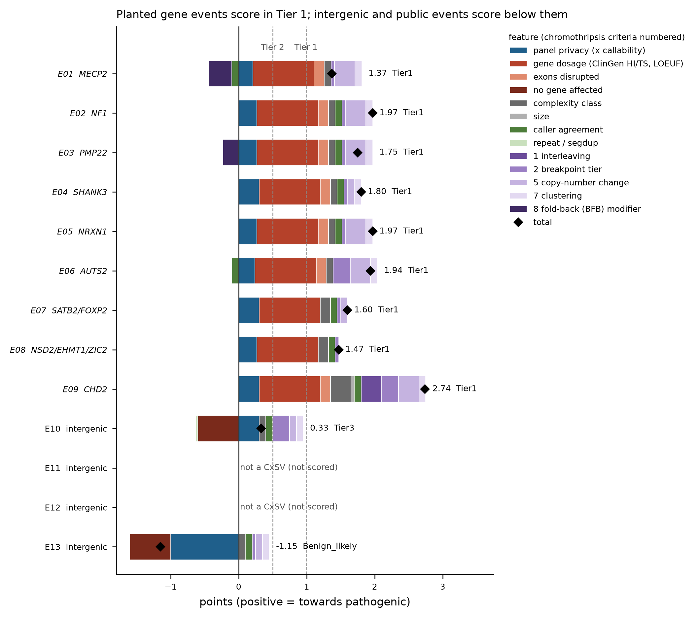

# Positive control: sample 3559 with a catalogue of planted CxSVs

The lab positive control is a real long-read genome (sample 3559, ONT R10.4.1,
~39x) into which thirteen heterozygous structural rearrangements have been
planted at known coordinates: ten complex SVs of different mechanisms, two
simple SVs that must **not** be called complex, and one complex SV (E13) that is
also planted in 3 of the regression's background genomes and must therefore
come out **public**. It tests the whole patient path on real background
sequence and real host variation: calling, CxSV clustering and classification,
breakpoint-level panel matching (a planted event must come out *private*, E13
*public* with 3 carriers) and the private VCF.

> **Data handling.** Sample 3559 is exempt (Chris Faulk, 2026-10-28), so
> its derived tables may be shared like the public panel data. The CRAMs stay
> on the lab NAS because of their size (~105 GB each); the repository holds the
> generator code, `events.yaml`, the truth set and summary counts. CI runs the
> fully synthetic test in `tests/synthetic/` instead.



*Figure: structure of each planted event, drawn from `events.yaml` by
`tests/positive_control/plot_events.py`. Top track per panel: reference,
segments to scale, deleted segments hatched. Lower track(s): derivative
haplotype(s), arrows pointing left are reverse-complemented. A segment keeps its
letter and colour in every track; red triangles mark novel junctions (the truth
set). Flanks are shortened; the two inter-chromosomal events are drawn
schematically. E13 is the public spike-in (also in 3 panel genomes).*

## The catalogue

Coordinates are T2T-CHM13v2 (UCSC hs1 names), 0-based half-open. All events
are heterozygous (host is female, so the chrX event at *MECP2* is
heterozygous as well). Path notation: segments 5'->3' on the derivative
haplotype, `+` reference orientation, `-` reverse complement, `p`/`q` flanks.

| ID | Event | Gene(s) | Span (hs1) | Derivative path | Expected class |
|---|---|---|---|---|---|
| E01 | DUP-TRP/INV-DUP | *MECP2* | chrX:152,320,014-152,349,014 | `der: p+ B+ C+ D+ C- B+ C+ D+ q+` | DUP+INV |
| E02 | delINVdel | *NF1* | chr17:32,243,849-32,271,849 | `der: p+ I- q+` | DEL+INV |
| E03 | dupINVdup | *PMP22* | chr17:15,140,559-15,166,559 | `der: p+ A+ C- B- A- C+ q+` | DUP+INV |
| E04 | DEL+INV+DUP | *SHANK3* | chr22:51,207,890-51,230,915 | `der: p+ A+ C- D+ E+ E+ q+` | DEL+DUP+INV |
| E05 | nested inversion with inner deletion | *NRXN1* | chr2:50,453,329-50,488,904 | `der: p+ E- C+ B- A- q+` | DEL+INV |
| E06 | templated insertions at a deletion (FoSTeS/MMBIR) | *AUTS2* | chr7:71,340,258-71,406,158 | `der: p+ T1+ U1+ T1+ T2- U2+ T2+ q+` | INS+DEL |
| E07 | reciprocal translocation with junction deletions | *SATB2*/*FOXP2* | chr2:199,854,293-199,856,293; chr7:115,868,955-115,869,905 | `der(2): p_chr2+ q_chr7+ / der(7): p_chr7+ q_chr2+` | BND_cluster |
| E08 | chromoplexy (balanced 3-chromosome chain) | *NSD2*/*EHMT1*/*ZIC2* | chr4:1,931,409-1,931,784; chr9:149,997,337-149,997,837; chr13:99,195,184-99,195,684 | `der(4): p_chr4+ q_chr9+ / der(9): p_chr9+ q_chr13+ / der(13): p_chr13+ q_chr4+` | BND_cluster |
| E09 | localized chromothripsis | *CHD2* | chr15:90,515,727-90,925,728 | `der: p+ S1+ S5- S3+ S9- S7+ S2+ S11- S6+ S10- q+` | Chromothripsis_like |
| E10 | multi-breakpoint cluster | intergenic | chr5:25,003,550-25,041,800 | `der: p+ A+ C- D+ E- G+ q+` | Multi_breakpoint_cluster |
| E11 | simple deletion (specificity control) | intergenic | chr10:29,098,000-29,115,650 | `der: p+ q+` | not a CxSV |
| E12 | simple inversion (specificity control) | intergenic | chr12:74,754,175-74,814,325 | `der: p+ I- q+` | not a CxSV |
| E13 | public spike-in: deletion-inversion cluster (also in HG00125, HG00111, HG00096) | intergenic | chr13:54,982,500-55,017,500 | `der: p+ A+ C- D+ E- F+ q+` | Multi_breakpoint_cluster; **public, 3 carriers** |

Placement rules (`design_events.py`, seed 3559): each catalogue template is
centred on its gene (gene events must disrupt an exon); every breakpoint is
moved by up to +/-5 kb to sequence with no segmental duplication within 10 kb
and <=30% soft-masked bases within +/-250 bp, so that the control measures the
pipeline rather than mappability. 37 novel junctions in E01-E12, 41 with E13.

E13 was added on 2026-10-28 (roadmap item 3) with the same placement rules:
`design_events.py --append-to events.yaml --only E13` places it while avoiding
every existing event and re-writes E01-E12 unchanged (checked: identical
entries and identical text). It is intergenic (no gene within 200 kb of the
event), so it never competes with the gene events in pathogenicity scoring
(item 5): 6 segments over 35 kb, B deleted, C and E inverted, 4 junctions.
Expected: a CxSV, **public with exactly 3 panel carriers**.

## How it is built

All stages are scripts in `tests/positive_control/`; outputs live under
`/mnt/sargasso1/CxSV/datasets/pos_control/`.

1. **Host realignment.** The original unaligned modBAM
   (`/mnt/pacific/monkey_meth/Human_raw_data/modbams/BloodofChildren_3559.allC.m6A.mod.bam`;
   dorado 0.8.3, `dna_r10.4.1_e8.2_400bps_sup@v5.0.0`) is realigned exactly like
   the background panel: `samtools fastq -T MM,ML,MN,qs | minimap2 2.24-r1122
   -y -x map-ont -a --eqx -K 4g` (k17 hs1 index), RG `ID:3559 SM:pos_control_3559`.
   13,928,513 reads in = 13,928,513 primary alignments out. -> `host/`
2. **Event design** - `design_events.py` -> `events.yaml`.
3. **Haplotypes and truth** - `build_haplotypes.py events.yaml hs1.fa build --check`
   writes, per event, `alt.fa` (derivative haplotype(s) with 150 kb flanks),
   `ref.fa` (the matching reference windows) and `replace.bed` (event span
   +/- 50 kb), plus `truth/` (`truth_junctions.tsv`, `truth.vcf` as VCF 4.2
   breakends with `GT 0/1`, `truth_events.bed`, `copy_number.tsv`). -> `build/`
4. **Read model** - Badread 0.4.2 error and q-score models trained on 20,000
   host reads aligned with `minimap2 -c`; read lengths and identities fitted to
   the host (200,000 reads: mean 7,110 bp, SD 8,683, N50 12,836; identity mean
   98.09%, SD 2.96 over 17,236 MAPQ>=20 alignments). The beta maximum is capped
   at 99.8% because the host 99.5th-percentile identity is 100%. Chimeras, junk
   and random reads, glitches and adapters are off. Check run: simulated reads
   had mean length 7,112 bp, identity 97.98% (SD 2.97) and mean read Q 39.5
   (host 39.1). -> `sim_model/`
5. **Simulate and splice** - `simulate_and_splice.py`: per event, local depth
   = median host depth over the replace windows; the derivative and the
   reference windows are each simulated at half that depth (one copy each).
   Simulated reads are aligned like the host. Every host read with any alignment
   in a replace window is removed (all its records); every simulated read with
   any alignment in a replace window is added (all its records). Simulated
   reads carry `RG ID:sim` with the host's `SM`, are named
   `sim_<event>_<alt|ref>_<n>` (origins in `sim_read_origins.tsv`) and have
   **no MM/ML methylation tags**. `check_splice.py` compares host and spliced
   depth in 2 kb bins across each window. -> `release/`

6. **E13 spike-in (add-on, spliced at regression time)** - `build_haplotypes.py`
   on the E13-only catalogue, then `make_spikein_reads.py`: for the control and
   each of the 3 background carriers, badread simulates the derivative and the
   reference window at half the host's local depth each (control 43x, HG00125
   30x, HG00111 25x, HG00096 25x), seeds 3559*100+host index. Reads are aligned
   like the panel (`RG ID:sim_E13`, `SM` = the host's own), and those with an
   alignment in the replace window (chr13:54,932,500-55,067,500) are kept.
   -> `addons/E13/` (`events_E13.yaml`, `build/`, `truth/`, `reads/<host>.E13.sim.bam`,
   `reads/simulation_plan.tsv`, `MD5SUMS`).

   **Why at regression time, not in a new control release:** the background
   genomes must be spliced at regression time anyway, because they are sliced
   from the public 1kGP CRAMs on every run. A new release would duplicate the
   ~105 GB control CRAM for one event. The release CRAM, its `truth/` (E01-E12)
   and `MD5SUMS` stay byte-identical. Determinism holds because the spliced
   reads are fixed, checksummed files (the regression runs `md5sum -c` on
   them first) and the splice (`samtools view -N ^dropped | samtools merge`)
   is deterministic. The scorer reads E13's truth from `addons/E13/truth` via
   `--extra-truth`.

## Running the regression

```bash
conda activate cxsv-pipeline
bash tests/lab/pos_control_regression.sh ~/scratch/cxsv_posctrl_regression 10
RERUN=1 bash tests/lab/pos_control_regression.sh ...   # plus determinism check
```

The script does the following:

1. Slices every replace window (release + E13 add-on) +/- 1 Mb from the
   control and from 10 background genomes (registry sheet, first 10 with
   `passes_17x`).
2. Splices E13 into the control slice and into the slices of its 3 carriers.
   It stops if a carrier is not among the backgrounds.
3. Builds a panel from the background slices, including junction sites and
   Sniffles2 population genotypes, with sex and superpopulation from the
   registry `individuals.tsv`.
4. Runs the patient workflow on the control slice.
5. Scores the result with `score_pos_control.py`: junctions are matched within
   +/-1 kb, and each event's verdict is checked against `expect` in
   `events.yaml`:
   - complex events must be CxSV loci that are **not public** (private or
     shared_junctions, 0 rearrangement carriers);
   - E13 must be **public with exactly 3 carriers**;
   - the simple controls E11/E12 must not be CxSVs, and every one of their
     truth junctions must be **matched on breakpoints** by a patient junction
     with 0 panel carriers.

Exit 0 means every event meets its expectation or is a listed known failure
that still fails. Since roadmap item 5, the expectations include the score
(`expect.score`): `top` means the top tier, `below_top` means not top tier and
below every `top` event, and `not_scored` means no scored locus. With
`RERUN=1`, the patient workflow runs again into a fresh results root. The
records of the merged VCF, the CxSV summary, the junction, panel-status and
catalogue tables, the locus depth and all scoring outputs must then be
byte-identical.

### Whole genome against a full panel release, from the offline bundle

```bash
B=/mnt/sargasso1/CxSV/bundles/cxsv-bundle-20261103-33c075a22071
bash $B/repo/tests/lab/pos_control_full_genome.sh $B ~/scratch/pc_full 12   # 12 cores on freya: ~2 h (splice 864 s + run 6,324 s)
python tests/positive_control/full_panel_report.py IN OUT                    # tables + figure
```

This driver builds no panel and slices nothing:

- It checks the control's MD5 and CRAM version. A CRAM 3.1 input is transcoded
  to 3.0 as the panel build did, because mosdepth 0.3.10 cannot decode 3.1.
- It splices the E13 add-on over the whole genome; `ADDONS="dir ..."` splices
  others too, such as the literature add-ons L01-L04, and `EVENTS` names the
  event list to score (section "Literature add-ons" below).
- It runs `run_cxsv.sh patient` (network off) against the bundle's own release
  and scores with `score_pos_control.py`. All of it runs inside the bundle's SIF.
- Verdicts are reported, not enforced: against a real panel E13 is expected to
  FAIL (see the full-panel result below).

## Splice checks (2026-10-28)

- Host: 13,928,513 reads in the original modBAM = 13,928,513 primary
  alignments after realignment; ~39x on autosomes, chrX 39.7x, chrY 0.92x
  (female; chrX/autosome mean-depth ratio 1.03).
- Simulated: local depth 32-43x per event, split 1:1 between the derivative
  and the reference copy (`release/truth/simulation_plan.tsv`).
- Spliced: 11,176 host reads removed, 11,855 simulated reads added; final
  primaries 13,929,192 (= 13,928,513 - 11,176 + 11,855).
- Depth (2 kb bins, windows +/- 25 kb, `check_splice.py`): spliced/host ratio
  median 0.99 over 1,501 bins, 0.96 over the 29 window-edge bins; 5th-95th
  percentile 0.62-1.39, the spread expected for two independent samplings at
  ~38x with 7 kb reads. Simulated depth is flat at the window median, so the
  host's own local depth variation does not continue inside a window.
- Release (`/mnt/sargasso1/CxSV/datasets/pos_control/release/`):
  `pos_control_3559.hs1.minimap2.cram` (md5 77d1b04f9c27fcd9d6b4b25a469743eb),
  `truth/`, `MD5SUMS`.

## Full-panel result (2026-11-03, panel-v1.0, whole genome, from the offline bundle)

The whole-genome control scored against the real panel release, run from the
validated offline bundle. Nothing is sliced and no panel is built. Driver:
`tests/lab/pos_control_full_genome.sh BUNDLE WORKDIR [CORES]`; report, tables
and figure: `tests/positive_control/full_panel_report.py`.

| | |
|---|---|
| bundle | `cxsv-bundle-20261103-33c075a22071` (commit `33c075a`, see docs/RELEASE_AND_BUNDLE.md section 6a) |
| panel release | `cxsv-panel-20261102-cd7e1d194cd4` (tag `panel-v1.0`; 1,619 genomes, 1,582 individuals). VERIFIED before and after the run: 1,634 files, manifest sha256 `928d721a…` unchanged |
| fingerprint | this run `cd7e1d194cd4…` = panel `cd7e1d194cd4…`: COMPATIBLE |
| input | `release/pos_control_3559.hs1.minimap2.cram` (md5 `77d1b04f…`, matches `MD5SUMS`). **CRAM 3.0**, so no 3.1 → 3.0 transcode was needed. All 25 `@SQ` M5 are in the bundle's cache |
| E13 | the add-on (MD5SUMS OK) spliced over the whole genome, as the regression does for its slice: 760 read names (847 records) in `E13.replace.bed` dropped, 914 simulated records added; 18,558,204 → 18,558,271 records (checked), written as CRAM 3.0 in 864 s |
| run | Singularity, `--containall --net --network none`, 12 cores on freya: patient workflow **6,324 s** (1 h 45 min; SVIM is the critical path); driver total 6,515 s with the splice reused from the first attempt (the splice itself takes 864 s) |
| depth | host ~35x (median flank depth at MAPQ ≥ 20) |



*Figure. (a) Each planted event's best-scoring CxSV locus: whole genome against
panel-v1.0 (dots, coloured by tier) and the 10-slice regression (black ticks),
with the Tier 1 and Tier 2 thresholds (dashed). E11 and E12 are simple SVs and
must not be CxSVs. (b) Tier-1 and Tier-2 calls per genome outside the planted
events, for the host and for the HG01868 stand-in (validation genome, not in the
panel). These are compared with healthy panel genomes scored leave-one-family-out
by the same scorer (item-10 calibration; n = 1,619 all, 292 at 20-30x, 628 at
≥30x; Tier 2 by stratum was not computed). (c) Genome span inside clusters that
the classifier drops whole as `FILTERED_oversized_cluster`, per panel genome
(n = 1,619), against the host, the stand-in and the 10-slice regression.*

| ID | Gene | Junctions exact/partial/missed (max offset bp) | Class | Panel status (carriers) | Junctions seen in panel | Score | Tier | 10-slice regression: status, score, tier | Panel genomes with the event span in an oversized cluster | Verdict |
|---|---|---|---|---|---|---:|---|---|---:|---|
| E01 | MECP2 | 2/0/0 (0) | Complex_inversion | private (0) | 0/2 | 1.35 | Tier1 | private (0), 1.37, Tier1 | 3/1619 | PASS |
| E02 | NF1 | 2/0/0 (1) | **no CxSV locus** | . | . | . | . | private (0), 1.97, Tier1 | 952/1619 | FAIL |
| E03 | PMP22 | 2/0/0 (1) | Complex_inversion | private (0) | 0/3 | 1.72 | Tier1 | private (0), 1.75, Tier1 | 9/1619 | PASS |
| E04 | SHANK3 | 3/0/0 (1) | DUP+INV | private (0) | 0/4 | 1.74 | Tier1 | private (0), 1.80, Tier1 | 0/1619 | PASS |
| E05 | NRXN1 | 4/0/0 (3) | Nested_SV | private (0) | 0/4 | 1.93 | Tier1 | private (0), 1.97, Tier1 | 72/1619 | PASS |
| E06 | AUTS2 | 3/0/0 (8) | DUP+INV | private (0) | 0/4 | 1.94 | Tier1 | private (0), 1.94, Tier1 | 454/1619 | PASS |
| E07 | SATB2/FOXP2 | 2/0/0 (3) | BND_cluster | private (0) | 0/2 | 1.55 | Tier1 | private (0), 1.60, Tier1 | 153/1619 | PASS |
| E08 | NSD2/EHMT1/ZIC2 | 2/1/0 (1) | BND_cluster | private (0) | 0/2 | 1.44 | Tier1 | private (0), 1.47, Tier1 | 56/1619 | PASS |
| E09 | CHD2 | 9/0/0 (438) | Chromothripsis_like | private (0) | 0/10 | 2.66 | Tier1 | private (0), 2.74, Tier1 | 4/1619 | PASS |
| E10 | intergenic | 4/0/0 (2) | Multi_breakpoint_cluster | private (0) | 0/6 | 0.26 | Tier3 | private (0), 0.33, Tier3 | 27/1619 | PASS |
| E11 | intergenic | 1/0/0 (1) | not a CxSV locus | . | . | . | . | not a CxSV (expected) | 96/1619 | PASS |
| E12 | intergenic | 2/0/0 (1) | not a CxSV locus | . | . | . | . | not a CxSV (expected) | 622/1619 | PASS |
| E13 | intergenic | 4/0/0 (1) | Nested_SV | private (0) | 0/4 | 0.08 | Tier3 | public (3), -1.15, Benign_likely | 11/1619 | FAIL |

*Junctions seen in panel: the best locus's junctions with ≥ 1 panel carrier
(`Panel_Junctions_Seen/Panel_Junctions`); 0 for every planted locus. Max offset:
the largest distance (bp) between a truth breakpoint and the closest matching
call, over the exact junctions. E04's 903 and E09's 95 region-overlap carriers
are panel loci that overlap the span but share no junction (hotspots).*

**Detection.** 40 of 41 truth junctions exact, 1 partial (E08's chr4-chr9
junction, as in the regression), 0 missed. Classes match
`ideal_class` for 10/11 CxSV events; the exception is E02, which has no locus.

**Privacy and scores.** Every called planted event is private, with 0
carriers and none of its junctions seen among the 1,582 panel individuals.
The scores are 0.00-0.08 below the 10-slice regression because the private
bonus is weighted by panel callability (0.30 × Panel_Callable/Panel_Individuals),
which is below 1 on the real panel. They are identical to item 10's re-scoring
of the slice calls against the full panel (`score_pos_control_full_panel.sh`):
the whole-genome calling reproduces the slice calling at these loci.
E01, E03-E09 are Tier 1; E10 is Tier 3 (intergenic, `below_top` as expected).

**E13 is private: a panel-composition effect, not a defect.** E13 is public in
the regression only because the regression splices its simulated reads into 3
of its 10 background genomes (HG00125, HG00111, HG00096). The real genomes of
those individuals in panel-v1.0 do not carry it, so against the real panel no
individual shares any of E13's 4 junctions. Its `public, 3 carriers`
expectation cannot hold against a real panel; the verdict FAIL is expected and
is not added to `known_failures.tsv`, which is for the regression. E13 scores
0.08 (Tier 3): no_genes -0.60, panel_privacy +0.23, complexity_class +0.10.

**E02 (*NF1* delINVdel) is lost in the whole genome: a new finding.** Both
junctions are called exactly (Sniffles2 + cuteSV, the same 5 records as in the
slice). In the whole genome, `bedtools cluster -d 50000` (rule `cluster_sv`,
`cxsv_params.cluster_distance` 50 kb), which joins records whose intervals
overlap or lie within 50 kb,
also chains them to multi-megabase records across the chr17 pericentromere. Examples: `Sniffles2.DEL.814S11`, a 25.7 Mb DEL at
chr17:16.7-42.4 Mb, and two SVIM INV/BND records of the same span. This gives
cluster 1953, chr17:16,672,217-42,437,362: 25.8 Mb, 189 records, 184 junctions.
Any cluster over `max_cluster_size` (500 kb) is dropped whole
(`FILTERED_oversized_cluster`), with E02 inside it. A ±1 Mb slice cannot contain such records,
which is why the regression never showed it. The effect is genome-wide (panel c):

- the host has 20 oversized clusters covering 539 Mb (largest 130 Mb, chr1);
- HG01868 has 16 covering 434 Mb;
- the 10-slice regression has 1 covering 4.4 Mb;
- in the panel, 1,616 of 1,619 genomes have at least one: median 12 clusters
  and 334 Mb per genome (5th-95th percentile 158-636 Mb; mean
  359 Mb, about 11% of the genome).

The E02 span lies inside an oversized cluster in 952 panel genomes, E06's in
454 and E12's in 622. Two consequences:

- CxSVs inside these spans are not called, in patients or in panel genomes.
- Privacy is not affected, because matching is junction-by-junction against all
  junction sites, not only CxSV loci.

The fix belongs to the calling (fingerprinted) code: for example, keep records
longer than `max_cluster_size` out of cluster linkage, or split oversized
clusters at those records. It would change the fingerprint and need a new
panel release (per-sample classification and aggregate, not the callers).
This is a decision for the PI (docs/ROADMAP.md).

**The host's own calls.** 1,054 CxSV loci lie outside the planted events: 1 private (Benign_likely),
121 `shared_junctions`, 932 public. By tier: **0 Tier 1**, 4 Tier 2, 25 Tier 3,
1,025 Benign_likely. A healthy panel genome has 0.457 Tier-1 calls on average
(0.868 at ≥30x) and 4.35 Tier-2 calls (item-10 calibration, deployed scorer,
leave-one-family-out). The host is within that range: at 0.868, P(0 Tier-1
calls) = 0.42. The HG01868 stand-in (974 loci, ~28x) also has 0 Tier 1 and 5
Tier 2. The 4 host Tier-2 calls:

| Locus | Size | Class | Panel status (carriers) | Genes | Score | Main contributions |
|---|---:|---|---|---|---:|---|
| chrX:32,547,958-32,608,507 | 60.5 kb | Multi_breakpoint_cluster | public (1,380) | *DMD* broken | 0.72 | public -1.00; gene_dosage +0.90; cn_oscillation +0.30 |
| chr19:32,981,723-32,985,224 | 3.5 kb | Nested_SV | shared_junctions (0; 1/2 junctions seen, f = 0.50, below the graded ramp) | *ZNF536* broken | 0.65 | gene_dosage +0.30; complexity_class +0.10; caller_agreement +0.10 |
| chr2:1,687,266-1,871,455 | 184 kb | Multi_breakpoint_cluster | public (584) | *MYT1L*, *PXDN* broken | 0.60 | public -1.00; gene_dosage +0.90; breakpoint_tier +0.25 |
| chr16:95,478,668-95,535,709 | 57 kb | Multi_breakpoint_cluster | public (1,178) | *ANKRD11* broken | 0.50 | public -1.00; gene_dosage +0.90; breakpoint_tier +0.25 |

Three of the four are common panel loci (584-1,380 carriers) that still reach
Tier 2 through gene-dosage points; the public penalty (-1.00) does not take them
below 0.50. The *EHMT1* host locus (chr9:150,076,936-150,111,418), Tier 1 before
item 10 on the regression, is public against panel-v1.0 (14 carriers):
0.00, Tier 3.

**Defect found and fixed on the way (PI-approved, commit `33c075a`).** The
first run, from bundle `cxsv-bundle-20261103-dc7f582c01cc` (superseded; deleted
2026-11-04, PI-approved),
failed at rule `locus_depth`. Sniffles2 2.8.1 wrote a PAR1 BND
(`Sniffles2.BND.90AS7`, chrX:142,943) whose ALT mate contig is `chrN`
(`CHR2=chrY`). `locus_segments.py` made depth intervals on `chrN`, and
`samtools bedcov` exited 2. Breakends on contigs absent from the reference now
get no interval; the count is logged (here `chrN 1`), and a unit test covers it.
`locus_segments.py` is outside the calling fingerprint.

## Item 13 check (2026-11-04, whole genome against panel-v1.0)

A check of the item-13 discovery change, not an input to it
(docs/OVERSIZED_CLUSTERS.md section 4c). The bundle run above was re-used with
its Snakemake metadata and this branch's code bound over the bundle's repo
(`calibration/oversized_clusters/pc_check.sh`); Snakemake re-made only the
downstream and patient rules (17 jobs, 1,455 s), with `allow_fingerprint_mismatch`
because the panel is still panel-v1.0. Records longer than 500 kb (47 in this
genome) take no part in discovery.

| | panel-v1.0 rule | item 13 |
|---|---|---|
| E02 *NF1* delINVdel | not called (25.8 Mb oversized cluster) | **private, Complex_inversion, Tier 1, 1.95** (regression 1.97) |
| E01, E03-E12 | | class, privacy, tier and score unchanged |
| E13 | private, Tier 3, 0.08 | unchanged (panel composition) |
| host Tier 1 / Tier 2 | 0 / 4 | 0 / 4 |
| loci scored | 1,065 | 1,246 |
| junctions | 40/41 exact, 1 partial | unchanged |

The first version of the change (clustering long records at their breakends,
`de23a0e`) also called E02 but gave the host 3 Tier-1 calls, each at an end
of a > 500 kb record whose whole interval was counted for genes; it was
replaced by excluding such records.



## Literature add-ons L01-L04 (roadmap item 11, 2026-11-04, whole genome against panel-v1.0)

Four published structures from the literature set (docs/LITERATURE_SET.md) are
planted as add-ons on host 3559, by the same mechanism as E13
(`tests/positive_control/literature_addons.py`). They live in
`/mnt/sargasso1/CxSV/datasets/pos_control/addons/L01..L04`, each with `addon.yaml`,
`reads/`, `truth/` and `MD5SUMS`. The combined event list is
`addons/events_E01-E13+L01-L04.yaml`. The release CRAM and the E01-E13 truth
are unchanged. Reads: badread 0.4.2, heterozygous.

| Add-on | Published event | hs1 | Mode |
|---|---|---|---|
| L01 | *PLP1* DUP-TRP/INV-DUP (Bahrambeigi 2019, BAB8964) | chrX:101,752,401-102,492,226 | full haplotype |
| L02 | 17p13.3 DEL-INV-DEL (Nazaryan-Petersen 2018, P2109_123) | chr17:2,154,467-2,685,421 | full haplotype |
| L03 | balanced germline chromothripsis, 40 junctions (Collins 2017, UTR22) | 28 windows on chr2/7/8/9, 7.0 Mb | windowed (100 kb per junction side) |
| L04 | Xq28 deletion + inverted 9q22.33 insertion (Eisfeldt 2024, P6) | chrX:151,998,369-152,053,304; chr9:109,768,705-109,770,177 | full haplotype |

```bash
A=/mnt/sargasso1/CxSV/datasets/pos_control/addons
B=/mnt/sargasso1/CxSV/bundles/cxsv-bundle-20261103-33c075a22071
ADDONS="$A/E13 $A/L01 $A/L02 $A/L03 $A/L04" EVENTS=$A/events_E01-E13+L01-L04.yaml SKIP_MD5=1 \
  bash tests/lab/pos_control_full_genome.sh $B W 12                      # bundle code
ADDONS=... EVENTS=... LITERATURE=/mnt/sargasso1/CxSV/resources/literature/lit-v1.0 \
  bash tests/lab/pos_control_rerun_downstream.sh $B W W_main CODE 12     # CODE's discovery, same calls
```

`pos_control_rerun_downstream.sh` copies the finished run and re-makes only the
downstream rules with another checkout, inside the bundle's SIF. Its dry run
must plan no caller, filter or merge rule, and the caller VCFs are checksummed
before and after. The fingerprint is recomputed and a mismatch is allowed
(`STRICT_FINGERPRINT=1` refuses it).

When BUNDLE is newer than the bundle of the source run (`SRC_BUNDLE`, by default
the one named in the source run's log), its reference MD5 cache has newer mtimes.
Under `--rerun-triggers mtime` that alone would re-run the reference check and
then every caller. Step 1b therefore requires the two `md5_manifest.tsv` files to
be byte-identical, and then marks the reference check, callers, filters and merge
as up to date with `snakemake --touch <merged_sv.vcf>`
(`tests/lab/lib/reuse_callers.sh`; the touch plan may hold only those rules).
Differing manifests stop the rerun. Touching `refcheck.ok` instead does not work,
because it is an input of every caller rule. CI tests this on a toy workflow
(`tests/synthetic/check_rerun_touch.sh`). The script is not part of the calling
fingerprint.

| Event | Junctions | Bundle 33c075a | Main 65ef970 (long spans excluded) |
|---|---|---|---|
| L01 | 2/2 exact | not called (20.2 Mb oversized chrX cluster) | not called (its 532.8 kb INV excluded; the 81.7 kb INV alone) |
| L02 | 2/2 exact | Complex_inversion, private, 1.04 Tier 1 | same |
| L03 | 40/40 exact | 5 loci, 11/40 junctions; best 1.04 Tier 1 | 20 junctions excluded; 13 loci, 23/40 junctions; best 1.04 Tier 1 |
| L04 | 2/2 exact | 2 BND_cluster loci, private, 1.74 Tier 1 | same |
| E02 | 2/2 exact | not called | 1.95 Tier 1 |

Junctions: 86 exact, 1 partial, 0 missed of 87 in both runs. E01 and E03-E13
are unchanged. On main, the scorer marks L03 FAIL only because its status
check counts host loci inside the 7 Mb of L03 windows (now classified;
`public`). Every locus with an L03 breakend is private (12) or
shared_junctions (1).



## Latest 10-slice regression result (2026-10-29, roadmap item 5: classifier on distinct junctions + scoring)

Fresh workdir `freya:/home/minknow/scratch/cxsv_item5_regression`, `CORES=24
RERUN=1`, 10 ONT backgrounds (first 10 with `passes_17x`), 16 regions (34.4 Mb),
E13 spliced into the control and into HG00125, HG00111 and HG00096. The
classifier change alters the calling fingerprint, so the panel was rebuilt:
test release `TEST-posctrl-slices-20261028-cd7e1d194cd4` (fingerprint
`cd7e1d194cd4`; it was `ad454c604bdd`). Run time 785 s. Scores come from
`config/scoring.yaml` defaults, with the four external catalogues from the NAS
(docs/SCORING.md).

| ID | Gene | Junctions exact/partial/missed | Class before (item 3 run) | Class now | Expected class (before → now) | Panel status (carriers) | Score | Tier | Top 3 contributions | Verdict |
|---|---|---|---|---|---|---|---:|---|---|---|
| E01 | MECP2 | 2/0/0 | Chromothripsis_like | Complex_inversion | DUP+INV → Complex_inversion | private (0) | 1.37 | Tier1 | gene_dosage +0.90; ct_bfb_modifier -0.34; ct_cn_oscillation +0.30 | PASS |
| E02 | NF1 | 2/0/0 | Chromothripsis_like | Complex_inversion | DEL+INV → Complex_inversion | private (0) | 1.97 | Tier1 | gene_dosage +0.90; ct_cn_oscillation +0.30; panel_privacy +0.27 | PASS |
| E03 | PMP22 | 2/0/0 | Chromothripsis_like | Complex_inversion | DUP+INV → Complex_inversion | private (0) | 1.75 | Tier1 | gene_dosage +0.90; ct_cn_oscillation +0.30; panel_privacy +0.27 | PASS |
| E04 | SHANK3 | 3/0/0 | Chromothripsis_like | DUP+INV | DEL+DUP+INV → DUP+INV | private (0) | 1.80 | Tier1 | gene_dosage +0.90; panel_privacy +0.30; exons +0.15 | PASS |
| E05 | NRXN1 | 4/0/0 | Chromothripsis_like | Nested_SV | DEL+INV → Nested_SV | private (0) | 1.97 | Tier1 | gene_dosage +0.90; ct_cn_oscillation +0.30; panel_privacy +0.27 | PASS |
| E06 | AUTS2 | 3/0/0 | DUP+INV | DUP+INV | INS+DEL → DUP+INV | private (0) | 1.94 | Tier1 | gene_dosage +0.90; ct_cn_oscillation +0.30; ct_breakpoint_tier +0.25 | PASS |
| E07 | SATB2/FOXP2 | 2/0/0 | Complex_other | BND_cluster | BND_cluster → BND_cluster | private (0) | 1.60 | Tier1 | gene_dosage +0.90; panel_privacy +0.30; complexity_class +0.15 | PASS |
| E08 | NSD2/EHMT1/ZIC2 | 2/1/0 | Complex_other | BND_cluster | BND_cluster → BND_cluster | private (0) | 1.47 | Tier1 | gene_dosage +0.90; panel_privacy +0.27; complexity_class +0.15 | PASS |
| E09 | CHD2 | 9/0/0 | Chromothripsis_like | Chromothripsis_like | Chromothripsis_like → Chromothripsis_like | private (0) | 2.74 | Tier1 | gene_dosage +0.90; panel_privacy +0.30; complexity_class +0.30 | PASS |
| E10 | intergenic | 4/0/0 | Chromothripsis_like | Multi_breakpoint_cluster | Multi_breakpoint_cluster → Multi_breakpoint_cluster | private (0) | 0.33 | Tier3 | no_genes -0.60; panel_privacy +0.30; ct_breakpoint_tier +0.25 | PASS |
| E11 | intergenic | 1/0/0 | not a CxSV | not a CxSV | - → - | - | - | not scored | - | PASS |
| E12 | intergenic | 2/0/0 | Nested_SV (CxSV) | not a CxSV | - → - | - | - | not scored | - | PASS |
| E13 | intergenic | 4/0/0 | Chromothripsis_like | Nested_SV | Multi_breakpoint_cluster → Nested_SV | public (3) | -1.15 | Benign_likely | panel_privacy -1.00; no_genes -0.60; complexity_class +0.10 | PASS |

Summary:

- **Junctions:** 40 of 41 exact, 1 partial (E08's chr4–chr9 junction), none
  missed. Unchanged.
- **Events:** 13 of 13 meet every expectation, scores included.
  `known_failures.tsv` is **empty**.
- **E12 is no longer a CxSV.** Its two Sniffles2 records (identical after
  SURVIVOR) are one junction with 2 breakends. Its junction is still matched
  on breakpoints with 0 panel carriers.
- **Detection and privacy verdicts unchanged** for E01–E11 and E13. E13 is
  public with 3 carriers; E04 is private (4 region-overlap carriers, hotspot).
- **Scoring:**
  - E01–E09 are all Tier 1 (1.37–2.74).
  - E10 (intergenic) scores 0.33 (Tier 3) and E13 (public) −1.15
    (Benign_likely), both below every gene event.
  - E11 and E12 are not scored.
  - The figure below shows each feature's contribution.
- **Class concordance:**
  - before (item-3 classifier): 1 of 11 complex events matched the original
    expected labels (E09);
  - after: 4 of 11 match the original labels (E07, E08, E09, E10), and 11 of 11
    match the revised expectations.
  - Seven expected labels were revised because the classes are now defined on
    *called* junction types. A deletion or duplication created by an
    inversion junction has no DEL/DUP record of its own. Each revision is
    recorded in `events.yaml` as `ideal_class_before` plus
    `ideal_class_reason`; the truth set is unchanged.
- **Determinism:** the second patient run gave byte-identical records for
  `merged_sv.vcf`, `cxsv/cxsv_summary.tsv`, `junctions/junctions.tsv`,
  `private/{cxsv_panel_status,junction_panel_status}.tsv`,
  `private/private_cxsv.vcf`,
  `private/{cxsv,junction}_catalogue_hits.tsv`, `scoring/locus_depth.tsv` and
  `scoring/cxsv_score{s,_features}.tsv` / `cxsv_score_report.md`.
- **Host loci outside the events:** 16 (12 public, 4 shared_junctions; 17
  before, the difference being a DEL pair now collapsed). 11 are contained in
  ≥ 1 external catalogue (max AF 0.45–0.83). 15 are Benign_likely. One,
  chr9:150,076,936–150,111,418 (*EHMT1*, shared_junctions), scores 1.00 and
  reaches Tier 1 (docs/SCORING.md section 7).
- **Copy number from read depth** matches the designs:
  - E01: 3,4,3 (MECP2 DUP-TRP/INV-DUP);
  - E02: 1,2,1;
  - E03: 3,2,3;
  - E07: 1 (the 2 kb junction deletion);
  - E09 and E10: losses at the deleted fragments.
  - Sex is inferred female from depth (chrX/autosome flank ratio 1.16;
    the splice check gave 1.03 genome-wide).
- **Fold-back / BFB modifier:** fires for E01 (subtelomeric) and E03, the two
  inverted-duplication designs, and lowers their chromothripsis points.



*Feature contributions (points) of each event's best-scoring CxSV locus;
diamonds are totals, and dashed lines the Tier 2 (0.5) and Tier 1 (0.99)
thresholds. n = 1 control genome against a 10-genome test panel. Drawn by
`tests/positive_control/plot_score_breakdown.py`.*

Score tables in the workdir:
- `score.events.tsv` (per event: score, tier, rank, top-3, class before/now);
- `score.cxsv_scores.tsv`, `score.features.tsv`, `score.report.md` (every
  scored locus);
- `score.junctions.tsv`, `score.offtarget.tsv`.

## Previous regression result (2026-10-28, roadmap item 3: breakpoint-level matching)

Patient workflow on the control slice (16 merged regions, 34.4 Mb, E13
included) against a panel of 10 ONT background genomes (first 10 with
`passes_17x`) sliced the same way. E13 was spliced into the control (760 host
reads dropped, 914 simulated records added) and into HG00125, HG00111 and
HG00096. Workdir: `freya:/home/minknow/scratch/cxsv_item3_regression_v2`, run
with `RERUN=1`. The second patient run gave byte-identical records for
`merged_sv.vcf`, `junctions/junctions.tsv`, `private/cxsv_panel_status.tsv`,
`private/junction_panel_status.tsv` and `private/private_cxsv.vcf`.

| ID | Junctions exact/partial/missed | Pipeline class | Expected | Panel status (carriers) | Region-overlap carriers | Junction panel carriers | Verdict |
|---|---|---|---|---|---|---|---|
| E01 | 2/0/0 | Chromothripsis_like | private | private (0) | 0 | 0,0 | PASS |
| E02 | 2/0/0 | Chromothripsis_like | private | private (0) | 0 | 0,0 | PASS |
| E03 | 2/0/0 | Chromothripsis_like | private | private (0) | 0 | 0,0 | PASS |
| E04 | 3/0/0 | Chromothripsis_like | private | **private (0)**, hotspot | 4 | 0,0,0 | **PASS** (was a known failure) |
| E05 | 4/0/0 | Chromothripsis_like | private | private (0) | 0 | 0,0,0,0 | PASS |
| E06 | 3/0/0 | DUP+INV | private | private (0) | 0 | 0,0,0 | PASS |
| E07 | 2/0/0 | Complex_other (2 loci) | private | private (0) | 0 | 0,0 | PASS |
| E08 | 2/1/0 | Complex_other | private | private (0) | 0 | -,0,0 | PASS |
| E09 | 9/0/0 | Chromothripsis_like | private | private (0) | 0 | 0 x 9 | PASS |
| E10 | 4/0/0 | Chromothripsis_like | private | private (0) | 0 | 0,0,0,0 | PASS |
| E11 | 1/0/0 | not a CxSV | not a CxSV, junction private | - | - | 0 | PASS |
| E12 | 2/0/0 | **Nested_SV (CxSV)** | not a CxSV, junction private | private (0) | 0 | 0,0 | known failure (item 5) |
| E13 | 4/0/0 | Chromothripsis_like | **public, 3 carriers** | **public (3)** | 3 | 3,3,3,3 | **PASS** |

Summary:

- **Junctions:** 40 of 41 recovered exactly, 1 partially (E08's chr4-chr9
  junction, as before), none missed.
- **Events:** 12 of 13 meet their expectation; E12 is the only listed known
  failure.
- **Breakpoint matching:** E11's and E12's simple-SV junctions are matched on
  breakpoints (1/1 and 2/2) with 0 panel carriers.
- **Host loci outside the events:** the slices hold 17 CxSV loci of the
  host's own, 13 public and 4 shared_junctions. Region overlap had made 16 of
  17 public.

What changed with item 3:

1. **E04 now passes.** Its 4 patient junctions (3 INV, 1 DUP, after collapsing
   Sniffles2's reciprocal breakends) match no panel site. The different panel
   CxSV at the *SHANK3* hotspot is a cluster of deletions at
   chr22:51,150,520-51,229,698 and is still visible as 4 region-overlap
   carriers (`Panel_Hotspot = yes`). It no longer makes E04 public.
2. **E13 is public with exactly 3 carriers.** Each of its 4 junctions is
   carried by the 3 spiked background genomes and no other.
3. **E12 remains a known failure of the classifier, not of matching.** Its
   reciprocal breakends collapse to one junction for matching, but
   `classify_cxsv.py` still sees two records, and C2 (nested SV) fires.
   Fixing that is roadmap item 5 and was deliberately not done here.

Previous result (before item 3, region-overlap matching, 12 events): 36/37
junctions exact; E04 labelled public (4 carriers) because it overlapped the
hotspot CxSV; E12 called a CxSV.

Further findings (unchanged; for roadmap item 5):

1. **Class labels.** `annotate_cxsv.py` tests C5 (>=3 SVs in 10-50 kb)
   before the type-based labels. Compact events with 2-4 junctions are
   therefore labelled `Chromothripsis_like`; the label matched the expected
   class for 1 of 11 complex events (E09). The README class table also omits
   the `Nested_SV`, `Overlapping_types` and `CN_plus_orientation_change` labels
   the code emits.
2. **Caller support.** 13 of the 37 E01-E12 junctions are recovered by
   Sniffles2 alone (SUPP_VEC 001), and the inter-chromosomal junctions (E07,
   E08) come mostly from SVIM/cuteSV records. Single-caller junctions
   therefore cannot be discounted in matching (docs/JUNCTIONS.md).

Score tables: `score.events.tsv`, `score.junctions.tsv` and
`score.offtarget.tsv` (the host's own CxSV loci) in the regression work
directory. `score.junctions.tsv` gives, for each truth junction, the patient
junction matched on breakpoints and its panel carriers.

## Replaces

The previous control (`BloodofChildren_3559.T2T.nested-inv.bam`, RefSeq
contig names) was meant to carry a nested inversion but holds a single ~100 kb
homozygous inversion at chr1:10,750,000-10,850,000: VISOR/LASeR simulated only
one haplotype, replaced the real reads of chr1:10-11 Mb, and gave ~2x depth
there. It is superseded by this control. On 2026-10-28 the BAM was moved to
the sargasso2 recycle bin, and the old `/mnt/sargasso2/CxSV` tree (renamed
`CxSV-old`) is scheduled for deletion; the old control is not kept.
