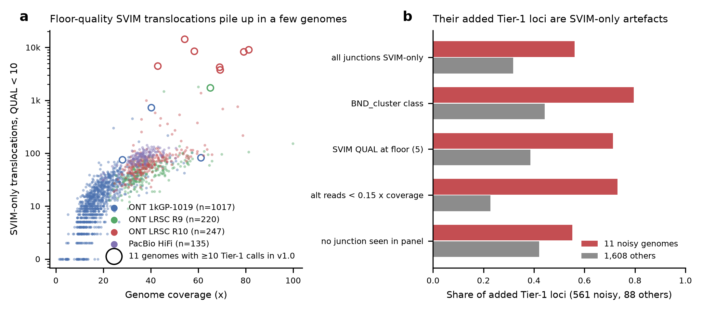
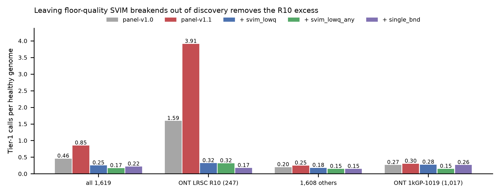

# Healthy Tier-1 excess in panel-v1.1: diagnosis and the adopted fix

**Status (2026-11-05): `svim_lowq` adopted by the PI as the default**
(`cxsv_params.single_caller_bnd_rule: svim_lowq`, `svim_min_qual_discovery: 10`
in config/calling.yaml). panel-v1.1 will be re-released from the merge commit,
downstream-only, into a new build root `/mnt/sargasso1/CxSV/build/panel-v1.1-r2`.
The first panel-v1.1 build (`cxsv-panel-20261104-64e10c1b1363`, below) is
**superseded and never tagged**; its build root `/mnt/sargasso1/CxSV/build/panel-v1.1`
is kept untouched as provenance. Branch `r10-excess-diagnosis` (off `main`
8aba785) holds the rule, the analysis code, the tables and figures and the
downstream-only rebuild scripts. Sections 1-6 are the diagnosis as reported on
2026-11-04; section 7 is the change.

## 1. Question

panel-v1.1 is `cxsv-panel-20261104-64e10c1b1363`, built from `main` 65ef970 with
the item-13 exclude rule; the build is recorded in docs/PANEL_BUILD.md,
"Downstream-only rebuild". On it, healthy-genome Tier-1 calls rose from 0.457 to
0.851 per genome (leave-one-family-out, deployed scorer with item-10 graded
privacy, all 1,619 panel genomes). That is over the +50% stop rule. The PI asked
for three things before any decision:

- why the added calls arise;
- why the genomes that carry them were already noisy in panel-v1.0;
- whether a narrow filter removes them without losing real events.

## 2. The panel-v1.1 bundle passed validation and the positive control

| check | result |
|---|---|
| bundle `cxsv-bundle-20261104-65ef970509da` (65ef970 + release `…64e10c1b1363`) | built in 221 s, 10,557,099,187 bytes |
| offline validation on stand-in HG01868 (`tests/lab/validate_bundle.sh`) | **8/8 PASS**, 0 failures, 11,860 s. Integrity; release; network off with Singularity and Docker plus controls; offline Singularity run (3,049 s); offline Docker run (2,749 s); run outside the bundle (4,403 s); records identical for 4 vs 6 and 5 vs 6; tampered releases refused |
| HG01868 result | 1,087 CxSV loci, 0 private, **0 Tier 1**, 5 Tier 2 |
| whole-genome positive control from the bundle | E01-E09 Tier 1 and E02 recovered (private Complex_inversion, 1.95). E10 Tier 3 (0.26). E11 and E12 not CxSV (PASS). E13 private Tier 3 (expected FAIL against a real panel). 40/41 junctions exact. **Host: 1,234 loci, 0 Tier 1, 4 Tier 2.** Release unchanged |

## 3. Diagnosis

Tables: `docs/r10_excess/added_tier1_loci.tsv` (one row per added Tier-1
locus) and `genome_callset_stats.tsv` (one row per genome). Code:
`calibration/r10_excess/diag_added_t1.py`.

**Which calls were added.** panel-v1.1 adds 649 Tier-1 loci and removes 11,
for 638 net. 561 of the 649 are in the 11 genomes that already had at least 10
Tier-1 calls in v1.0 (`noisy_genomes.tsv`):

- 7 LRSC R10: HG04176, HG03680, HG03224, HG03514, HG01860, HG04107, HG03788;
- 1 LRSC R9: HG01459;
- 3 ONT-1019: HG00268, HG01879, HG03009.

All 649 lie in spans that v1.0 dropped as oversized clusters. They were hidden
by the blind spot, not created by the exclude rule.

| property of the added Tier-1 loci | 11 noisy genomes (561) | 1,608 others (88) |
|---|---|---|
| BND_cluster class | 79.5% | 44.3% |
| every junction SVIM-only (`SUPP_VEC` 010) | 56.1% | 31.8% |
| every junction single-caller | 58.6% | 36.4% |
| median SVIM QUAL of their junctions | **5** (the `svim_min_qual` floor) | 10 |
| median best variant reads per junction | 5 | 18 |
| median variant reads / genome coverage | **0.09** | 0.47 |
| no junction seen in any other panel family | 55.3% | 42.0% |
| more than 10% segdup / satellite | 2.9% / 0.7% | 3.4% / 0% |
| median size | 41 kb | 31 kb |

The excess is SVIM-only translocation records at SVIM's quality floor. Each
has about 5 supporting reads, or 9% of the genome's coverage. Clustered within
50 kb of real, three-caller deletions, they turn simple deletions into
BND_cluster and CN_plus_orientation_change loci with gene content and private
junctions. Typical example: HG01459 chr11:9,131,188-9,160,882 is one 3-caller
DEL (44 reads) plus one SVIM-only BND (QUAL 5, 5 reads), Tier 1 at 1.25. Repeat
context does not explain it.

**Why these genomes were already noisy in v1.0.** It is not coverage.

- The 7 noisy R10 genomes carry **3,753-14,258** SVIM-only translocation records
  with QUAL < 10. The other 240 R10 genomes have a median of 62 and a maximum of
  1,376. The 7 are exactly the top 7 R10 genomes by this count (figure, panel a).
- Coverage-matched clean R10 genomes stay low: HG03663 at 76x has 755 and
  HG03382 at 70x has 688.
- Their reads carry more supplementary alignments, consistent with chimeric
  libraries (`read_profile.tsv`, chr20:30-32 Mb):

  | group | reads with an SA tag |
  |---|---|
  | 7 noisy R10 | 10.4-18.3% |
  | 6 clean R10, 63-79x | 6.8-11.8% |
  | 3 noisy ONT-1019 | 27-43% |
  | 3 clean ONT-1019, 47-54x | 15-18% |

  The R10 ranges overlap, so the SA rate is a contributing property, not a
  separator.
- Only SVIM calls these breakends. Sniffles2 and cuteSV, with their own support
  thresholds, do not.
- In v1.0 the same artefacts made the genomes' Tier-1 calls outside the giant
  clusters. In v1.1 they also make them in the regions the giant clusters used
  to hide.
- Two ONT-1019 genomes differ:
  - HG00268: its Tier-1 loci are mostly SVIM-only **deletions** at QUAL < 10.
  - HG01879: single-caller Sniffles2-only and cuteSV-only inversions plus
    SVIM-only deletions.

  Both already had 37 and 52 Tier-1 calls in v1.0, and item 13 barely changes
  them (43 and 73).



**Figure: diagnosis.**
- **(a)** SVIM-only translocation records with QUAL < 10 per panel genome, against
  coverage. Circles mark the 11 genomes with at least 10 Tier-1 calls in v1.0.
- **(b)** Properties of the 649 Tier-1 loci that panel-v1.1 adds, in those 11
  genomes versus the other 1,608.

## 4. Candidate fixes (discovery only; no scoring weight changed)

All three rules act at CxSV discovery, in `vcf_to_bed.py
--single-caller-bnd-rule` (`cxsv_params.single_caller_bnd_rule`). A record
they match is left out of clustering, exactly like a long-span record: it stays
a junction of the sample, a merged call and a panel junction site, and it is
listed in `cxsv/single_caller_filtered.tsv`. Panel junction sites, and with
them privacy matching, are therefore unchanged.

| rule | leaves out of discovery | records left out, all 1,619 genomes |
|---|---|---|
| `svim_lowq` | SVIM-only (`SUPP_VEC` 010) BND/TRA records with QUAL < 10 | 120,279 (median 24 per genome; 46% in the 11 noisy genomes) |
| `svim_lowq_any` | SVIM-only records of any type with QUAL < 10 | 2,548,136 |
| `single_bnd` | every single-caller BND/TRA record | 181,074 |

How each rule was tested:

- **Panel genomes.** Each rule was evaluated exactly, by re-running discovery on
  every panel genome's v1.1 `merged_sv.vcf` (`rerun_discovery.py`). With rule
  `keep` the driver reproduces the v1.1 per-sample outputs byte for byte (21
  genomes, 168 files). Then the full-panel leave-one-family-out re-score with the
  deployed scorer (`panel_rates.sh`, unchanged weights) against the v1.1 release.
- **Positive control and HG01868.** Downstream reruns of the bundle runs with
  the rule (`patient_rerun_downstream.sh`).
- **Literature test A** (63 events). Its synthetic call sets are all `SUPP_VEC`
  111 (282/282 records), so none of the rules can change it. On the v1.1
  release, main calls 8 of 63 events, 7 of them Tier 1.

| arm | T1/genome, all | R10 | R9 | ONT-1019 | PacBio | 1,608 others | 11 noisy | T2/genome | genomes with any T1 | CxSV loci / genome |
|---|---|---|---|---|---|---|---|---|---|---|
| panel-v1.0 | 0.457 | 1.591 | 0.273 | 0.265 | 0.126 | 0.200 | 38.1 | 4.35 | 15.4% | 980 |
| panel-v1.1 as built | 0.851 | 3.911 | 0.382 | 0.304 | 0.141 | 0.248 | 89.0 | 6.50 | 16.2% | 1,092 |
| **v1.1 + `svim_lowq`** | **0.251** | **0.320** | 0.141 | 0.275 | 0.126 | 0.179 | 10.8 | 3.33 | 13.9% | 1,071 |
| v1.1 + `svim_lowq_any` | 0.170 | 0.316 | 0.150 | 0.149 | 0.096 | 0.147 | 3.6 | 2.62 | 11.6% | 1,001 |
| v1.1 + `single_bnd` | 0.218 | 0.174 | 0.136 | 0.264 | 0.089 | 0.147 | 10.6 | 3.18 | 13.0% | 1,054 |

| arm | positive control | PC host Tier 1 / Tier 2 | HG01868 loci, Tier 1 / Tier 2 | test A called / Tier 1 |
|---|---|---|---|---|
| panel-v1.1 as built | E01-E12 PASS (E02 Tier 1 1.95, E07 Tier 1 1.55) | 0 / 4 | 1,087, 0 / 5 | 8 / 7 |
| **+ `svim_lowq`** | E01-E12 PASS, every score unchanged | 0 / 4 | 1,076, 0 / 4 | 8 / 7 |
| + `svim_lowq_any` | E01-E12 PASS, every score unchanged | 0 / 4 | 1,016, 0 / 4 | 8 / 7 |
| + `single_bnd` | **E07 lost**: its second junction is SVIM-only (QUAL 13) | 0 / 4 | 1,065, 0 / 4 | 8 / 7 |

E13 is private Tier 3 (0.08) in every arm, as expected against a real panel.
Under `svim_lowq` three genomes keep at least 10 Tier-1 calls: HG01879 (73) and
HG00268 (42), whose noise is not SVIM breakends, and HG01867 (R10, 32), whose
SVIM-only breakends have QUAL ≥ 10.



**Figure: candidate rules.** Healthy Tier-1 calls per genome (leave-one-family-out,
deployed scorer, all 1,619 panel genomes) for panel-v1.0, panel-v1.1 as built
and v1.1 with each candidate rule.

## 5. Recommendation

**Adopt v1.1 + `svim_lowq` and rebuild downstream-only.** *(Adopted 2026-11-05.)*

- It is the narrowest rule that removes the excess. It leaves out 120,279 SVIM
  records at the quality floor, 0.28% of the panel's 43,288,964 merged records,
  and nothing any other caller supports.
- Healthy Tier 1 goes to 0.251 per genome, below v1.0's 0.457, and R10 goes to
  0.320 (v1.0 1.591).
- The 1,608 other genomes fall from 0.200 to 0.179.
- Every positive-control event, the host (0 Tier 1), HG01868 (0 Tier 1) and
  literature test A are unchanged.

The other two rules:

- `svim_lowq_any` is stronger (0.170). It also leaves out 2,427,857 further SVIM-only records
  of other types and gives 6.5% fewer CxSV loci per genome than `svim_lowq`. It is less
  narrow than the evidence supports.
- `single_bnd` loses E07 and is rejected.

The rule changes the calling fingerprint (`vcf_to_bed.py`, `per_sample.smk` and
`cxsv_params`), so it needs:

- a merge to `main`;
- a downstream-only rebuild with `scripts/panel_build/rebuild_downstream.sh`
  (about 4 h on freya, see docs/PANEL_BUILD.md);
- a new release, bundle and validation.

The three residual noisy genomes (HG01879, HG00268, HG01867) are a separate,
pre-existing problem. Candidates are a coverage-relative support threshold or
library-chimerism QC; neither was tested here.

## 6. Reproduce

All runs were on freya, keurig and shadowfax. Build root
`/mnt/sargasso1/CxSV/build/panel-v1.1` (read only). Results in
`/mnt/sargasso1/CxSV/calibration/item13_v11` (v1.1 healthy rates) and
`/mnt/sargasso1/CxSV/calibration/r10_excess/<rule>/` (candidates).

```bash
# diagnosis (8 threads, ~10 min)
python3 calibration/r10_excess/diag_added_t1.py --v10 BUILD_v1.0 --v11 BUILD_v1.1 \
  --cal CAL_v1.1/after --old-scores CAL_item10/loci_scores_graded.tsv.gz \
  --satellite satellite.bed --per-genome-old lofo_v11_per_genome.tsv --out-prefix diag [--all-t1]
# one candidate: discovery rerun (~25 min) + full-panel LOFO (~1.5-2.5 h)
singularity exec -B /mnt/sargasso1 SIF python calibration/r10_excess/rerun_discovery.py \
  --panel BUILD_v1.1/results/panel --code . --out OUT --rule svim_lowq --aggregate-yaml BUILD_v1.1/aggregate.yaml
SIF=SIF SAMPLES_ROOT=OUT/samples SAMPLE_MANIFEST=OUT/sample_manifest.tsv REUSE_CAL=CAL_v1.1/after \
  bash calibration/oversized_clusters/panel_rates.sh BUILD_v1.1 OUT/cal 10
python3 calibration/oversized_clusters/panel_rates_collect.py --old-scores … --manifest OUT/sample_manifest.tsv --cal OUT/cal --out-prefix OUT/lofo
# positive control / HG01868 under a rule (~30-40 min each)
BINDS=… bash calibration/r10_excess/patient_rerun_downstream.sh BUNDLE SRC_RUN W . RUN_CONFIG 10 rule.yaml
bash calibration/r10_excess/score_patient_runs.sh BUNDLE . W pc_<rule> hg01868_<rule>
# figures
python calibration/r10_excess/figures_r10.py --diag-genomes … --diag-loci … --noisy docs/r10_excess/noisy_genomes.tsv --arms … --out-dir docs/figures/r10_excess
```

| file | role |
|---|---|
| `workflow/scripts/vcf_to_bed.py` | `--single-caller-bnd-rule keep, svim_lowq, svim_lowq_any or single_bnd` (command-line default keep) |
| `config/calling.yaml`, `workflow/rules/per_sample.smk` | `cxsv_params.single_caller_bnd_rule: svim_lowq`, `svim_min_qual_discovery: 10` (pipeline default; required keys) |
| `calibration/r10_excess/diag_added_t1.py` | per added Tier-1 locus and per genome diagnosis |
| `calibration/r10_excess/read_profile.py` | supplementary-alignment rate, read length, MAPQ |
| `calibration/r10_excess/rerun_discovery.py` | discovery rerun under a rule into a separate tree |
| `calibration/r10_excess/patient_rerun_downstream.sh`, `score_patient_runs.sh` | patient runs under a rule |
| `calibration/r10_excess/figures_r10.py` | figures |
| `calibration/oversized_clusters/panel_rates.sh`, `panel_rates_collect.py` | full-panel LOFO healthy rates |
| `tests/unit/test_single_caller_filter.py` | the rule and the config default (7 tests) |

## 7. Adopted change (2026-11-05)

- **Default.** `config/calling.yaml` `cxsv_params` gains
  `single_caller_bnd_rule: svim_lowq` and `svim_min_qual_discovery: 10`;
  `per_sample.smk` reads both keys from the config without a fallback. The
  `vcf_to_bed.py` command-line default stays `keep` (panel-v1.0 discovery), as
  `--long-span-rule` keeps its own command-line default.
- **What it changes.** Only CxSV discovery: the excluded records are still
  merged calls, junctions and panel junction sites, and are listed per sample in
  `cxsv/single_caller_filtered.tsv`. Literature test A passes the configured
  rule to `vcf_to_bed.py` (its records are all `SUPP_VEC` 111, so its result
  does not change).
- **Fingerprint.** `cxsv_params` and two fingerprinted files changed, so the
  calling fingerprint is new (reported in the branch's commit message and the
  rebuild's release id). A patient run with this code is refused by the
  panel-v1.0 release and by `…64e10c1b1363`; it needs the r2 release.
- **Rebuild (next round, after the merge).** From the merge commit into
  `/mnt/sargasso1/CxSV/build/panel-v1.1-r2`, upstream hard-linked from
  panel-v1.0 (docs/PANEL_BUILD.md, "Downstream-only rebuild"); release;
  full-panel LOFO with the stop rule *healthy Tier 1 must not exceed v1.0's 0.457
  per genome*; bundle; 8-check offline validation; positive control; docs branch.
- **Also on this branch.** `callable_mask.sh` logs `callable_bp` with `%.0f`
  (mawk's `%d` printed 2147483647 for every genome). The file is not
  fingerprinted, the mask itself is unchanged and the rule is held in a
  downstream-only rebuild.
