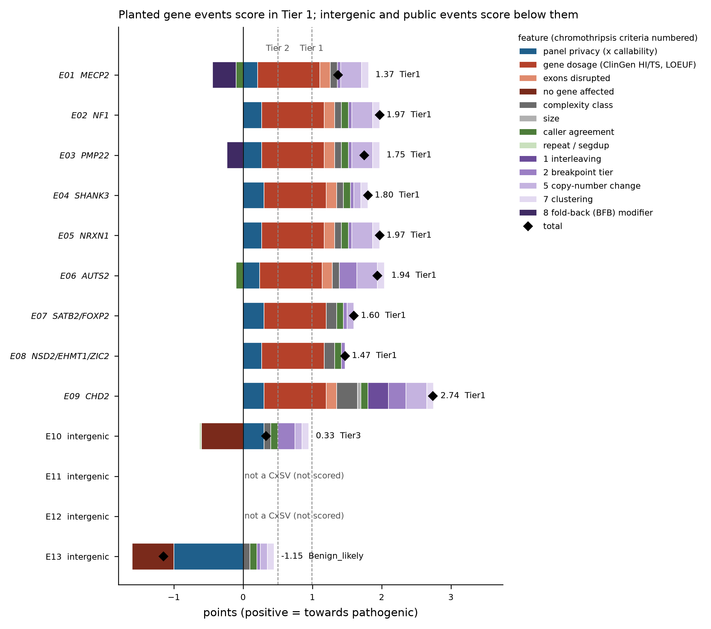

# Scoring patient CxSVs (roadmap item 5)

The patient workflow scores every CxSV locus of a patient with an **explicit,
configurable points system**. The system is modelled on the ACMG/ClinGen CNV
scoring framework (Riggs et al., *Genet Med* 2020) and adds computed
chromothripsis criteria from the PI's design document
*germline-chromothripsis-pipeline-criteria*. Nothing is learned: labelled
pathogenic CxSVs are too few. Every call's report lists each feature's raw
value, the rule applied and its points, then the total and a tier. A reviewer
can therefore see why a call ranked where it did.

> **Framing.** No threshold or weight here has been validated against a
> constitutional truth set. Following the PI's document, every number is an
> **operational, cohort-specific choice, not a validated cutoff**. The report
> says so in its header. The scores rank calls for expert review. They are not
> a classification of pathogenicity and not a diagnosis.

Code: `workflow/lib/cxsv_scoring.py` (features, pure functions),
`workflow/scripts/score_cxsv.py` (inputs, ranking, report),
`workflow/scripts/match_catalogues.py` (catalogue hits, roadmap item 4),
`workflow/scripts/locus_segments.py` (segments for read depth),
`workflow/rules/patient_scoring.smk`. Settings: `config/scoring.yaml`. Tests:
`tests/unit/test_scoring.py` (each feature, the catalogue matcher and both
scripts end to end), and the synthetic CI test, where PRIVATE must rank first
in Tier 1 with an HPO match and COMMON must be found in a synthetic catalogue.

Scoring is **not fingerprinted**. It does not decide which loci exist, so
weights can be changed and a patient rescored against the same calls and panel
release. The classifier changes that came with this item *are* fingerprinted
(see "Classifier changes" below).

## 1. Where it runs

```
cxsv_master_table ─► classify_patient_cxsv (panel status, item 3)
                        │
                        ├─► catalogue_hits   private/cxsv_catalogue_hits.tsv, junction_catalogue_hits.tsv,
                        │                    catalogue_check.tsv
                        ├─► locus_depth      scoring/locus_segments.bed → samtools bedcov → locus_depth.tsv
                        ├─► scoring_params   scoring/scoring_params.json (weights, tiers, resources, patient info)
                        └─► score_cxsv       scoring/cxsv_scores.tsv, cxsv_score_features.tsv, cxsv_score_report.md
```

- `cxsv_scores.tsv`: one row per locus, ranked. Columns: total, tier, top-3
  contributions, chromothripsis points, panel and catalogue columns, affected
  genes, and `<feature>_value` / `<feature>_points` for every feature.
- `cxsv_score_features.tsv`: the same in long format (locus, feature, group,
  value, points, rule).
- `cxsv_score_report.md`: a ranking table, then one section per call with its
  feature table, genes and copy-number segments, and the run's resource
  versions and catalogue checks.

## 2. Features and default points

Positive points weigh towards pathogenic. Totals are sums. Every weight is in
`config/scoring.yaml → weights`.

| Group | Feature | Rule (defaults) | Modelled on |
|---|---|---|---|
| privacy | `panel_privacy` | private: **+0.30 × Panel_Callable / Panel_Individuals** (absent where the panel could not see it is no evidence; unknown callability × 0.5); shared_junctions 0; public **−1.00** | ClinGen 4O (common in the population) |
| privacy | `catalogue_frequency` | the most severe catalogue that *contains* the locus (≥ 0.75 of its junctions matched): max AF ≥ 0.01 −1.00, ≥ 0.001 −0.50, lower or not given −0.25. Combined privacy = min(panel, catalogue); catalogues are **never summed** (they overlap each other and the panel) | ClinGen 4O |
| genes | `gene_dosage` | max over affected genes. A gene is **broken** (a breakend inside it), **lost** or **gained** (wholly inside a segment with a copy-number change from read depth). Broken: HI 3 +0.90, HI 2 +0.45, HI 1 +0.15. Lost: HI 3 +1.00 / 2 +0.45 / 1 +0.15. Gained: TS 3 +1.00 / 2 +0.45 / 1 +0.15. Without curated HI evidence (not curated, 0 or 30, never over a curated 40): gnomAD LOEUF < 0.35 +0.30, < 0.6 +0.15 | ClinGen section 2 (2A, 2E, 2H) |
| genes | `exons` | ≥ 1 exon in the rearranged interval or hit by a breakend +0.15 | ClinGen 2 (coding content) |
| genes | `gene_count` | ≥ 25 affected genes +0.45, ≥ 35 +0.90 | ClinGen section 3 |
| genes | `no_genes` | no gene broken, lost or gained, and no exon: −0.60 | ClinGen 1B |
| event | `complexity_class` | Chromothripsis_like +0.30, DEL+DUP+INV +0.20, BND_cluster +0.15, DEL+INV / DUP+INV / INS+DEL / Complex_inversion / Multi_breakpoint_cluster / Nested_SV +0.10, other +0.05 | |
| event | `size` | locus span ≥ 100 kb +0.05, ≥ 1 Mb +0.15 | |
| evidence | `caller_agreement` | ≥ 50% of junctions with ≥ 2 callers (SUPP_VEC) +0.10; all single-caller −0.10 | |
| evidence | `read_support` | a junction with < 5 supporting reads (max over the callers' SUPPORT / RE) −0.15 | |
| evidence | `artefact_context` | −0.30 × fraction of breakends (± 50 bp) in segmental duplications − 0.15 × fraction in simple repeats / low complexity / satellites (rebuilt per-element RepeatMasker) | artefact penalty |
| chromothripsis | `ct_interleaving` | largest interleaved junction component ≥ 3 +0.20, ≥ 6 +0.30 | PI criterion 1 |
| chromothripsis | `ct_breakpoint_tier` | intermediate (3–5 breakends) +0.05, extreme (> 5) +0.25 | PI criterion 2 |
| chromothripsis | `ct_cn_oscillation` | any copy-number change +0.10; a run of ≥ 3 segments alternating between two CN states +0.20. Supporting only, never a gate | PI criterion 5 |
| chromothripsis | `ct_clustering` | simulated q ≤ 0.2: +0.10 (descriptive) | PI criterion 7 |
| chromothripsis | `ct_bfb_modifier` | BFB-like (fold-backs ≥ 50% of inversion-type junctions, at least one over a CN gain): the chromothripsis points × 0.5 (× 0.25 if subtelomeric, < 5 Mb from a chromosome end) | PI criterion 8 |
| phenotype | `hpo_match` | optional: ≥ 1 patient HPO term matched by the affected genes' annotations +0.30, ≥ half +0.45 | ClinGen section 4 (phenotype specificity) |
| phenotype | `omim` | optional, **off by default** (needs the lab's licence: `scoring_resources.omim_genemap2`): an affected gene with an OMIM phenotype (mapping key 3) +0.15 | |
| inheritance | `inheritance` | optional (parents in the same run): de novo (absent in both) +0.45; inherited from an unaffected parent −0.30 (affected +0.15); one parent only: 0 | ClinGen 5A / 5D |

**Tiers** (total points; `config/scoring.yaml → tiers`):
`Tier1_high_priority` ≥ 0.99 (the ClinGen "pathogenic" boundary),
`Tier2` ≥ 0.50, `Tier3` ≥ 0, `Benign_likely` < 0.

### Feature details

- **Matching** is the item-3 matcher (`cxsv_matching.SiteIndex.query`)
  everywhere: panel, catalogues and parents. Svtype and contigs must agree and
  both ends lie within 500 bp. A catalogue site or a parent's junction is a
  point (its envelope is itself). There is one implementation.
- **Copy number (criterion 5).** For each locus, the distinct breakends define
  segments (trimmed by 200 bp), plus a 20 kb flank on each side after a 1 kb
  gap. `samtools bedcov -Q 20 -j` gives mean depth. CN = depth / flank
  baseline × the flank's ploidy. A change needs |CN − ploidy| ≥ 0.6. Ploidy:
  autosomes 2; chrX 1 in males outside the CHM13v2 PARs; chrY 1 in males.
  Sex comes from the sample sheet / `patients` config, or is inferred from the
  chrX / autosome flank depth (< 0.75 male, > 0.85 female). Segments < 1 kb get
  no call. The CN profile is reported per call. It drives `gene_dosage`
  (lost/gained genes), criterion 5 and the fold-back test.
- **Clustering (criterion 7).** The chromosome's breakends are those of the
  patient's junctions with no panel carriers (recurrent public / NAHR-hotspot
  SVs are not the patient's breakage), with segmental duplications masked.
  The null is chromosome-intrinsic: the same number of breakends placed
  uniformly on the masked chromosome, 1,000 seeded simulations. The statistic
  is the shortest span of k consecutive breakends vs the locus's span, plus the
  KS distance of the locus's spacings to the exponential of uniform breakage.
  Benjamini–Hochberg q over the run's loci. As the PI's document asks, this is
  **reported as a descriptive statistic** with a small weight, not as a
  diagnostic threshold. A 50 kb-clustered CxSV is clustered by construction,
  so p sits at the simulation floor (1/1001) for most loci.
- **Fold-back / BFB (criterion 8).** Junction orientation comes from the
  merged VCF's ALT brackets:
  - `t[p[` is DEL-like and `]p]t` DUP-like;
  - `t]p]` and `[p[t` are the two inversion-type joins (ShatterSeek's h2hINV /
    t2tINV);
  - a symbolic or sequence-resolved INV stands for both of its joins.

  The four-type balance is tested with a χ² goodness of fit against equal
  proportions (≥ 4 junctions). A **fold-back** is an inversion-type junction
  without a reciprocal (opposite join with both ends within 300 bp) and
  < 30 kb apart (Xing et al. 2019, as in the PI's document). BFB-like =
  fold-backs ≥ 50% of the inversion-type junctions and at least one over a CN
  gain. The modifier lowers only the chromothripsis points, as a confidence
  modifier. Pathogenicity points are untouched.
- **HPO match.** Patient terms (sample-sheet column `hpo_terms` or
  `patients.<sample>.hpo_terms`) are compared with the HPO annotations of the
  affected genes. A patient term T matches when an annotation equals T, is a
  descendant of T, or is an ancestor of T below the roots (`hp.obo` is_a).

## 3. Resources (free sources only)

Built by `acquisition/resources/build_resources.py` (sources in
`acquisition/resources/sources.tsv`). Downloads are kept in
`/mnt/sargasso1/CxSV/resources/_downloads/20261029/` with `SOURCES.tsv`.
Every built file is recorded in `resources/resources_manifest.tsv` (bytes,
sha256, md5, source, version, URL, source sha256, retrieval time, licence).
`make_bundle.sh` verifies the manifest and ships `resources/` and
`resources/scoring/` in the bundle.

| File | Source, version | URL | sha256 (built file) |
|---|---|---|---|
| `repeats.final.bed` | T2T consortium CHM13v2 RepeatMasker 4.1.2p1.2022Apr14, per element (5,590,282 records) | `s3-us-west-2.amazonaws.com/human-pangenomics/T2T/CHM13/assemblies/annotation/chm13v2.0_RepeatMasker_4.1.2p1.2022Apr14.bed` | `fb94ad9143cf…` |
| `scoring/clingen_dosage.tsv` | ClinGen gene curation list (GRCh38), file dated 2026-10-28, 1,538 genes | `ftp.clinicalgenome.org/ClinGen_gene_curation_list_GRCh38.tsv` | `c52a6c00e3b7…` |
| `scoring/gnomad_constraint.tsv` | gnomAD v4.1 constraint (LOEUF = `lof.oe_ci.upper`; MANE Select, else canonical), 17,941 genes | `storage.googleapis.com/gcp-public-data--gnomad/release/4.1/constraint/gnomad.v4.1.constraint_metrics.tsv` | `0a2bcf947072…` |
| `scoring/hpo_genes_to_phenotype.txt` | HPO release v2026-09-01 | `github.com/obophenotype/human-phenotype-ontology/releases/download/v2026-09-01/genes_to_phenotype.txt` | `507a17bff9c4…` |
| `scoring/hp.obo` | HPO release v2026-09-01 (data-version hp/releases/2026-09-01) | same release, `hp.obo` | `93dace952fcb…` |
| `scoring/par.bed` | CHM13v2 PARs (chrX 0–2,394,410 and 153,925,834–154,259,566; chrY 0–2,458,320 and 62,122,809–62,460,029) | `…/T2T/CHM13/assemblies/analysis_set/chm13v2.0_PAR.bed` | `9ba7f1ed5dfd…` |
| external catalogues | CoLoRSdb v1.2.0, HGSVC3 HGSVC2024v1.0, HPRC release2-mc-v2.1, gnomAD-SV v4.1 (lifted), shared junction-site schema; each table verified against its manifest's `output_sha256` before use | docs/EXTERNAL_CATALOGUES.md | `889bf2c0…`, `4015168c…`, `d13b6b53…`, `866b159f…` |

Genes are matched **by symbol** to `resources/genes.final.bed`. Its column 4
can hold several comma-separated symbols; each is used. `genes.final.bed`,
`exons.filtered.bed` and `segdup.final.bed` predate this item (UCSC hs1
tracks). Their checksums are in the manifest, but their provenance was never
recorded.

**OMIM** is optional and off by default. It is used only if the lab points
`scoring_resources.omim_genemap2` at its licensed `genemap2.txt`. The
pipeline never downloads it.

### Repeat annotation rebuilt (ROADMAP item 5, known issue)

`repeats.final.bed` held UCSC RepeatMasker "joined" spans. They covered
2.82 Gb (91%) of hs1, against 1.70 Gb (54.9%) for the per-element records.
The old file is kept as `repeats.final.bed.bak`.

**MECP2 re-checked** (gene chrX:152,295,253–152,371,375, 76,122 bp):

| Measure | Old (joined spans) | New (per element) | hs1 soft mask |
|---|---|---|---|
| repeat cover, gene | 83.75% | **50.57%** | 50.44% |
| exons (11,243 bp) | 3,480 bp (31.0%) | **408 bp (3.6%)** | |
| E01 span (chrX:152,320,014–152,349,014) | 100% | 69.9% | 71.4% |

The ROADMAP's "~1.9% soft-masked" could not be reproduced for the gene: the
soft mask covers 50.4% of the gene interval. The finding behind it holds,
though: the joined spans overstated repeats, and the per-element file now
agrees with the soft mask. The repeat feature uses **breakend windows (± 50 bp)**,
not the locus span, and only simple repeats / low complexity / satellites are
penalised. Breakends inside ordinary interspersed repeats (LINE, SINE) are
common in real CxSVs and are not treated as artefacts. `Repeat_Annotation` in
the master table remains a label (all classes the locus overlaps).

## 4. The PI's criteria 1–8: implemented vs deferred

| # | Criterion (PI document) | Status | Where |
|---|---|---|---|
| 1 | Region definition: SV **interleaving** (candidate floor Y ≥ 3–4; alternative ≥ 3 intra + ≥ 4 interchromosomal) | **implemented**: in the classifier (`Max_Interleaved`; `Chromothripsis_like` needs it) and scored (`ct_interleaving`) | `cxsv_classes.interleaved_components`; `cxsv_params.min_interleaved` 3, `interleave_alt_min_intra` 3, `interleave_alt_min_inter` 4 |
| 2 | **Breakpoint count** X: intermediate < 5 vs extreme > 5 | **implemented**: distinct breakends (`N_Breakpoints`/`N_Breakends`), tier in the classifier (`Chromothripsis_like` / `Multi_breakpoint_cluster` need extreme), scored (`ct_breakpoint_tier`). X and Y are kept non-redundant: X counts breakends, Y junctions. 5 itself counts as intermediate | `cxsv_params.extreme_min_breakends` 6 |
| 3 | **Single haplotype of origin** (read-backed phasing) | **deferred** (ROADMAP item 8) | needs read-backed SNV phasing |
| 4 | **Reconstructability** (derivative walk, ≥ 80%) | **deferred** (ROADMAP item 8) | needs multi-breakpoint reads / local assembly and a walk |
| 5 | **Copy-number oscillation**, supporting, never a gate; sex-aware, PAR excluded | **implemented**: read-depth CN per segment, scored (`ct_cn_oscillation`); also drives lost/gained genes | `copy_number` section |
| 6 | **Junction microhomology / templated insertion** from read sequence | **deferred** (ROADMAP item 8) | needs junction read sequence |
| 7 | **Breakpoint clustering** vs exponential under uniform breakage, chromosome-intrinsic null, hotspots masked, descriptive FDR | **implemented**: descriptive, small weight (`ct_clustering`); segdups and panel-public junctions masked | `clustering` section |
| 8 | **Fragment-join balance / fold-back** as a BFB confidence modifier | **implemented**: join-type counts and χ² balance, fold-back detector (Xing 2019), modifier of the chromothripsis points (`ct_bfb_modifier`) | `foldback` section |

Criteria 3, 4 and 6 are the axes the PI expects to adjudicate germline
events. Until they exist, `Chromothripsis_like` and the chromothripsis points
are a candidate tier, not a mechanism call.

## 5. Classifier changes that came with this item (fingerprinted)

The positive control exposed two classifier faults:
- **E12:** a simple inversion was called a CxSV. Duplicate reciprocal INV
  records made C2 fire.
- **Labels:** C5 overrode the type-based labels, so compact events were
  labelled `Chromothripsis_like`.

Both are fixed (`workflow/lib/cxsv_classes.py`; README "CxSV Definition" and
"Complexity Class Labels"):

1. C1–C5 run on **distinct junctions**. Duplicate and reciprocal records are
   collapsed with the junction tables' rule (`cxsv_junctions.collapse`, 300 bp),
   and SVIM's composite inversions are not counted.
2. C1 counts junctions (≥ 3), or ≥ 2 junctions with ≥ 3 breakends and an
   orientation change. This rescues delINVdel, dupINVdup and unbalanced
   reciprocal translocations, whose CxSV status used to rest on the duplicate
   records.
3. `Chromothripsis_like` needs the extreme tier **and** interleaving. Other
   events get type-based labels. `Complex_inversion` is new.

The calling fingerprint changes: the code hash and the new `cxsv_params`
keys. **Every panel release built before 2026-10-29 must be rebuilt.** A
patient run refuses an older release at `check_panel_compatibility`. The
regression's test panel went from fingerprint `ad454c604bdd` to
`cd7e1d194cd4`.

Effect on the item-3 regression samples (11 genomes, 34.4 Mb slices; old vs
new classifier on the same calls): CxSV loci 198 → 185. 15 loci were lost:
mostly two DEL records that had counted as ≥ 3 breakpoints through duplicate
records, plus E12. 2 were gained: an unbalanced BND pair on chr7 in two
genomes.

## 6. Validation

### Positive control (`tests/lab/pos_control_regression.sh`, fresh workdir, `RERUN=1`)

Run 2026-10-29 on freya: workdir `/home/minknow/scratch/cxsv_item5_regression`,
10 ONT backgrounds, 16 regions (34.4 Mb), panel rebuilt with the new
fingerprint. Release `TEST-posctrl-slices-20261028-cd7e1d194cd4` (test). The
run took 785 s. Every hard requirement holds:

- E12 is no longer a CxSV, and `known_failures.tsv` is empty.
- E01–E11 and E13 keep their detection and privacy verdicts; E13 is public
  with 3 carriers.
- E01–E09 are all Tier 1 (1.37–2.74); E10 (0.33, Tier 3) and E13 (−1.15,
  Benign_likely) score below them.
- E11 and E12 are not scored.
- The rerun gave byte-identical scoring outputs.

Full table: docs/POSITIVE_CONTROL.md.



*Feature contributions of each planted event's best-scoring CxSV locus
(n = 1 control genome; 10-genome test panel; config/scoring.yaml defaults).
Positive points push to the right, penalties to the left; the diamond is the
total; dashed lines are the Tier 2 (0.5) and Tier 1 (0.99) thresholds.*

What the features show on the control:

- **Copy number (criterion 5) recovers the designed dosage of every event
  with segments ≥ 1 kb:**
  - E01: CN 3,4,3 (duplicated B, triplicated C, duplicated D; female, inferred
    from depth);
  - E02: 1,2,1 (deletions flanking the inversion);
  - E03: 3,2,3 (duplicated A and C);
  - E07: 1 (the 2 kb junction deletion on chr2);
  - E09 and E10: losses at the deleted fragments.
- **Fold-backs (criterion 8)** flag E01 (MECP2, subtelomeric, CN gain) and
  E03 (PMP22, CN gain) as BFB-like. Their chromothripsis points are reduced.
  These are the two replication-based inverted-duplication designs.
- E09 (the only designed chromothripsis) has an interleaved component of 10
  junctions, 13 breakends and a balanced join-type mix (χ² p 0.22). It is the
  only `Chromothripsis_like` call.
- No planted event matches any catalogue. Of the 16 host loci outside the
  events (12 public, 4 shared_junctions in the panel), 11 are contained in
  ≥ 1 catalogue, with max AF 0.45–0.83. 15 of the 16 are Benign_likely; the
  remaining one is Tier 1 (section 7).

### Synthetic (CI)

`tests/synthetic/run_synthetic.sh` (stand-in scoring resources and a
synthetic catalogue SYNCAT):

- PRIVATE ranks 1, Tier 1, total 2.55 (gene_dosage +0.90 for the HI-3 stand-in
  gene, hpo_match +0.45, panel_privacy +0.30).
- COMMON (public, contained in SYNCAT 3/4) scores −0.59 and RARE −0.85, both
  Benign_likely.
- Feature points add up to every total, and the catalogue table verifies.

## 7. Known limitations and open findings

- **The ClinGen gene list underserves duplications here.** The 2026-10-28 file
  gives TS 0 for *MECP2* and *PMP22*, the classic duplication genes, while
  listing a TS disease id. It does not list *EHMT1* at all. The Kleefstra and
  other recurrent regions are curated in ClinGen's separate **region** list,
  which is not used yet. Adding `ClinGen_region_curation_list_GRCh38.tsv` (free)
  as a region-level dosage feature is the obvious next step. On the control,
  *EHMT1* is scored through its LOEUF (0.16).
- **One host locus reaches Tier 1.** chr9:150,076,936–150,111,418 scores
  exactly 1.00: an 11-breakend DEL/DUP cluster breaking *EHMT1*,
  `shared_junctions` (5 of 7 junctions seen in the panel), and 4–5 of 7
  junctions in CoLoRSdb/HPRC (below the 0.75 "contains" fraction). Partially
  seen loci get no privacy penalty. A graded penalty by the fraction of
  junctions seen in the panel or catalogues is a candidate refinement. It was
  not tuned here, to avoid fitting the weights to the control.
- Criterion 7 is at its simulation floor for nearly every locus (see above).
  It is descriptive.
- On the regression slices, the chromosome breakend sets cover only 34 Mb, so
  clustering statistics there mean nothing outside the test.
- Translocation partner chromosomes contribute genes and copy number. A locus
  is still defined per chromosome, so a two-chromosome event appears as two
  loci with the same genes (E07: both loci 1.60).
- Criteria 3, 4 and 6 are deferred (ROADMAP item 8).

## 8. Changing the scoring

- Edit `config/scoring.yaml`, or put a `weights` / `tiers` / `scoring_resources`
  overlay in the site config. Then rerun the patient workflow: only the
  scoring rules rerun.
- Patient information goes in the sample sheet (`sex`, `hpo_terms`, `mother`,
  `father`, `parents_affected`) or under `patients.<sample_id>`.
- Parents must be samples of the same patient run. Their junction tables are
  matched with the panel matcher (≥ `panel_match.min_junction_fraction` of
  the locus's junctions).
