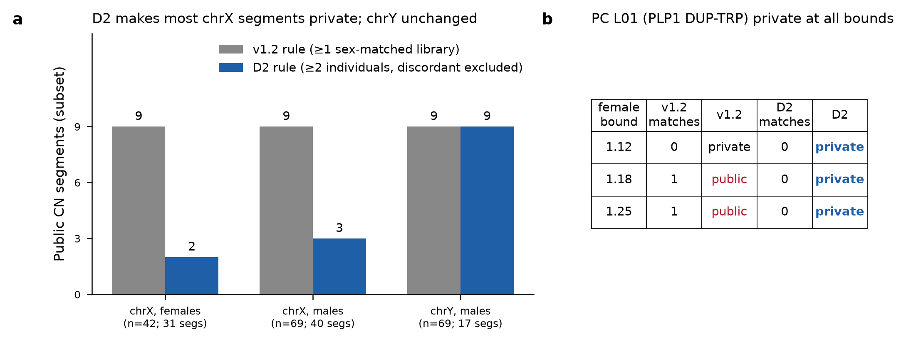
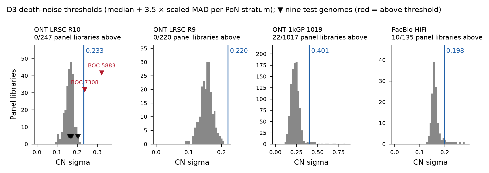
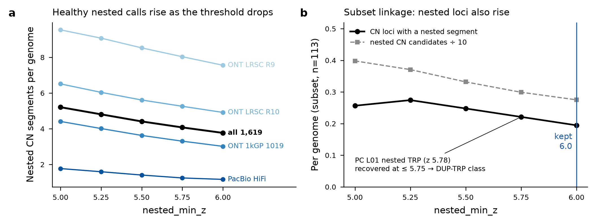
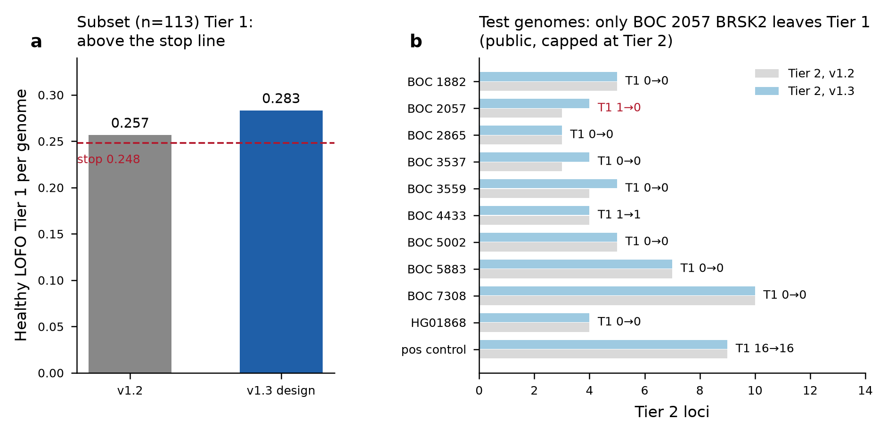

# panel-v1.3 Phase 1 design check (D2, D3, D5, D1/h)

2026-11-12. Integration branch `v13-design-check` = main e4ed243 + PR #43 (v13-cn-fixes 9d411b2) + PR #47 (v13-scoring-report 17cb153) + D3 thresholds (979e232) + CN-locus clamp fix (d830a0e); last code commit cd08108 (calling fingerprint **aa64baf08272**); the later commits on the branch add only this report, its figures, tables and scripts (not fingerprinted, so the fingerprint of the branch tip is unchanged) (main/panel-v1.2-r2: fdac9ff80401).

**Outcome: STOP.** One acceptance criterion fails (subset healthy LOFO Tier 1 per genome 0.283 > 0.248). Per the plan's stop rule nothing was merged; main is unchanged.

## Criteria

| Criterion | Value | Result |
|---|---|---|
| L01 private under D2 at female chrX bounds 1.12 / 1.18 / 1.25 | private at all three (v1.2 rule: public at 1.18 and 1.25 via NA19238, now sex-discordant) | PASS |
| BOC_2057 BRSK2 chr11:1,465,980-1,509,727 at most Tier 2 | Tier2 (Tier 1 by points, score 1.06; public, capped) | PASS |
| BOC_4433 NF1 chr17:31,902,782-32,067,453 Tier 1 with caller agreement >= 1/2 | Tier1_high_priority, score 1.46 -> 1.66; agreement 0/2 -> 2/2 | PASS |
| No malformed locus IDs (zero-length / chr:0-2 CN loci) | none in any re-scored sample; BOC_5883 chr17:0-2 -> chr17:0-5037000 (9 -> 3 CN loci). 2-bp junction-track BND_cluster loci (unchanged from v1.2, Benign_likely) are by design. A crash (HG03667 CN locus past chr2 end) was found and fixed (d830a0e) | PASS |
| Sex call printed for every sample | sex line from the CN track in all 9 test genomes, HG01868 and the PC | PASS |
| 0 public loci at Tier 1 | subset LOFO 0 / 32; test genomes 0; HG01868 0; PC 0 | PASS |
| Subset healthy LOFO Tier 1 per genome <= 0.248 | 0.2832 (v1.2 on the same 113 genomes: 0.2566; +0.0266) | **FAIL** |
| HG01868 0 Tier 1 | 0 Tier 1 (4 Tier 2) | PASS |
| PC planted Tier 1 events kept vs v1.2 | 13/17 vs 13/17 at v1.2; none lost, scores identical | PASS |
| D3 gate flags BOC_5883 and BOC_7308 | both 'Depth noise high' (0.322, 0.237 > 0.233) | PASS |

## Design set

No 110-genome list exists in the repo or on the NAS. The Phase 1 subset is `calibration/cn_linkage/subset100.tsv` (100 genomes); with the 14 panel-v1.2 L01 matchers (one already in it) the design set is **113 panel genomes**, the same set as the panel-v1.2-r2 sex design check (`calibration/panel_v12_r2/design_check_v2`). Plus the nine monkeymeth test genomes, the positive control (PC, sample 3559 + E13 + L01-L04) and the stand-in HG01868.

## D2: chrX/chrY public counting

Subset at the deployed female bound 1.12. v1.2 rule = main code (>= 1 sex-matched other library); D2 = PR #43 (>= 2 distinct sex-matched individuals; libraries of a sex-discordant individual count for no one). Discordant at every bound (tolerance 0.10): NA19238 and HG03499, 2 libraries each.

| Set | Sex | Genomes | chrX segs | chrX public v1.2 | chrX public D2 | chrY segs | chrY public v1.2 | chrY public D2 |
|---|---|---|---|---|---|---|---|---|
| positive_control | female | 1 | 1 | 0 | 0 | 0 | 0 | 0 |
| subset | ambiguous | 2 | 1 | 0 | 0 | 1 | 1 | 0 |
| subset | female | 42 | 31 | 9 | 2 | 0 | 0 | 0 |
| subset | male | 69 | 40 | 9 | 3 | 17 | 9 | 9 |
| test_genome | female | 5 | 21 | 5 | 2 | 0 | 0 | 0 |
| test_genome | male | 4 | 10 | 1 | 0 | 2 | 2 | 1 |

The subset counts are identical at 1.18 and 1.25. PC L01 segment chrX:101,753,000-102,493,000 (3/2): matches v1.2 / D2 = 0/0 at 1.12, 1/0 at 1.18, 1/0 at 1.25. The single match, NA19238 LRSC, is sex-discordant. **L01 is private at all three bounds.**

## D3: depth-noise threshold

CN sigma from the existing `cn/stats.json` of all 1,619 panel-v1.2-r2 libraries. Threshold = median + 3.5 x scaled MAD (robust z 3.5, the default; no reason found to change it: R10 and R9 have no panel library above, and the flagged ONT-1019 libraries are mostly < 5x depth).

| Stratum | n | median | scaled MAD | sigma_max | panel above |
|---|---|---|---|---|---|
| ONT_1kGP_1019 | 1017 | 0.2330 | 0.0480 | **0.401** | 22 |
| ONT_LRSC_R10 | 247 | 0.1629 | 0.0200 | **0.233** | 0 |
| ONT_LRSC_R9 | 220 | 0.1558 | 0.0185 | **0.220** | 0 |
| PacBio_HiFi | 135 | 0.1586 | 0.0111 | **0.198** | 10 |

Flagged panel libraries (32): HG01302, HG01308, HG01527, HG01600, HG01870, HG01965, HG02661, HG03431, HG03886, HG03890, HG03894, HG04025, HG04118, NA18516, NA18623, NA18867, NA18942, NA19027, NA19669, NA19676, NA19703, NA19762, HG01062, HG01084, HG01879, HG01925, HG02653, HG02656, HG02659, HG02662, HG02727, HG02978.
Test genomes (all R10): **BOC_5883 0.322 and BOC_7308 0.237 are flagged**; the other seven are 0.160-0.207. PC 0.174 and HG01868 (R9) 0.166 are normal. Written to `config/scoring.yaml` `depth_noise.sigma_max` (commit 979e232); `default_sigma_max` stays null because every PoN stratum is listed.

## D5: nested_min_z sweep

Segmentation of all 1,619 libraries + PC at each z (PR #43 `cn_segment.py --set segmentation.nested_min_z=Z`, release PoN). At z 6.0 this reproduces the release: 1,619/1,619 segment files and the panel segment table are byte-identical. Linkage (`cn_linkage.py`, branch) on the 113-genome subset + PC against the panel table of the same z.

| z | nested segments / genome (1,619) | nested CN candidates / genome (subset) | CN loci with a nested segment / genome (subset) | CN loci / genome (subset) |
|---|---|---|---|---|
| 5.0 | 5.209 | 3.982 | 0.257 | 0.496 |
| 5.25 | 4.809 | 3.708 | 0.274 | 0.513 |
| 5.5 | 4.411 | 3.319 | 0.248 | 0.496 |
| 5.75 | 4.075 | 2.991 | 0.221 | 0.469 |
| 6.0 | 3.768 | 2.752 | 0.195 | 0.451 |

PC: the L01 nested triplication (z 5.78) is recovered at z <= 5.75, where the L01 locus becomes DUP-TRP/INV-DUP; at 6.0 it is a CN_linked_gain locus (Tier 1, 1.53). E01-E13 overlap no CN segment at any z, and L02/L03 are unchanged. **Healthy nested calls rise at every lower z, so nested_min_z stays 6.0** (no config change). The cost of that rule is that L01 does not get its correct structural class.

## D1 and (h): re-scoring

Nine test genomes, HG01868 and the PC: the downstream part of each finished v1.2 run was re-run with the integration code in the v1.2 bundle SIF. Callers were kept via `--allowed-rules`; CN segmentation, linkage, annotation, junctions, privacy, depth and scoring were re-run. Control: the same driver with main code reproduced BOC_1882's `cxsv_scores.tsv` byte-for-byte. Subset: branch `cn_linkage` -> `annotate_cxsv` -> `extract_junctions` on the release per-sample outputs, then `panel_rates.sh` LOFO against panel-v1.2-r2 (own family left out; depth reused by locus id). Control: the same tree driver with main code reproduced 8/8 release files for two genomes.

Subset (113): Tier 1 29 -> 32 loci, 0.2566 -> **0.2832 per genome**; genomes with any Tier 1 17 -> 19; public Tier 1 0 -> 0. Tier 1 changes:

| Genome | Locus | Change | Class | Status | Score | Cause |
|---|---|---|---|---|---|---|
| HG00136 | chr2:230331000-230521261 | gained | DUP-TRP_INV-DUP | private | 1.41 | locus id widened (item g), same locus |
| HG00136 | chr2:230331120-230521261 | lost | DUP-TRP_INV-DUP | private | 1.41 | locus id widened (item g), same locus |
| HG04054 | chr16:1000-131000 | gained | CN_nested_gain | private | 1.61 | locus id widened (item g), same locus |
| HG04054 | chr16:58360-130866 | lost | CN_nested_gain | private | 1.56 | locus id widened (item g), same locus |
| HG00268 | chrX:32547914-32645149 | gained | DEL+INV | shared_junctions | 1.14 | caller agreement 2/5 -> 3/5 (h), 0 -> +0.10 |
| HG04015 | chr13:42100142-42229231 | gained | DEL+DUP+INV | private | 1.05 | caller agreement 0/3 -> 2/3 (h), -0.10 -> +0.10 |
| HG00311 | chr16:6666191-7204000 | gained | CN_linked_loss | private | 1.0 | caller agreement 0/2 -> 2/2 (h), -0.10 -> +0.10 |

The three real new Tier 1 loci are all caused by type-agnostic caller agreement (h). The v1.2 rate on this subset (0.257) is itself above 0.248: the subset is enriched for library-QC-flagged and L01-matcher genomes, so the 0.248 stop line (full-panel v1.2 0.198 + 0.05) does not transfer to it. The change against v1.2 on the same genomes is +0.027 per genome.

Test genomes: BOC_2057 BRSK2 Tier 1 -> Tier 2 (public, 65 carriers; capped by D1). BOC_4433 NF1 stays Tier 1 (1.46 -> 1.66; caller agreement 0/2 -> 2/2). No other Tier 1 change. HG01868 has 0 Tier 1. PC: 13/17 events Tier 1, identical to v1.2, and 0 off-target Tier 1.

## Findings

1. Defect in PR #43 item (g): `locus_span` took the end of a CN segment's last 1 kb bin, which can lie past the contig end (HG03667: chr2:242,559,540-242,697,000; chr2 length 242,696,752). `check_locus` then raised, and `cn_linkage.py` stopped the sample. A panel rebuild or a patient run would have failed. Fixed on the integration branch (d830a0e: clamp to the contig length, plus a unit test; 45 CN unit tests pass). It is not yet on the PR #43 branch.
2. Item (h) raises healthy Tier 1: 3 of 3 real new subset Tier 1 loci come from caller-agreement points. Options for the PI: accept on the basis of the delta (+0.027 vs + 0.05 allowed), judge on the full-panel LOFO of Phase 3, or reduce the `caller_agreement.multi` points.
3. D5 trade-off: z 5.75 would give L01 its correct DUP-TRP class but adds about 0.3 healthy nested segments per genome.
4. The `touch_upstream` edit to the re-score driver was blocked by the safety check and not retried; `--allowed-rules` was used instead, with no files touched.

## Data and code

NAS `/mnt/sargasso1/CxSV/calibration/panel_v13_design/` (`d2/`, `d5/` sweep with `summary/`, `lofo_subset_z6.0/` with `compare/`, `rescore/` with `check/`, frozen code `code/` = d830a0e). Scripts in `calibration/design_check_v13/` of this branch.
