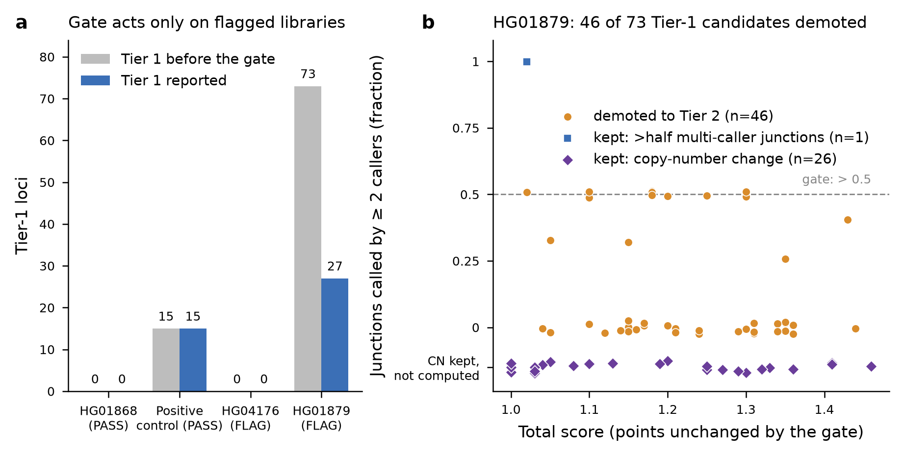
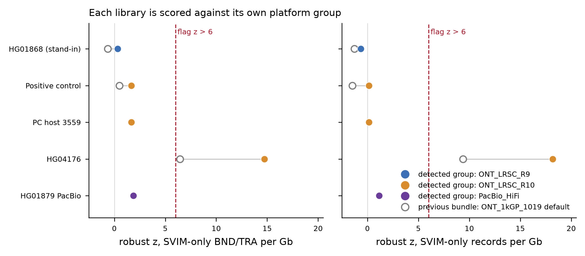

# Library QC deployment record: bundle `cxsv-bundle-20261105-95126e14f036`

*Superseded for patient runs on 2026-11-09 by `cxsv-bundle-20261109-84d380e08cc4` (tag `panel-v1.2`,
panel-v1.2 release `cxsv-panel-20261108-fdac9ff80401`; library QC unchanged; record in
[../panel_v1.2/README.md](../panel_v1.2/README.md) section 10). Until then the patient bundle was
`cxsv-bundle-20261106-169503679a60` (rebuild with the library-QC follow-ups, record at the end of
this file); it is kept on the NAS until the PI decides on deletion.*

Roadmap item 14, step 2 (2026-11-05/06, freya). PI decision 2026-11-05:
- report the library-QC flag in every patient report;
- turn conservative mode ON by default for flagged libraries;
- do not exclude flagged libraries from the panel.

This record covers the bundle built from `main` 95126e1, which carries that
default, and its validation against the tagged bundle `cxsv-bundle-20261105-8fc5bef725bd`
(panel-v1.1). The tagged bundle was not modified (see "Bundle" below).

*a: Tier-1 loci before and after the conservative gate in four whole-genome runs from
the new bundle. HG01868 and the positive control are scored against the bundled
panel-v1.1. HG04176 and HG01879 are scored against the exclusion test release (run B
below). b: the 73 Tier-1 candidates of flagged library HG01879 (run B), placed by total
score and by the fraction of their junctions called by at least 2 callers. The gate keeps a locus when
that fraction is above 0.5 or when at least one copy-number segment changed. For loci
kept on copy number the report does not compute the fraction, so they sit on their own
row.*

## Bundle

| | |
|---|---|
| bundle | `/mnt/sargasso1/CxSV/bundles/cxsv-bundle-20261105-95126e14f036` |
| commit | `95126e14f0363bfe75ac67885517158508cf642b` (`main`, PR #29 merge; library QC with `conservative_mode: true`) |
| panel release | `cxsv-panel-20261105-c31ecc9f8fa2` (panel-v1.1, finalised, tag `panel-v1.1`), `release_manifest.tsv` sha256 `09d3e32e8610463408a29d49e73ea660434184e1076ab5c139ff3064a412393b`, 1,634 files VERIFIED before and after |
| calling fingerprint | `c31ecc9f8fa2` (code digest `40bd82f0c816`): unchanged, so the runs are COMPATIBLE with panel-v1.1 |
| image | reused `cxsv-pipeline:ba820f7b2bd3`, id `sha256:b6c1bded…`, SIF sha256 `9f4e049fe5c5eb89717e1f531d284836efc7c306e0103374872c8165c01ff967` (the same SIF as the tagged bundle) |
| size | 10,559,296,238 bytes, 2,059 files; `MANIFEST.sha256` sha256 `f8c71b98d198bc5f5bedf66b555e4a2d32062104a66bae7026b94610ab6db9e9` |
| site config | `config/bundle_site.yaml` has no `library_qc` key, so the repository default `conservative_mode: true` applies. A site can switch the mode off with `library_qc: {conservative_mode: false}` in its own `--config` |
| build | `scripts/make_bundle.sh bundle --commit 95126e1 --release <panel-v1.1 release>`, 5,825 s. The first attempt hung in `git bundle create` (`git pack-objects` blocked in uninterruptible I/O on the CIFS-hosted `.git`) and was cancelled. The rebuild ran from a node-local clone of GitHub at the same commit (same `git archive`, same objects) |
| tagged bundle | `cxsv-bundle-20261105-8fc5bef725bd` untouched: `verify-bundle` passes (all 2,011 files) and its `MANIFEST.sha256` sha256 is still `02da76d481bdcc3ad89e88b7f9ec5b145965bf4abed89251d34eda86820201d4` |

## 1. Eight-check offline validation (stand-in HG01868)

`CORES=12 STANDIN_RUN=standin_HG01868 bash tests/lab/validate_bundle.sh BUNDLE OUT
/home/minknow/scratch/cxsv_validation/standin RELEASE`, from a clean checkout at 95126e1.
Log: [deployment/bundle_validation.log](deployment/bundle_validation.log).

| Check | Result |
|---|---|
| 1. bundle integrity | PASS (2,059 files, 54 s) |
| 2. panel release integrity | PASS |
| 3. network off (Singularity, Docker) + controls | PASS |
| 4. patient run, Singularity, bundle only | PASS (3,849 s) |
| 5. patient run, Docker | PASS (3,660 s) |
| 6. patient run outside the bundle | PASS (3,287 s) |
| 7. records, 4 vs 6 and 5 vs 6 | PASS, no unexpected difference |
| 8a/8b. tampered release refused | PASS |
| total | failures 0; 11,313 s |

**Stand-in HG01868: library QC PASS.** Group ONT_1kGP_1019, both z ≤ 6:
- SVIM-only BND/TRA 0.42 per Gb (z −0.63);
- SVIM-only records 33.5 per Gb (z −1.29).

The report says conservative mode is on and did not act. Tiers: 0 Tier 1, 4 Tier 2,
25 Tier 3, 1,047 Benign_likely.

**Against the tagged bundle**, run 4 and run 6 were compared with their counterparts
from the tagged-bundle validation (`/home/minknow/scratch/item_tag/bundle_validation`), file by
file, with `compare_qc_masked.py`. Comparison tables:
[Singularity](deployment/compare_tagged_HG01868_offline_singularity.tsv),
[normal](deployment/compare_tagged_HG01868_normal.tsv).
- 41 files byte-identical.
- `cxsv_scores.tsv`, `cxsv_score_report.md` and `scoring_params.json` are identical once
  the library-QC parts are removed: the `Library_QC_Gate` column, the QC bullet and the
  `library_qc` parameter block.
- New, as expected: `qc/library_qc.tsv` and `qc/library_qc_params.json`.
- Caller VCFs, `merged_sv.vcf`, `cxsv_only.vcf` and `private_cxsv.vcf` differ only in
  header lines: `fileDate`, and command lines carrying the run's input path. Their
  records are identical (for example, 27,590 merged records).
- The two PDFs are identical apart from `CreationDate`/`ModDate`.
- The SVIM log file name carries the run time.

## 2. Whole-genome positive control (E01–E13 + L01–L04)

`SKIP_MD5=1 ADDONS="E13 L01 L02 L03 L04" EVENTS=events_E01-E13+L01-L04.yaml bash
BUNDLE/repo/tests/lab/pos_control_full_genome.sh BUNDLE WORKDIR 10` (7,782 s).
- **Input.** The spliced input CRAM was copied from the tagged-bundle run
  (`/home/minknow/scratch/item11r2_full`; same release CRAM, same five add-ons; `cmp`
  identical). The release-CRAM md5 check was therefore skipped. That run had verified
  it.
- **Logs.** [deployment/pc_full_genome.log](deployment/pc_full_genome.log),
  [deployment/pc_score_events.tsv](deployment/pc_score_events.tsv).

Results:
- **Library QC: PASS.** Group ONT_1kGP_1019. SVIM-only BND/TRA 1.16 per Gb (z 0.50);
  SVIM-only records 33.2 per Gb (z −1.47). Conservative mode did not act.
- **Events.** `score.events.tsv`, `score.junctions.tsv` and `score.offtarget.tsv` are
  **byte-identical** to the tagged-bundle run.
  - E01–E12, L02 and L04 pass. E13, L01 and L03 fail exactly as before.
  - Junctions: 86 exact, 1 partial, 0 missed of 87.
  - Off-target CxSV loci: 1,198.
  - Tier 1: 12 of the 17 events (`score.events.tsv`); 15 Tier-1 loci genome-wide
    (the report's tier line: Tier1_high_priority 15, Tier2 8, Tier3 28, Benign_likely 1,181).
- **Result tree** ([comparison](deployment/compare_tagged_pc.tsv)): same pattern as HG01868.
  - 42 files identical and 3 identical after QC masking.
  - 2 new QC files.
  - Header-only VCF differences: bodies identical, 30,294 merged records.
  - PDF timestamps.
  - The SVIM log name.

## 3. Flagged panel libraries end to end

Both genomes are panel members, so each was run twice through the bundle's patient
workflow (`run_cxsv.sh patient`, Singularity, network off).
- **Run A** is the deployment configuration (bundled panel-v1.1). The library matches
  itself in the panel, so every junction is seen and nothing reaches Tier 1.
- **Run B** copies run A's work directory and sets `panel_release` to the library-QC
  exclusion test release. That release (`/mnt/sargasso1/CxSV/scratch/libqc_exclusion`;
  1,595 libraries, 1,561 individuals) leaves out all 24 flagged libraries. Only the
  scoring steps re-ran (9 jobs). The scored genome therefore behaves like an unseen
  patient.

| genome | QC (patient default group ONT_1kGP_1019) | CxSV loci | run A Tier 1 / 2 | run B Tier 1 before gate | demoted | run B Tier 1 reported |
|---|---|---:|---|---:|---:|---:|
| HG04176 (LRSC R10, 54x) | **FLAG**: SVIM-only records 122 per Gb (z 9.4), SVIM-only BND/TRA 90.7 per Gb (z 6.5) | 1,256 | 0 / 4 | 0 | 0 | 0 |
| HG01879 (ONT 1kGP-1019, 28x) | **FLAG**: SVIM-only records 112 per Gb (z 9.1) | 3,891 | 0 / 7 | 73 | **46** | **27** |

**HG04176** has no Tier-1 candidate even when its library is not in the panel. This
agrees with the leave-one-family-out calibration (Tier 1 = 0), so its report can only
show the FLAG. The report says the mode "demoted no locus"
([excerpt](deployment/HG04176_runA_report_excerpt.md)).

**HG01879** ([run B report excerpt](deployment/HG01879_runB_report_excerpt.md);
all 73 gated loci: [deployment/HG01879_runB_tier1_gate.tsv](deployment/HG01879_runB_tier1_gate.tsv)):
- The report carries the FLAG, the caution line, and the bold line "Conservative mode
  DEMOTED 46 Tier-1 locus/loci … 27 Tier-1 locus/loci kept".
- The section "Library QC: loci demoted by conservative mode" lists all 46 loci, with
  rank, locus, class, total, tier before (Tier1_high_priority), tier reported (Tier2)
  and reason, e.g. "0/4 junctions with >= 2 callers, 0 copy-number-changed segment(s)".
- Of the 27 kept, 26 have a copy-number change and 1 has more than half of its junctions
  multi-caller.
- 73 → 27 is the calibration result for this library ([../LIBRARY_QC.md](../LIBRARY_QC.md)
  section 4).

The patient QC metrics equal the panel survey values. For HG01879 (same group in both),
the z values also agree: 9.1027 here, 9.1028 in the survey. The cutoff is unchanged.

## 4. Findings (not fixed here)

1. **Patient QC group.** A patient's calibration group comes from `qc_group` in the
   sample sheet, then `patients.<sample>.qc_group`, otherwise the platform default
   (ONT → ONT_1kGP_1019).
   - HG04176 is an LRSC R10 library. Under its own group (survey) its z values are
     14.7 / 18.2; under the default group they are 6.5 / 9.4. It is flagged either way.
   - For R10 or PacBio patients, sites should set `qc_group` in the sample sheet.
2. **Wording when there is no Tier-1 locus.** A flagged library with no Tier-1 locus
   gets "Conservative mode is on and demoted no locus: all 0 Tier-1 loci have
   multi-caller or copy-number support".
   - Proposed: "no Tier-1 locus to gate" when the count is 0. This is a one-line change
     in `score_cxsv.library_qc_report`.
   - It needs a new bundle to reach patients.
3. **Release ids can collide.** The exclusion test release has the same `release_id` as
   panel-v1.1, `cxsv-panel-20261105-c31ecc9f8fa2`: same date, same fingerprint,
   `test_release: true`. The score report prints only the id, so run B's report names
   panel-v1.1.
   - Proposed: print `test_release` and the release-manifest sha256 in the report
     header, or add a name suffix to test releases.
4. **NAS-hosted git.** On 2026-11-05 evening, git operations on the CIFS-hosted
   repository (fetch, worktree checkout, `git bundle create`) took tens of minutes or
   hung. Ordinary NAS reads and writes ran at 13–90 MB/s.
   - Bundle builds can run from a node-local clone. The bundle content is the same.

## 5. Reproduce

The scripts used are kept with this record:
- [validate.sh](deployment/validate.sh);
- [pc.sh](deployment/pc.sh);
- [hg04176.sh](deployment/hg04176.sh);
- [hg01879.sh](deployment/hg01879.sh);
- the comparison tools [compare_qc_masked.py](deployment/compare_qc_masked.py) and
  [diff_detail.py](deployment/diff_detail.py).

They expect the freya paths above. The figure is made by
[make_figure.py](deployment/make_figure.py) from the run-B scores tables.

---

# Rebuild 2026-11-06: bundle `cxsv-bundle-20261106-169503679a60` (library-QC follow-ups)

PI decision 2026-11-06: three follow-ups (section 4 of this record above), then a
rebuild.
- **(a) Group.** The patient's calibration group is detected from the alignment
  header and the reads, unless the sample sheet sets `qc_group`
  ([../LIBRARY_QC.md](../LIBRARY_QC.md) section 4a).
- **(b) Wording.** A flagged library with no Tier-1 locus reads "no Tier-1 locus to
  gate".
- **(c) Release ids.** Test releases get a `-test` id. The report header shows
  `test release` and the `release_manifest.tsv` sha256.

The previous bundle `cxsv-bundle-20261105-95126e14f036` was not modified:
`verify-bundle` passes (all 2,059 files), and its `MANIFEST.sha256` sha256 is still
`f8c71b98d198bc5f5bedf66b555e4a2d32062104a66bae7026b94610ab6db9e9`. The panel-v1.1
bundle `cxsv-bundle-20261105-8fc5bef725bd` has been deleted (PI-approved).

*Robust z of the two flag metrics for the five genomes checked with this bundle.
- Filled: under the auto-detected group.
- Open: under the ONT_1kGP_1019 default that the previous bundle used (HG01868, the
  positive control, HG04176).
- Dashed: the flag threshold z = 6.*

## Bundle

| | |
|---|---|
| bundle | `/mnt/sargasso1/CxSV/bundles/cxsv-bundle-20261106-169503679a60` |
| commit | `169503679a600918645a71c4a0ac2213bddc7c59` (PR #32 merge). `main` has since moved on (PR #33, item 15, new calling fingerprint `6001d99ea4d4`, incompatible with panel-v1.1), so this bundle stays pinned to 1695036 |
| panel release | `cxsv-panel-20261105-c31ecc9f8fa2` (panel-v1.1), `release_manifest.tsv` sha256 `09d3e32e8610463408a29d49e73ea660434184e1076ab5c139ff3064a412393b`, VERIFIED. Its id is unchanged under the new release-id code, because it is not a test release |
| calling fingerprint | `c31ecc9f8fa2` (code `40bd82f0c816`), COMPATIBLE |
| image | `cxsv-pipeline:ba820f7b2bd3`, SIF sha256 `9f4e049fe5c5…` (unchanged) |
| size | 10,562,414,920 bytes, 2,122 files; `MANIFEST.sha256` sha256 `da9c296e02b937bc609711dee6a440fc87ad181adb22ff57bc53d254767c51f8` |
| site config | no `library_qc` key, so the defaults apply: `conservative_mode: true` and the `group_detection` thresholds |
| build | 630 s, from a node-local clone at 1695036 |

## Validation (HG01868) and positive control (E01–E13 + L01–L04)

- **Validation:** 8/8 PASS, failures 0, 10,961 s
  ([deployment_v2/bundle_validation.log](deployment_v2/bundle_validation.log)).
  Run times: Singularity 3,166 s, Docker 3,880 s, outside the bundle 3,111 s.
- **Positive control:** 8,106 s. Its spliced input was copied byte-identical from the
  95126e14f036 run, and the release-CRAM md5 was skipped
  ([deployment_v2/pc_full_genome.log](deployment_v2/pc_full_genome.log)).
  - `score.events.tsv`, `score.junctions.tsv` and `score.offtarget.tsv` are
    byte-identical to the 95126e14f036 run.
  - E01–E12, L02 and L04 pass; E13, L01 and L03 fail as before.
  - Junctions: 86 exact, 1 partial, 0 missed of 87.
  - 1,198 off-target loci; 15 Tier-1 loci genome-wide.
- **QC-masked comparison** with the 95126e14f036 runs
  ([HG01868 Singularity](deployment_v2/compare_95126_HG01868_offline_singularity.tsv),
  [HG01868 normal](deployment_v2/compare_95126_HG01868_normal.tsv),
  [positive control](deployment_v2/compare_95126_pc.tsv)). The mask now also removes
  the report's `(test release: …; release_manifest.tsv sha256 …)` and the
  `panel_release_test` / `panel_release_manifest_sha256` keys of
  `scoring_params.json`.
  - `cxsv_scores.tsv` and `merged_sv.vcf` are **byte-identical**: 45 files identical
    for HG01868, 46 for the positive control.
  - `cxsv_score_report.md` and `scoring_params.json` are identical after masking.
  - `qc/library_qc.tsv` and `qc/library_qc_params.json` differ, as expected: new
    group columns and evidence, and the detection block.
  - Caller VCFs differ only in header lines (`fileDate`, input path); their records
    are identical.
  - PDFs differ only in `CreationDate`/`ModDate`.
  - The SVIM log name carries the run time.

## Auto-detected groups

| genome | detected group | from | evidence | z SVIM-only BND/TRA per Gb | z SVIM-only records per Gb | flag | z under the ONT_1kGP_1019 default (previous bundle) |
|---|---|---|---|---:|---:|---|---|
| HG01868 (stand-in, R9 LSK110) | ONT_LRSC_R9 | header | `@PG CL` names R9; reads median mean Q 23.5 | 0.34 | −0.66 | **PASS** | −0.63 / −1.29 |
| positive control (3559 + add-ons) | ONT_LRSC_R10 | header | `@RG DS` names r10.4.1; reads Q 43.1 | 1.68 | 0.16 | **PASS** | 0.50 / −1.47 |
| PC host 3559 | ONT_LRSC_R10 | header | as above | 1.68 | 0.16 | **PASS** | – |
| HG04176 (LRSC R10, flagged) | ONT_LRSC_R10 | reads | no `@RG`; reads Q 44.2 | 14.74 | 18.17 | **FLAG** | 6.45 / 9.38 |
| HG01879 PacBio | PacBio_HiFi | header | `@RG PL` PACBIO; 100% CCS read names | 1.88 | 1.16 | **PASS** | – (PacBio default) |

How each row was obtained:
- **HG01868 and the positive control** are the validation and positive-control runs
  above.
- **HG04176, HG01879 PacBio and the PC host** are the bundle's `library_qc.py`, run in
  the bundle SIF with network off, with the params JSON the rule writes
  ([deployment_v2/qc_direct.sh](deployment_v2/qc_direct.sh)):
  - HG04176 uses its alignment and the `merged_sv.vcf` of its run through the previous
    bundle; the caller outputs are the same.
  - HG01879 PacBio uses the panel-v1.1 per-sample `merged_sv.vcf`.
  - The PC host uses the host CRAM for the read-level metrics and the group, and the
    positive control's `merged_sv.vcf` for the call metrics, as in the panel survey.
    The host has no own call set.
- **HG04176's z** under its own group equals the panel-survey values (14.74 / 18.17).

All rows: [deployment_v2/qc_groups.tsv](deployment_v2/qc_groups.tsv).
