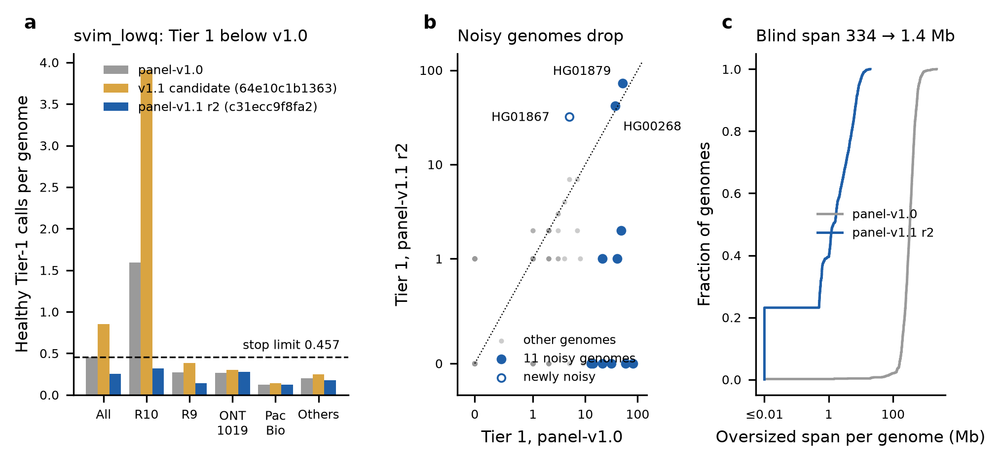

# panel-v1.1 release record (2026-11-05)

**Release `cxsv-panel-20261105-c31ecc9f8fa2`: VERIFIED, validated offline, positive
control passed.**

git tag: panel-v1.1 (annotated tag efea4fc on 8fc5bef, created 2026-11-05)

It is panel-v1.0 (`cxsv-panel-20261102-cd7e1d194cd4`) rebuilt downstream-only with
`main` 8fc5bef. 8fc5bef carries two discovery changes:
- the item-13 long-record rule (docs/OVERSIZED_CLUSTERS.md);
- `single_caller_bnd_rule: svim_lowq` (docs/R10_EXCESS.md).

It **supersedes the untagged candidate `cxsv-panel-20261104-64e10c1b1363`**
(`main` 65ef970, without `svim_lowq`). That candidate was held because healthy
Tier 1 rose to 0.851 per genome. Its build root `/mnt/sargasso1/CxSV/build/panel-v1.1`
is kept unchanged as provenance.

## 1. Release

| | |
|---|---|
| release id | `cxsv-panel-20261105-c31ecc9f8fa2` |
| build root | `/mnt/sargasso1/CxSV/build/panel-v1.1-r2` (release: `results/panel/release`) |
| source | `8fc5bef725bd0020901eb1e3ee563832ccbcf2a2` (git archive, `dirty: false`) |
| calling fingerprint | `c31ecc9f8fa26f3c76509fd48327522309af1310689d94423ec7f89fd866b7d7` (from the `calling_fingerprint` rule; code digest `40bd82f0c816…`) |
| manifest | `release_manifest.tsv` sha256 `e8b7b800b85348251f16c6e9bc83e38140521315f09197b0d6916918246e68de`, 1,634 files, 2,452,335,137 bytes |
| image | `cxsv-pipeline:ba820f7b2bd3`, image id `sha256:b6c1bded8b3a…`, SIF sha256 `9f4e049fe5c5…` (unchanged since panel-v1.0) |
| panel | 1,619 samples / 1,582 individuals (LRSC 467, ONT-1019 1,017, PacBio 135) |
| description | records the reuse provenance and that this release supersedes the 64e10c1b1363 candidate ([release_description.txt](release_description.txt)) |

**Build.**
- **Dry runs.** A read-only dry run against the panel-v1.0 tree and the driver's
  own dry run each planned 12,975 jobs. Neither planned a caller, merge,
  mosdepth/`callable_mask` or Sniffles2-population job, and no planned output was
  a hard link.
- **Reuse.** 58,646 upstream files (1.41 TB), including each sample's
  `logs/svim.log`, are hard links of the panel-v1.0 files (inventory
  `provenance/reused_upstream.tsv`, sha256 `93927b34b139…`). They were re-checked
  as unchanged after the build.
- **Callable masks.** 8fc5bef changed `callable_mask.sh` in its log line only.
  It was re-run on 6 panel genomes (CRAM 3.0 ×2, CRAM 3.1, R10, R9, PacBio): all
  6 masks and mosdepth summaries are byte-identical
  ([callable_identity.tsv](callable_identity.tsv)).
- **Run.** freya, 20 cores, Snakemake work directory on node-local disk:
  4 h 01 min (23:25-03:26 CST).
- **Old releases untouched.** The panel-v1.0 and 64e10c1b1363 manifests are
  unchanged (`928d721a…`, `6f6a3431…`).

## 2. Counts

| | panel-v1.0 | v1.1 candidate (64e10c1b1363) | **panel-v1.1** |
|---|---|---|---|
| junction sites | 1,304,862 | 1,304,862 | **1,304,862** (identical apart from the version column) |
| panel CxSV loci | 14,428 | 17,578 | **13,488** |
| of which in 1 individual | 6,104 | 7,806 | 5,426 |
| CxSV loci per genome (mean) | 979.7 | 1,092.0 | **1,070.7** |
| blind span per genome (median / mean) | 334 Mb / – | 1.40 / 2.70 Mb | **1.40 / 2.69 Mb** |

Per-genome junction tables are identical to both other builds in 1,619/1,619
genomes, apart from `locus_id` ([compare_v10_r2.tsv](compare_v10_r2.tsv),
[compare_v11_r2.tsv](compare_v11_r2.tsv)). Every per-sample discovery output
(21,047 files) is byte-identical to the `svim_lowq` tree written by
`calibration/r10_excess/rerun_discovery.py`. So the candidate evaluation in
docs/R10_EXCESS.md is exactly this release.

## 3. Healthy-genome Tier 1 (full-panel LOFO, deployed scorer, no re-tuning)

Each of the 1,619 panel genomes was scored with its family left out of this
release (`calibration/oversized_clusters/panel_rates.sh`, keurig, 50 min). Depth
rows were reused by locus coordinates from the `svim_lowq` candidate calibration;
its loci are byte-identical, as section 2 shows. **Stop rule (Tier 1 must not
exceed v1.0's 0.457 per genome): passed, 0.251.**

| stratum | n | Tier 1 per genome, v1.0 | **panel-v1.1** | Tier 2 v1.0 | panel-v1.1 | share of genomes with Tier 1 | loci per genome |
|---|---|---|---|---|---|---|---|
| all | 1,619 | 0.457 | **0.251** | 4.35 | 3.33 | 13.9% | 1,070.7 |
| LRSC R10 | 247 | 1.591 | **0.320** | 11.10 | 4.31 | 17.8% | 1,216.3 |
| LRSC R9 | 220 | 0.273 | **0.141** | 4.21 | 3.69 | 13.2% | 1,216.7 |
| ONT-1019 | 1,017 | 0.265 | **0.275** | 2.97 | 3.09 | 13.5% | 995.9 |
| PacBio HiFi | 135 | 0.126 | **0.126** | 2.63 | 2.73 | 11.1% | 1,129.4 |
| the 1,608 others | 1,608 | 0.200 | **0.179** | 2.98 | 2.95 | 13.7% | 1,066.1 |
| the 11 noisy genomes | 11 | 38.1 | **10.8** | 204.9 | 58.8 | 45.5% | 1,742.9 |

The v1.1 candidate had 0.851 overall (R10 3.911). Per genome, the loci, Tier 1
and Tier 2 values equal those of the `svim_lowq` candidate run in 1,619/1,619
genomes.

**Residual noisy genomes** (≥ 10 Tier 1; [lofo_r2_residual_noisy.tsv](lofo_r2_residual_noisy.tsv)):

| genome | cohort | coverage | Tier 1 v1.0 | panel-v1.1 |
|---|---|---|---|---|
| HG01879 | ONT-1019 | 28x | 52 | 73 |
| HG00268 | ONT-1019 | 61x | 37 | 42 |
| HG01867 | LRSC R10 | 38x | 5 | 32 |

- These three hold 147 of the 407 Tier-1 calls; without them, Tier 1 is 0.160
  per genome.
- HG01879 and HG00268 were noisy before item 13. Their noise is not
  BND/TRA: it is SVIM-only DEL at QUAL < 10 and single-caller INV.
- HG01867 is newly noisy. It carries 2,642 SVIM-only TRA records at QUAL ≥ 10
  (2,144 at ≥ 20; LRSC medians 10 and 1), which are above the `svim_lowq` cut. In
  v1.0 they sat inside 2.29 Gb of oversized clusters. Item 13 exposed them as 22
  BND_cluster and 10 CN_plus_orientation_change Tier-1 loci.
- None of the three is addressed by `svim_lowq`. Follow-up (ROADMAP): library-chimerism
  QC or coverage-relative support (docs/R10_EXCESS.md, not tested).
- The other 8 of the 11 noisy genomes have 0-2 Tier-1 calls
  ([lofo_r2_noisy11.tsv](lofo_r2_noisy11.tsv)).



**Figure.**
- (a) Healthy Tier-1 calls per genome (LOFO, deployed scorer) for panel-v1.0,
  the held candidate and panel-v1.1, by platform and for the 1,608 genomes outside
  the noisy 11. Dashed line: the stop limit.
- (b) Per genome, Tier 1 in panel-v1.0 against panel-v1.1 (symmetric log axes).
  Filled blue: the 11 genomes with ≥ 10 Tier 1 in v1.0. Open: HG01867.
- (c) Cumulative distribution of the oversized-cluster span per genome.

## 4. Bundle and offline validation

**Bundle `cxsv-bundle-20261105-8fc5bef725bd` (`/mnt/sargasso1/CxSV/bundles/`), rebuilt
2026-11-05 from the tag `panel-v1.1` (commit 8fc5bef) and the finalised release**
(PI decision 2026-11-05; `scripts/make_bundle.sh bundle --commit panel-v1.1 --release
/mnt/sargasso1/CxSV/build/panel-v1.1-r2/results/panel/release`, freya, 2,502 s).

| | |
|---|---|
| bundle id | `cxsv-bundle-20261105-8fc5bef725bd` (the default id; the commit is unchanged, so the id equals the pre-tag bundle's) |
| size | 10,556,544,623 bytes, 2,011 files |
| `MANIFEST.sha256` sha256 | `02da76d481bdcc3ad89e88b7f9ec5b145965bf4abed89251d34eda86820201d4` |
| embedded `release.json` | byte-identical to the finalised release's: `source.git_tag` `panel-v1.1`, `git_tag_object` `efea4fc09451…`, `finalised_utc` 2026-11-05T16:32:13Z |
| embedded `release_manifest.tsv` | sha256 `09d3e32e8610463408a29d49e73ea660434184e1076ab5c139ff3064a412393b`, 1,634 files (2,452,335,302 bytes) verified |
| image | unchanged: SIF sha256 `9f4e049fe5c5…`, reused from `_images/img-ba820f7b2bd3` |

**Pre-tag bundle, kept pending deletion approval.** The bundle first built for this release
(before `finalise`, embedded `release.json` without `git_tag`; 10,556,543,879 bytes,
`MANIFEST.sha256` sha256 `675e59f95966…`) was renamed, not deleted, to
`/mnt/sargasso1/CxSV/bundles/cxsv-bundle-20261105-8fc5bef725bd.pretag`. Deleting it needs
the PI's approval. Its validation record is [r2_bundle_validation.log](r2_bundle_validation.log).

Validation of the tagged bundle (`tests/lab/validate_bundle.sh`, stand-in HG01868, 12 cores,
freya, 11,279 s): **all 8 checks PASS, 0 failures** ([tag_bundle_validation.log](tag_bundle_validation.log)).

| check | tagged bundle | pre-tag bundle |
|---|---|---|
| 1 bundle integrity | PASS (431 s) | PASS (303 s) |
| 2 release integrity | PASS | PASS |
| 3 network off (Singularity, Docker; with controls) | PASS | PASS |
| 4 offline Singularity run | PASS (4,864 s) | PASS (3,105 s) |
| 5 offline Docker run | PASS (2,792 s) | PASS (2,752 s) |
| 6 normal run (repository + conda + lab paths) | PASS (2,803 s) | PASS (2,575 s) |
| 7 outputs identical (both offline runs vs normal) | PASS, no unexpected difference | PASS |
| 8 tampered release refused (byte, extra file) | PASS | PASS |

HG01868 (not in the panel): 1,076 CxSV loci, 0 private, **0 Tier 1**, 4 Tier 2,
25 Tier 3, in all three runs. `cxsv_scores.tsv` is byte-identical across the three runs
and to the pre-tag bundle's three runs (md5 `375ab309e298…`); so are both `compare_*.tsv`.
(v1.1 candidate: 1,087 loci, 0 / 5.) Run times are longer than for the pre-tag bundle
because the NAS was slow that afternoon (the bundle build also took 2,502 s against 260 s).

## 5. Positive control (full genome, from the bundle)

`tests/lab/pos_control_full_genome.sh` (bundle copy, pre-tag bundle, 10 cores, 7,799 s; patient
run 6,245 s; fingerprint COMPATIBLE with the release;
[pc_r2_score_events.tsv](pc_r2_score_events.tsv), [pc_r2_score.txt](pc_r2_score.txt)):

| event | class | status | score | tier | verdict |
|---|---|---|---|---|---|
| E01 | Complex_inversion | private | 1.35 | Tier 1 | PASS |
| **E02** | Complex_inversion | private | **1.95** | **Tier 1** | PASS |
| E03 | Complex_inversion | private | 1.72 | Tier 1 | PASS |
| E04 | DUP+INV | private | 1.74 | Tier 1 | PASS |
| E05 | Nested_SV | private | 1.93 | Tier 1 | PASS |
| E06 | DUP+INV | private | 1.94 | Tier 1 | PASS |
| **E07** | BND_cluster (2 loci) | private | **1.55** | **Tier 1** | PASS |
| E08 | BND_cluster | private | 1.44 | Tier 1 | PASS |
| E09 | Chromothripsis_like | private | 2.66 | Tier 1 | PASS |
| E10 | Multi_breakpoint_cluster | private | 0.26 | Tier 3 | PASS |
| E11, E12 | not CxSV | – | – | – | PASS |
| E13 | Nested_SV | private | 0.08 | Tier 3 | FAIL (expected: its carriers are synthetic panel genomes that are not in the real panel) |

- Junctions: 40 exact, 1 partial, 0 missed of 41.
- Class concordance: 11/11.
- Host genome (3559, outside the planted events): 1,208 CxSV loci, **0 Tier 1**,
  4 Tier 2, 26 Tier 3.
- The bundle's release verified unchanged afterwards.
- These scores equal the `svim_lowq` candidate rerun (docs/R10_EXCESS.md) and,
  for every event, the v1.1 candidate.

**Tagged bundle, with the literature add-ons.** `pos_control_full_genome.sh` from the tagged
bundle with `ADDONS="E13 L01 L02 L03 L04"` and `EVENTS=…/addons/events_E01-E13+L01-L04.yaml`
(keurig, 12 cores, patient run 7,505 s; fingerprint COMPATIBLE; release VERIFIED
afterwards; [tag_pc_L_score_events.tsv](tag_pc_L_score_events.tsv), [tag_pc_L_score.txt](tag_pc_L_score.txt)).
The events above are unchanged. The add-ons give: L01 not called (2/2 junctions exact),
L02 Tier 1 1.04, L03 Tier 1 1.04 (40/40 exact; split into 19 loci, verdict FAIL as
before), L04 Tier 1 1.74. Junctions: 86 exact, 1 partial, 0 missed of 87. Host: 0 Tier 1
(all 15 Tier-1 loci are at planted events). Every scorer output (`score.events.tsv`,
`score.junctions.tsv`, `score.offtarget.tsv`), `cxsv_scores.tsv`,
`single_caller_filtered.tsv` (88 `svim_lowq` records, none at a planted event) and the
merged VCF body (30,294 records) are byte-identical to the same run from the pre-tag
bundle (freya), and every event result equals 65ef970's.

Literature test A (63 events) does not change by construction: all of its records
are `SUPP_VEC` 111. Its result against 8fc5bef + the v1.1 candidate was 8 called,
7 Tier 1; it was not rerun against this release.

## 6. Files

| file | content | made by |
|---|---|---|
| [lofo_r2_strata.tsv](lofo_r2_strata.tsv) | LOFO by platform and coverage (v1.0 vs panel-v1.1) | `calibration/oversized_clusters/panel_rates_collect.py` |
| [lofo_r2_strata_summary.tsv](lofo_r2_strata_summary.tsv) | the section-3 table incl. the 1,608 others / noisy 11 | `calibration/panel_v1.1/report_r2.py` |
| [lofo_r2_per_genome.tsv](lofo_r2_per_genome.tsv) | per genome: loci, Tier 1, Tier 2 (columns `*_v1.0` = panel-v1.0, `*_v1.1` = this release) | `panel_rates_collect.py` |
| [lofo_r2_tier1_loci.tsv](lofo_r2_tier1_loci.tsv) | every healthy-genome Tier-1 locus | `panel_rates_collect.py` |
| [lofo_r2_residual_noisy.tsv](lofo_r2_residual_noisy.tsv), [lofo_r2_noisy11.tsv](lofo_r2_noisy11.tsv) | residual and formerly noisy genomes | `report_r2.py` |
| [compare_v10_r2.tsv](compare_v10_r2.tsv), [compare_v11_r2.tsv](compare_v11_r2.tsv) | per genome: loci, oversized clusters, blind span, junction identity (columns `*_v1.1` = this release) | `scripts/panel_build/compare_builds.py` |
| [callable_identity.tsv](callable_identity.tsv), [release_description.txt](release_description.txt) | build provenance (copies of `provenance/`) | `check_callable_identity.sh` |
| [r2_bundle_validation.log](r2_bundle_validation.log) | full validation log (pre-tag bundle) | `tests/lab/validate_bundle.sh` |
| [tag_bundle_validation.log](tag_bundle_validation.log) | full validation log (tagged bundle) | `tests/lab/validate_bundle.sh` |
| [tag_pc_L_score_events.tsv](tag_pc_L_score_events.tsv), [tag_pc_L_score.txt](tag_pc_L_score.txt) | positive control + E13/L01-L04 add-ons, tagged bundle | `tests/lab/pos_control_full_genome.sh` |
| [pc_r2_score_events.tsv](pc_r2_score_events.tsv), [pc_r2_score.txt](pc_r2_score.txt) | positive-control scoring | `tests/lab/pos_control_full_genome.sh` |
| `../figures/panel_v1.1/fig_panel_v11_r2.png` | the figure | `report_r2.py` |

## 7. Reproduce

```bash
B=/mnt/sargasso1/CxSV/build; NEW=$B/panel-v1.1-r2; T=$NEW/code/scripts/panel_build
# code tree, read-only dry run against panel-v1.0, hard links (docs/PANEL_BUILD.md, "Downstream-only rebuild")
git -C REPO archive 8fc5bef | tar -x -C $NEW/code; git -C REPO rev-parse 8fc5bef > $NEW/code/COMMIT
python3 $T/link_upstream.py --old $B/panel-v1.0/results/panel --new $NEW/results/panel \
  --dryrun DRY/dryrun.txt --inventory $NEW/provenance/reused_upstream.tsv --include-log svim.log --apply
bash $T/check_callable_identity.sh $NEW/code $B/panel-v1.0/results/panel OUT SIF 4 3 COHORT:SAMPLE:ALN ...
python3 $T/make_aggregate_yaml.py $B/panel-v1.0 $NEW $NEW/provenance/release_description.txt
CXSV_SIF=SIF CXSV_REBUILD_WORKDIR=<node-local dir> bash $T/rebuild_downstream.sh $B/panel-v1.0 $NEW 20 [--dry-run]
# healthy rates (keurig, ~50 min with depth reuse)
SIF=SIF REUSE_CAL=/mnt/sargasso1/CxSV/calibration/r10_excess/svim_lowq/cal \
  bash $NEW/code/calibration/oversized_clusters/panel_rates.sh $NEW CAL/lofo 14
python3 $NEW/code/calibration/oversized_clusters/panel_rates_collect.py \
  --old-scores /mnt/sargasso1/CxSV/calibration/item10/loci_scores_graded.tsv.gz \
  --manifest $NEW/results/panel/panel/sample_manifest.tsv --cal CAL/lofo --out-prefix CAL/lofo_r2
# bundle, validation, positive control (from a worktree at 8fc5bef)
bash scripts/make_bundle.sh bundle --commit panel-v1.1 --release $NEW/results/panel/release   # after finalise (git_tag)
CORES=12 STANDIN_RUN=standin_HG01868 bash tests/lab/validate_bundle.sh BUNDLE OUT STANDIN_DIR $NEW/results/panel/release
bash BUNDLE/repo/tests/lab/pos_control_full_genome.sh BUNDLE WORKDIR 10
ADDONS="$A/E13 $A/L01 $A/L02 $A/L03 $A/L04" EVENTS=$A/events_E01-E13+L01-L04.yaml \
  bash BUNDLE/repo/tests/lab/pos_control_full_genome.sh BUNDLE WORKDIR 12   # A=datasets/pos_control/addons
# tables + figure
python calibration/panel_v1.1/report_r2.py --per-genome CAL/lofo_r2_per_genome.tsv --compare compare_v10_r2.tsv \
  --candidate-rates docs/r10_excess/candidate_rates.tsv --noisy docs/r10_excess/noisy_genomes.tsv --out-dir OUT
```

Calibration results: `/mnt/sargasso1/CxSV/calibration/panel_v11_r2`.
