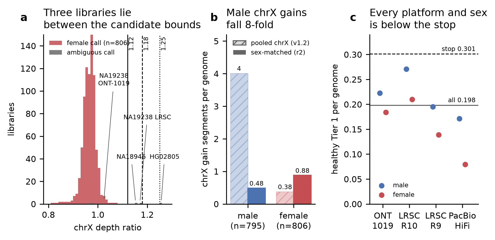

# panel-v1.2 build record (2026-11-08 to 2026-11-09)

**Release `cxsv-panel-20261108-fdac9ff80401` (panel-v1.2-r2): tagged `panel-v1.2`, finalised,
VERIFIED.** Tagged bundle `cxsv-bundle-20261109-84d380e08cc4`: validated offline 9/9, positive
control L01 Tier 1. **Since 2026-11-09 this is the current patient bundle** (it replaces
`cxsv-bundle-20261106-169503679a60` + panel-v1.1; section 10).

git tag: panel-v1.2 (annotated tag 101023e4a4b4 on 84d380e, created 2026-11-09 by the PI)

The release adds roadmap item 15, the copy-number-anchored track for large DUP-TRP/INV-DUP
and other copy-number-linked events (docs/CN_LINKAGE.md). It was built twice:

| | candidate (superseded) | **panel-v1.2-r2** |
|---|---|---|
| release id | `cxsv-panel-20261108-6001d99ea4d4` | **`cxsv-panel-20261108-fdac9ff80401`** |
| source | main 73c4beb | main **84d380e** (PR #38) |
| build root | `/mnt/sargasso1/CxSV/build/panel-v1.2` (kept unchanged) | `/mnt/sargasso1/CxSV/build/panel-v1.2-r2` |
| chrX / chrY copy-number reference | both sexes pooled | per sex call (chrX male / female; chrY male only) |
| positive control L01 (PLP1 DUP-TRP) | **not called**: dropped as `public_cn` | **Tier 1**, private |
| bundle | `cxsv-bundle-20261108-c40e26528d5f` (validated 8/8; superseded) | `cxsv-bundle-20261109-84d380e08cc4` |



**Figure** ([make_figure.py](make_figure.py)).
- **(a)** chrX depth ratio (chrX / genome median) of the panel libraries called female (red)
  or ambiguous (grey) in the female range, with the three candidate female upper bounds.
  The female median is 0.967 (robust SD 0.024). The released bound 1.12 is the median
  + 6.4 robust SD; 1.18 is + 8.9 SD and 1.25 is + 11.8 SD.
- **(b)** chrX gain segments per genome in the two releases, by sex call. Hatched: candidate
  (pooled chrX reference); solid: r2 (sex-matched). Not shown: the 18 ambiguous libraries
  (35.8 → 18.1 per genome), which never count for sex-matched panel frequency.
- **(c)** Healthy-genome Tier 1 per genome, full-panel LOFO, by platform and sex call. Solid
  line: all 1,619 genomes. Dashed: the stop limit.

## 1. Why the first candidate was superseded

The positive-control event L01, a PLP1 DUP-TRP (chrX:101,752,400-102,492,226) in the female
host 3559, was segmented in bundle c40e26528d5f. It was then dropped as `public_cn`, with
panel counts 2, 2 and 10 over its three segments.

- The candidate's chrX panel of normals pooled both sexes.
- Where male depth is not exactly half the female depth, every male genome showed chrX
  gains: 4.01 gain segments per male genome, against 0.38 per female genome.
- 14 panel genomes, 13 of them male, matched L01's segments and made it public.

**Fix** (PR #38, main 84d380e; docs/CN_LINKAGE.md section 2a):
- Each library gets a sex call from its chrX and chrY depth. Male: chrX ratio 0.40–0.60 and
  chrY ≥ 0.10. Female: chrX ratio 0.80–1.12 and chrY ≤ 0.05. Anything else is ambiguous.
- chrX gets one reference per sex; chrY has a male-only reference.
- On chrX and chrY, only individuals with the same sex call count towards panel frequency.
- New calling fingerprint `fdac9ff80401…`. The sex call agrees with the registry in every
  called library (0 discordant); 18 of 1,619 libraries are ambiguous.

## 2. Female chrX upper bound: robustness (fragile, stated plainly)

The female upper bound was first 1.25. After the first design check, NA19238 (LRSC) still
made L01 public at 1.25, and the bound was tightened to 1.12. It was therefore tuned on the
acceptance case. The PI asked for a sweep
([female_bound_robustness.tsv](female_bound_robustness.tsv); design-check recomputation of
every panel library and the PC, only `sex_x_female` changed):

| female upper bound | females / ambiguous | female chrX gains per genome | male chrX gains per genome | panel genomes matching L01 | L01 |
|---|---|---|---|---|---|
| **1.12 (released)** | 806 / 18 | 0.877 | 0.484 | 0 | **private** |
| 1.18 | 808 / 16 | 1.010 | 0.484 | 1 (NA19238 LRSC) | public |
| 1.25 | 808 / 16 | 1.010 | 0.484 | 1 (NA19238 LRSC) | public |

Autosomes are identical at all three bounds (1,619/1,619 genomes). Female chrX loss stays at
0.153 per genome.

**Justification for 1.12.**
- The female chrX ratio is tightly distributed: median 0.967, robust SD 0.024, so 1.12 is
  about 6 robust SD above the median.
- Only three libraries fall between 1.12 and 1.25: NA18946 (ONT-1019, 1.153), NA19238
  (LRSC R10, 1.171) and HG02805 (ONT-1019, 1.257; ambiguous at every bound).
- NA19238 LRSC has a chrX-wide excess (gain segments across the whole of chrX).
- The same individual's other library (ONT-1019) has a normal chrX ratio of 1.02. The excess
  is therefore a property of the LRSC library, not of the individual.
- This LRSC library is not library-QC flagged and is in the autosomal panel of normals. The
  library-QC flag in `pon_exclude` is on NA19238's ONT-1019 library.

**Fragility.** L01 stays private only because one library, NA19238 LRSC, is classed as
ambiguous. With a bound of 1.18 or more, that one library makes L01 public again. A real
patient's chrX gain could be dropped in the same way by a single anomalous panel library.
The proposed hardening is ROADMAP item 16 (b): at least 2 sex-matched individuals on chrX/chrY,
or exclusion of libraries that disagree with another library of the same individual.

## 3. Release (panel-v1.2-r2)

| | |
|---|---|
| release id | `cxsv-panel-20261108-fdac9ff80401` |
| source | `84d380e08cc4a5bfdc6ae0208e74c6c8781577a2` (git archive) |
| calling fingerprint | `fdac9ff804017b671528b22bbd44c2babff71eab19f6a64f8ffe4e6d3a6503ed` (code digest `505018dd3650…`) |
| manifest | `release_manifest.tsv` sha256 `0f12e7b42f045eae1799d0d050fd4b4e32a22e6977ee3f580fab5676b35a5d5f`, 1,640 files, 2,465,679,403 bytes ([verify_panel_release.txt](verify_panel_release.txt)) |
| image | `cxsv-pipeline:ba820f7b2bd3`, SIF sha256 `9f4e049fe5c5…` (unchanged) |
| description | [release_description.txt](release_description.txt) |
| PoN members | [pon_members.tsv](pon_members.tsv): 795 male, 806 female, 18 ambiguous; 1,595 in the PoN, 24 library-QC excluded |
| copy-number segments | 37,562 (autosomes 35,837, identical to the candidate; chrX 4,340 → 1,606; chrY 100 → 119); per library: [release_chrX_segments_per_genome.tsv](release_chrX_segments_per_genome.tsv) |

**Build** (freya, 20 cores; docs/PANEL_BUILD.md "Copy-number track"):
- Downstream-only rebuild from panel-v1.1-r2, with 58,646 upstream files (1,410.5 GB)
  hard-linked. Depth came from `/mnt/sargasso1/CxSV/build/cn_depth_v1`.
- 17,835 jobs in 17,089 s (4 h 45 min), in one run with no resume.
- Guard compares: the panel-v1.1-r2 tree before and after shows 0 differences
  ([guard_v11r2_compare.txt](guard_v11r2_compare.txt)); the candidate's release (sha256 of
  every file) shows 0 differences ([guard_v12_release_compare.txt](guard_v12_release_compare.txt)).

**Candidate build, for the record** (main 73c4beb, root `build/panel-v1.2`):
- Same tooling, 17,835 jobs. The first run **stopped at 54 %** (9,716 of 17,835 jobs) when
  one `cn_depth` job failed (HG01137).
- In precomputed mode, `cn_depth.sh` hard-links each depth file from `cn_depth_v1`. The
  output keeps the source's mtime, which is older than the code checkout. Snakemake then
  touches outputs that are older than their inputs, and that touch also changes the shared
  `cn_depth_v1` file.
- For HG01137 the CIFS NAS still reported the old mtime, so Snakemake removed the output and
  failed the job.
- **Side effect:** the mtimes of about 1,619 `cn_depth_v1` depth files changed. All 1,619
  still match their recorded sha256, and panel-v1.1-r2 showed 0 differences.
- `--resume` finished the run in 10,735 s. The release VERIFIED (1,640 files, manifest
  `62043373b052…`).
- Fix queued as ROADMAP item 16 (a): copy instead of hard-link. The r2 rebuild did not hit
  the problem, because the files already carried the newer mtime.

## 4. Healthy-genome Tier 1 (full-panel LOFO)

- Every one of the 1,619 panel genomes was scored against the release with its own family
  left out (`calibration/oversized_clusters/panel_rates.sh`, freya, 3,381 s).
- Library QC as deployed: auto QC group, conservative mode on.
- Callability and depth calibration reused from panel-v1.1-r2; library-QC root reused from
  the candidate (`library_qc.py` unchanged 73c4beb → 84d380e).
- **Stop rule (≤ 0.301 per genome): passed, 0.198.**

Full tables: [lofo_by_platform_sex.tsv](lofo_by_platform_sex.tsv),
[lofo_per_genome.tsv](lofo_per_genome.tsv), [lofo_tier1_loci.tsv](lofo_tier1_loci.tsv),
[lofo_strata.tsv](lofo_strata.tsv). In `lofo_strata.tsv`, the `v1.0` columns are the
panel-v1.0 graded baseline and the `v1.1` columns are this release.

| stratum | n | Tier 1 per genome, candidate | **r2** | chrX Tier 1 per genome, candidate | **r2** |
|---|---|---|---|---|---|
| all | 1,619 | 0.198 | **0.198** | 0.0185 | **0.0185** |
| ONT 1kGP-1019 | 1,017 | 0.204 | **0.204** | 0.0216 | 0.0216 |
| ONT LRSC R10 | 247 | 0.247 | **0.247** | 0.0202 | 0.0202 |
| ONT LRSC R9 | 220 | 0.159 | **0.159** | 0.0136 | 0.0136 |
| PacBio HiFi | 135 | 0.133 | **0.133** | 0 | 0 |
| male | 795 | 0.224 | **0.224** | 0.0151 | **0.0151** |
| female | 806 | 0.171 | **0.171** | 0.0223 | **0.0223** |
| ambiguous | 18 | 0.278 | **0.278** | 0 | 0 |
| library QC FLAG | 24 | 2.625 | 2.625 | 0.375 | 0.375 |
| library QC PASS | 1,595 | 0.162 | 0.162 | 0.0132 | 0.0132 |

Per platform and sex call (r2):

| | ONT 1kGP-1019 | LRSC R10 | LRSC R9 | PacBio HiFi |
|---|---|---|---|---|
| male | 0.222 (499) | 0.271 (144) | 0.195 (82) | 0.171 (70) |
| female | 0.184 (506) | 0.210 (100) | 0.139 (137) | 0.079 (63) |
| ambiguous | 0.250 (12) | 0.333 (3) | 0 (1) | 0.500 (2) |

**Tier 1 loci:** 321 in both releases.
- Copy-number classes (`CN_*`): 29 → **30**.
- `DUP-TRP_INV-DUP`: 9 → **8**.

The sex fix removed most male chrX segments (3,800 → 403), but none of them had made a
Tier 1 call. Exactly two Tier 1 loci changed, both in female ONT-1019 genomes on chrX
([lofo_changed_tier1.tsv](lofo_changed_tier1.tsv)):

| genome | locus | candidate | r2 | why |
|---|---|---|---|---|
| NA19024 | chrX:66,821,477-67,508,120 | Tier 1 DUP-TRP_INV-DUP 1.57 | not a locus | Against the female-only reference, the nested 3/4/3 gain becomes 4 then 3 copies, so there is no gain-in-gain. The OPHN1 CN_plus_orientation_change Tier 1 (chrX:66,821,477-66,859,969) is unchanged. |
| **HG02164** | chrX:151,135,838-151,328,161 | no segment | **Tier 1 CN_linked_gain 1.54**, private (0/1,581) | New 3/2 gain at chrX:151.13-151.44 Mb (z 7.19); NSDHL broken; PNMA3, PNMA5 and ZNF185 gained. |

**HG02164 needs manual review.** Its new Tier 1 gain lies on the same coordinates as a public
DEL+INV locus (94/1,581 carriers, Tier 2) in the same genome. That locus is an extreme
complex locus in a segmental-duplication context (segdup 0.44). A private 3-copy gain there
may be a depth artefact of the complex locus rather than a real duplication.

## 5. Bundle

Built with `scripts/make_bundle.sh bundle --commit 84d380e08cc4a5bfdc6ae0208e74c6c8781577a2 --release
/mnt/sargasso1/CxSV/build/panel-v1.2-r2/results/panel/release` from a node-local clone on freya, in 86 s.

| | |
|---|---|
| bundle id | `cxsv-bundle-20261109-84d380e08cc4` |
| size | 10,577,419,722 bytes; 2,180 files listed in `MANIFEST.sha256` (the directory also holds `MANIFEST.sha256` and `bundle_manifest.tsv`) |
| `MANIFEST.sha256` sha256 | `1abd15dc14360087e09e0e5ddf317d6a2bd367ab1e5e8c92c4406b38d304cef4` |
| image | reused `_images/img-ba820f7b2bd3`, SIF sha256 `9f4e049fe5c5eb89717e1f531d284836efc7c306e0103374872c8165c01ff967` |
| literature set | `lit-v1.0`, verified against its MANIFEST.tsv (`config/bundle_site.yaml`: `literature_set.root: /bundle/resources/literature/lit-v1.0`) |
| fingerprint | recomputed on the bundle's code inside the SIF: `fdac9ff804017b67…`, equal to the release's, 0 differences ([bundle_fingerprint_check.txt](bundle_fingerprint_check.txt)) |
| release files | `release.json` and `release_manifest.tsv` sha256 unchanged by the build |

**Literature-set defect in earlier bundles (PR #37).** `make_bundle.sh` picked the file
`lit-v1.0.build.log` instead of the directory `lit-v1.0`. Bundles `33c075a22071`,
`169503679a60` (the deployed patient bundle, with panel-v1.1) and `c40e26528d5f` therefore
carry no literature set, and their patient runs have no `literature_match` annotation.
Tiers are unaffected. This bundle is the first one built with the fixed script.

## 6. Validation

**Offline validation** (`tests/lab/validate_bundle.sh`, freya, stand-in HG01868; 8,418 s;
[bundle_validation.log](bundle_validation.log)): **9/9 checks passed, failures 0.**

| check | result |
|---|---|
| 1 bundle integrity | PASS, all 2,180 files verified (31 s) |
| 2 release integrity | PASS, 1,640 files |
| 3 network off | PASS (Singularity and Docker; controls detect a network) |
| 4 offline Singularity run | PASS (2,762 s) |
| 5 offline Docker run | PASS (2,778 s) |
| 6 run outside the bundle | PASS (2,556 s) |
| 7 records identical (4 vs 6, 5 vs 6) | PASS, no unexpected difference |
| 8 tampered release refused | PASS (one byte changed; one unlisted file) |
| 9 literature set shipped | PASS: lit-v1.0, 9 files match MANIFEST.tsv; offline run wrote 1,077 locus rows to `private/cxsv_literature_hits.tsv`; the lab copy has the same MANIFEST.tsv |

**HG01868** (stand-in patient, LRSC R9):
- 1,077 loci: **0 Tier 1**, 4 Tier 2, 25 Tier 3, 1,048 Benign_likely.
- `cxsv_scores.tsv` is identical in all three runs.
- Against bundle c40e26528d5f, every locus and every column is identical. The only change is
  two new columns, `Literature_Match` and `Literature_Events`, which are `none` for all 1,077
  loci.
- Copy-number sex ([hg01868_cn_stats.json](hg01868_cn_stats.json)): `sex_call` **female**,
  `x_ratio` **0.9714**, `y_ratio` **0.0001**, `pon_sex_reference` `by_sex`, stratum ONT_LRSC_R9.

**Positive control, full genome** (`tests/lab/pos_control_full_genome.sh`, E01–E13 +
add-ons L01–L04, callers re-run, freya, 6,205 s; [pc_score.txt](pc_score.txt),
[pc_score_events.tsv](pc_score_events.tsv),
[pc_events_vs_previous_bundles.tsv](pc_events_vs_previous_bundles.tsv)):
- Host 3559 copy-number sex: female, `x_ratio` 1.0398, `y_ratio` 0.0001, stratum ONT_LRSC_R10
  ([pc_cn_stats.json](pc_cn_stats.json)).
- Junctions: 86 exact, 1 partial, 0 missed of 87. Off-target CxSV loci in the slices: 1,198
  (1 private).

| event | verdict | tier, score (rank) | vs 169503679a60 (deployed, panel-v1.1) | vs c40e26528d5f (candidate) |
|---|---|---|---|---|
| **L01** PLP1 DUP-TRP | **PASS** | **Tier 1, 1.53 (11)**, `CN_linked_gain`, private, 0 carriers | FAIL → PASS (not called before) | FAIL → PASS (dropped as public before) |
| E01 MECP2 | PASS | Tier 1, 1.35 (13) | rank 12 → 13 | rank 12 → 13 |
| E02, E03, E04, E05, E06, E07, E09 | PASS | Tier 1, unchanged | identical | identical |
| E08 | PASS | Tier 1, 1.44 (12) | rank 11 → 12 | rank 11 → 12 |
| E10 | PASS | Tier 3, 0.26 (32) | rank 30 → 32 | rank 31 → 32 |
| E11, E12 | PASS | not CxSV (as expected) | identical | identical |
| E13 | FAIL (known: private, expected public; panel composition) | Tier 3, 0.08 (39) | rank 37 → 39 | rank 38 → 39 |
| L02 | PASS | Tier 1, 1.04 (14) | rank 13 → 14 | rank 13 → 14 |
| L03 | FAIL (known: mixed locus status) | Tier 1, 1.04 (15) | +1 locus (`CN_linked_loss`), rank 14 → 15 | rank 14 → 15 |
| L04 | PASS | Tier 1, 1.74 (5) | identical | identical |

- The rank shifts come from the new L01 locus at rank 11; against 169503679a60 they also
  include L03's extra copy-number locus.
- Every verdict, score and tier other than L01's is unchanged.
- L01 is called as `CN_linked_gain`, not `DUP-TRP_INV-DUP`. With the female-only reference its
  nested triplication scores z 5.73, below `nested_min_z` 6.0 (6.14 with the pooled
  reference), so L01 is one 3-copy segment (chrX:101,753,000-102,493,000).

**Literature test A through the bundle** (shadowfax, `--containall --network none`; the
literature set, code, release, resources and catalogues all come from the bundle, with no lab
bind of the literature set):
- Results are byte-identical to the lab run against the same release
  ([testA_lab.tsv](testA_lab.tsv)) and to the candidate.
- Junction level: 8/63 called, 7 Tier 1
  ([testA_bundle_literature_event_summary.tsv](testA_bundle_literature_event_summary.tsv)).
- Copy-number level: 41/63 called, 34 Tier 1; DUP-TRP 26/26 called, 23 Tier 1
  ([testA_bundle_literature_cn_summary.tsv](testA_bundle_literature_cn_summary.tsv)).
- The copy-number half segments with the Phase 1 prototype PoN, so it does not test the sex
  reference (ROADMAP item 16 (d)).

## 7. Patient outputs and sex (read before switching patients)

- `cn/stats.json` carries `sex`, `sex_call`, `x_ratio`, `y_ratio` and `pon_sex_reference`.
- The report prints only the ploidy sex and the chrX ratio. **An ambiguous sex call is silent
  in the report**: it appears only as a stderr line in `cn_segment.log`.
- Sex-chromosome aneuploidy is not surfaced. A 45,X sample is ambiguous, gets male ploidy, and
  no chrX loss is called. An XXY sample is ambiguous, gets female ploidy, and its chrY is not
  segmented.
- `score_cxsv.py` runs its own flank-depth `infer_sex` (0.75 / 0.85), which can disagree with
  the copy-number call.
- **Interim operating rule** (docs/CN_LINKAGE.md, "After every patient run"): after every
  patient run, read `cn/stats.json`. If `sex_call` is ambiguous, flag the sample as a possible
  sex-chromosome aneuploidy or mosaicism and treat its chrX/chrY copy-number calls as
  unreliable. Fix: ROADMAP item 16 (c).

## 8. State and next steps

- Done 2026-11-09: tag, finalise, tagged bundle, patient switch (section 10). Nothing deleted.
- **For the PI:** deletion of the superseded bundles listed in section 10 (none deleted).
- **Follow-ups:** ROADMAP item 16 (a)–(d). The `docs/PANEL_BUILD.md` "measured for
  panel-v1.2" addition is still pending (it was blocked by a safety check); the facts are in
  section 3.

## 9. Reproduce

```bash
# release: docs/PANEL_BUILD.md "Copy-number track" (OLD=/mnt/sargasso1/CxSV/build/panel-v1.1-r2,
#   NEW=/mnt/sargasso1/CxSV/build/panel-v1.2-r2, COMMIT=84d380e, --cn-depth-precomputed .../cn_depth_v1)
# LOFO
CODE=$NEW/code SIF=<SIF> REUSE_CAL=/mnt/sargasso1/CxSV/calibration/panel_v11_r2/lofo \
  LIBQC_ROOT=/mnt/sargasso1/CxSV/calibration/panel_v12/libqc \
  bash $CODE/calibration/oversized_clusters/panel_rates.sh $NEW /mnt/sargasso1/CxSV/calibration/panel_v12_r2/lofo 12
python $CODE/calibration/oversized_clusters/panel_rates_collect.py --old-scores /mnt/sargasso1/CxSV/calibration/item10/loci_scores_graded.tsv.gz \
  --manifest $NEW/results/panel/panel/sample_manifest.tsv --cal /mnt/sargasso1/CxSV/calibration/panel_v12_r2/lofo \
  --out-prefix /mnt/sargasso1/CxSV/calibration/panel_v12_r2/lofo_v12r2
# female-bound sweep: calibration/cn_linkage/sex_design_check.py with sex_x_female [0.80, 1.18] / [0.80, 1.25]
# bundle, validation, positive control
bash scripts/make_bundle.sh bundle --commit 84d380e08cc4a5bfdc6ae0208e74c6c8781577a2 --release $NEW/results/panel/release
CORES=12 STANDIN_RUN=standin_HG01868 bash tests/lab/validate_bundle.sh $B WORKDIR <standin dir> $NEW/results/panel/release
ADDONS="$A/E13 $A/L01 $A/L02 $A/L03 $A/L04" EVENTS=$A/events_E01-E13+L01-L04.yaml SKIP_MD5=1 \
  bash $B/repo/tests/lab/pos_control_full_genome.sh $B WORKDIR 12
# literature test A through the bundle: singularity exec --containall --net --network none --bind $B:/bundle:ro ... \
#   python3 /bundle/repo/tests/literature/score_literature_set.py --literature /bundle/resources/literature/lit-v1.0 ...
python3 make_figure.py   # this directory
```
NAS outputs: `/mnt/sargasso1/CxSV/calibration/panel_v12_r2/` (`lofo/`, `bound_check/`,
`design_check_v2/`, `testA_literature/`, `testA_cn/`, `testA_bundle_literature/`, `testA_bundle_cn/`).

## 10. Tag, finalised release, tagged bundle and patient switch (2026-11-09)

**Tag and finalise (PI).**
- Annotated tag `panel-v1.2`: tag object `101023e4a4b4ce8da654f801a2cfede949bdb94e` on commit
  `84d380e08cc4a5bfdc6ae0208e74c6c8781577a2`.
- The release was finalised with `write_release_metadata.py --finalise` (main 71c0416):
  `source.git_tag` `panel-v1.2`, `git_tag_object` `101023e4…`, `finalised_utc`
  2026-11-09T17:04:02Z.
- Only `release.json` and its manifest row changed. Manifest sha256 `0f12e7b42f04…` →
  `3e46602dfe12b2276e739681b5c33e02bebd7e9c1475b27836d8b9d0a7b0db12`; `release.json` sha256
  `7f4e597d7cb3…`.
- The pre-finalise copies are in `build/panel-v1.2-r2/provenance/pre_finalise/`.

**Independent re-verification of the finalised release** (read-only, freya):
- The sha256 and size of every file listed in `release_manifest.tsv` were recomputed: 1,640
  files, 2,465,679,568 bytes, 0 mismatches.
- No file on disk is missing from the manifest.
- `verify_panel_release.py` reports VERIFIED, with the manifest sha256 `3e46602d…`.

**Tagged bundle.**
- Built with `scripts/make_bundle.sh bundle --commit panel-v1.2 --release
  /mnt/sargasso1/CxSV/build/panel-v1.2-r2/results/panel/release`, from a node-local clone
  checked out at the tag (HEAD 84d380e, clean), in 82 s.
- As for panel-v1.1, the bundle id is the default and equals the untagged bundle's, because
  the commit is unchanged. The untagged bundle was renamed first, not deleted, to
  `cxsv-bundle-20261109-84d380e08cc4.pretag`.

| | |
|---|---|
| bundle | `/mnt/sargasso1/CxSV/bundles/cxsv-bundle-20261109-84d380e08cc4` |
| size | 10,577,419,887 bytes, 2,182 files (2,180 in `MANIFEST.sha256`) |
| `MANIFEST.sha256` sha256 | `1a5e1719eaa42f4aec83fa9e63f16fa3f675c40f62b284fd6e4d79a36b7daf88` |
| embedded `release.json` | sha256 `7f4e597d7cb39c998d5611ba564b60683be9b60ba94eccad82d8b9a53c44ce40`, byte-identical to the finalised release's; `source.git_tag` `panel-v1.2`, `git_tag_object` `101023e4…`, `finalised_utc` 2026-11-09T17:04:02Z |
| embedded `release_manifest.tsv` | sha256 `3e46602dfe12…` (the finalised manifest) |
| image | SIF sha256 `9f4e049fe5c5eb89717e1f531d284836efc7c306e0103374872c8165c01ff967` (unchanged) |
| literature set | `lit-v1.0` (verified) |
| fingerprint | recomputed on the bundle's code in the SIF: `fdac9ff804017b67…` = release, 0 differences |
| vs the untagged bundle | `repo/` byte-identical (every file). `MANIFEST.sha256` differs only in `bundle.json`, the embedded `release.json` and `release_manifest.tsv` (finalised), and `source/cxsv-84d380e08cc4.bundle` |

Where the tag is recorded:
- `bundle.json` has no git-tag or release-manifest field (schema `cxsv-offline-bundle/1`; it
  records `source.commit` 84d380e and the release id and fingerprint).
- The tag and the finalised manifest are recorded in the embedded `panel_release/…/release.json`
  and `release_manifest.tsv`, as in the panel-v1.1 tagged bundle.
- The bundle's `git bundle` holds the commit under a temporary ref
  (`refs/cxsv-bundle-tmp/84d380e08cc4`), not the tag object.

**Validation of the tagged bundle** (freya, stand-in HG01868, 8,413 s;
[tag_bundle_validation.log](tag_bundle_validation.log)): **9/9 checks passed, failures 0.**
- Check 1 verified all 2,180 files. The release has 1,640 files and manifest `3e46602d…`.
- The offline Singularity, offline Docker and outside-the-bundle runs each finished
  (2,759 s, 2,783 s and 2,555 s).
- Records are identical; the tampered release is refused; check 9 found lit-v1.0 shipped and
  verified, with 1,077 literature rows.
- **HG01868: 0 Tier 1** (1,077 loci; 4 Tier 2, 25 Tier 3, 1,048 Benign_likely).
- `cxsv_scores.tsv` is **byte-identical** to the untagged bundle's run in all three runs (md5
  `c1e9f5fe8cdb…`). So are `cn/stats.json` (sex_call female, x_ratio 0.9714, y_ratio
  0.0001), `cn/segments.tsv`, `cn/cn_loci.tsv` and `private/cxsv_literature_hits.tsv`.
- Both `compare_*.tsv` files are also byte-identical
  ([tag_hg01868_identity_vs_pretag.txt](tag_hg01868_identity_vs_pretag.txt)).

**Positive control** (`tests/lab/pos_control_full_genome.sh`, full genome with callers re-run,
E01–E13 + L01–L04, tagged bundle, 12 cores, 6,184 s; this is how the panel-v1.1 tagged
bundle was checked):
- Byte-identical to the untagged bundle's run: `score.events.tsv`, `score.junctions.tsv`,
  `score.offtarget.tsv`, `score.txt`, the sample's `scoring/cxsv_scores.tsv`, `cn/cn_loci.tsv`,
  `cn/cn_candidates.tsv`, `cn/segments.tsv`, `cn/stats.json`,
  `private/cxsv_literature_hits.tsv`, and the merged VCF body (md5 `a39ffc3325e8…`)
  ([tag_pc_identity_vs_pretag.txt](tag_pc_identity_vs_pretag.txt),
  [tag_pc_score_events.tsv](tag_pc_score_events.tsv), [tag_pc_score.txt](tag_pc_score.txt)).
- **L01: Tier 1, `CN_linked_gain`, score 1.53, rank 11, private.**
- The bundle's panel release VERIFIED after the run, with manifest `3e46602d…`.

**Patient switch.** The current patient configuration is now:

| | |
|---|---|
| bundle | `/mnt/sargasso1/CxSV/bundles/cxsv-bundle-20261109-84d380e08cc4` (tag `panel-v1.2`, commit 84d380e) |
| panel release | `cxsv-panel-20261108-fdac9ff80401` (panel-v1.2, finalised), embedded in the bundle |
| replaces | `cxsv-bundle-20261106-169503679a60` + panel-v1.1 `cxsv-panel-20261105-c31ecc9f8fa2` |
| library QC | unchanged from 169503679a60 (auto-detected group, conservative mode on) |
| new for patients | copy-number track (CN_* classes, DUP-TRP/INV-DUP), sex-matched chrX/chrY panel frequency, literature annotation (`Literature_Match`, `private/cxsv_literature_hits.tsv`) |

Patient-run instructions (docs/RELEASE_AND_BUNDLE.md section 5):

1. `run_cxsv.sh verify-bundle`, then `run_cxsv.sh verify-release`.
2. `run_cxsv.sh patient --workdir … --config patient.yaml --bind … --cores N`.
3. **After every patient run, read `results/patient/samples/<cohort>/<sample>/cn/stats.json`**
   (`sex_call`, `x_ratio`, `y_ratio`). **If `sex_call` is `ambiguous`**, flag the sample to the
   analyst as a possible sex-chromosome aneuploidy or mosaicism, and treat all chrX/chrY
   copy-number calls of the run as unreliable. The report does not show this yet (ROADMAP
   item 16 (c); docs/CN_LINKAGE.md, "After every patient run").

**Superseded bundles (none deleted; deletion is the PI's decision)**
([superseded_bundles.tsv](superseded_bundles.tsv); sizes by `du -sb` on the NAS, 2026-11-09;
NAS `/mnt/sargasso1` is at 87 %, 15 TB free):

| bundle | bytes | files | what it is |
|---|---|---|---|
| `cxsv-bundle-20261109-84d380e08cc4.pretag` | 10,577,419,722 | 2,182 | untagged first build of this bundle (same commit and release; release.json/manifest before finalise; validated 9/9; renamed 2026-11-09) |
| `cxsv-bundle-20261108-c40e26528d5f` | 10,576,350,956 | 2,161 | panel-v1.2 candidate 6001d99ea4d4 (PC L01 failed); no literature set |
| `cxsv-bundle-20261106-169503679a60` | 10,562,414,920 | 2,124 | previous patient bundle (panel-v1.1 c31ecc9f8fa2 + library QC); no literature set |
| `cxsv-bundle-20261103-33c075a22071` | 10,524,465,214 | 1,902 | panel-v1.0 validation bundle; no literature set |
| `cxsv-bundle-20261029-1dcabd9770f7` | 8,089,067,107 | 240 | item 5 bundle, test release TEST-posctrl10slice-…-cd7e1d194cd4 |
| `cxsv-bundle-20261028-26085cdd9977` | 8,028,013,781 | 218 | item 2 bundle, test release TEST-posctrl10slice-…-ad454c604bdd |
| **total** | **58,357,731,700** (58.4 GB) | | |

`_images/` (1.5 GB, the shared image cache that every bundle build reuses) is not superseded.
